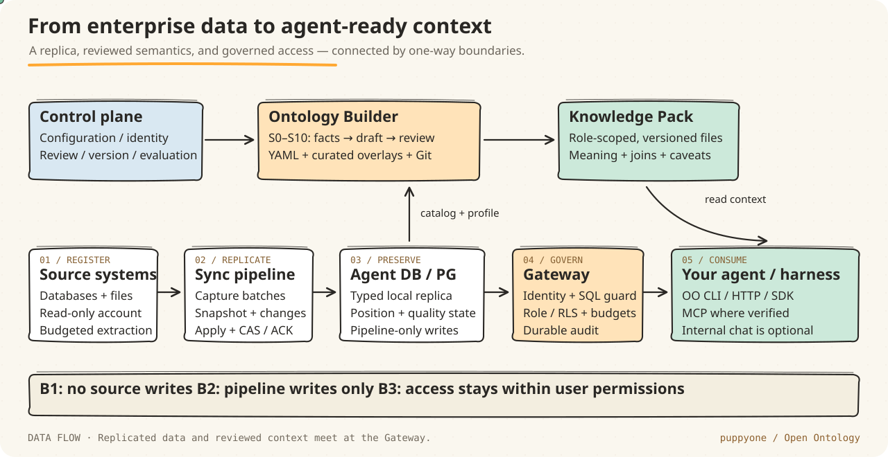
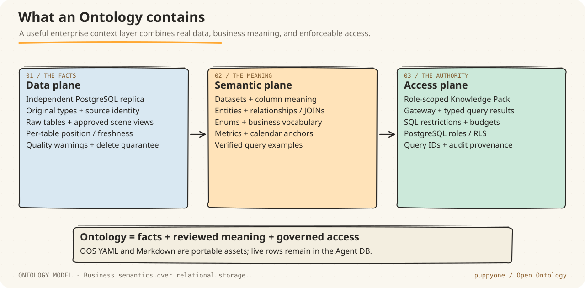
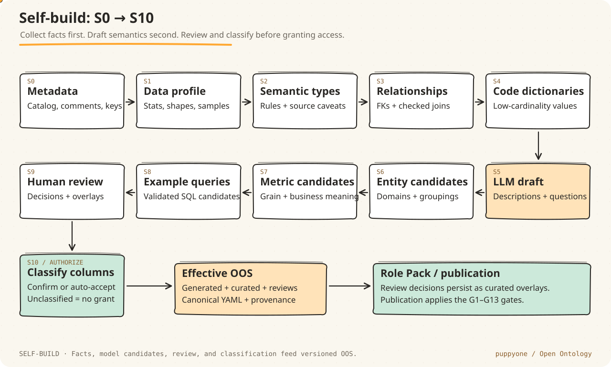
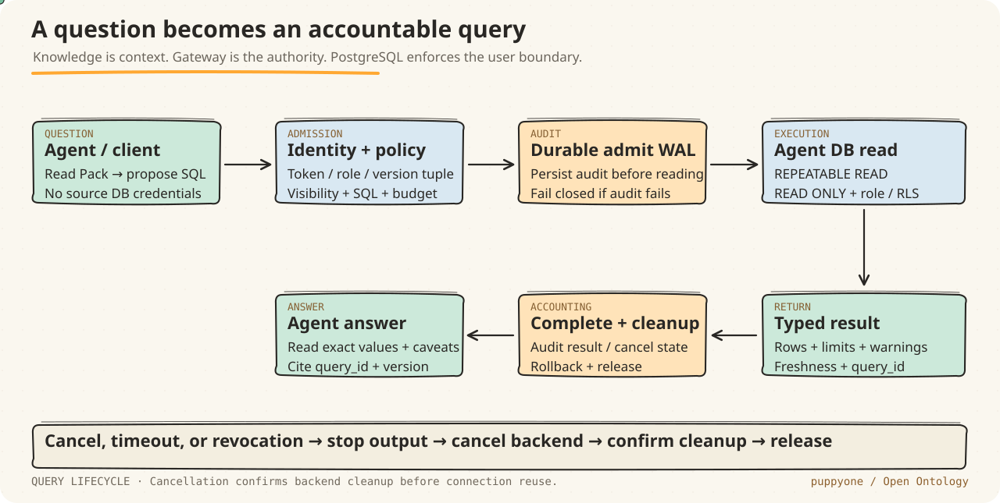
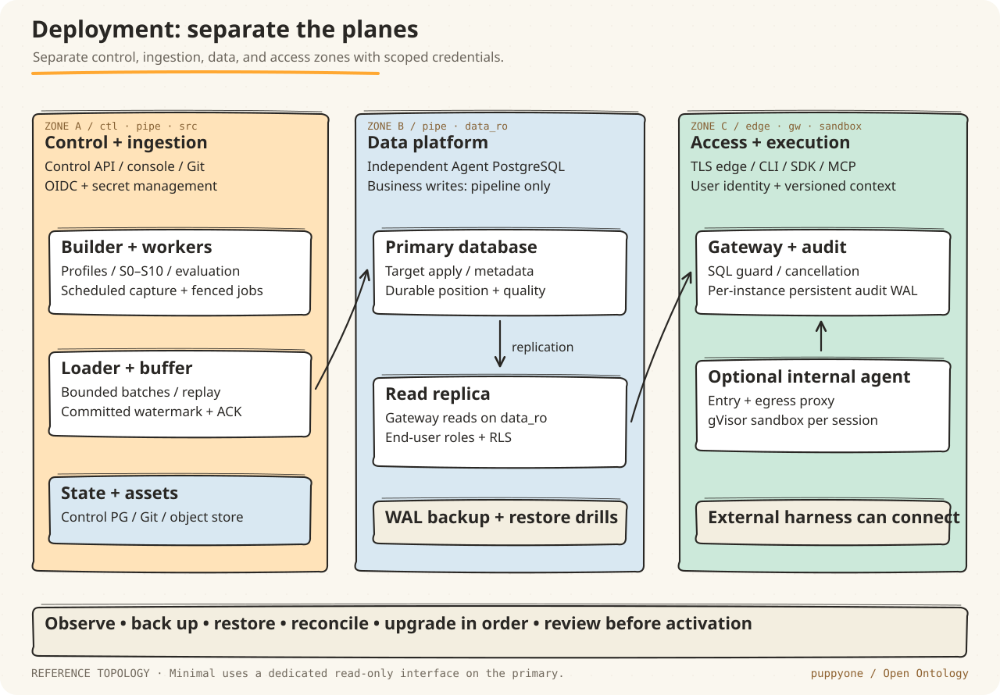
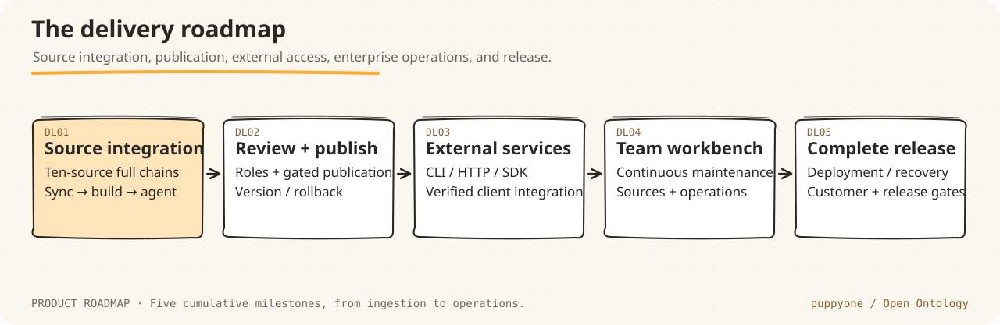

<p align="center">
  <a href="https://github.com/puppyone-ai"></a>
</p>

<h1 align="center">Open Ontology</h1>

<p align="center"><strong>Turn enterprise data into context your agents can understand — and access responsibly.</strong></p>
<p align="center">A PostgreSQL data replica. Reviewed business semantics. A governed interface for your agent.</p>

<p align="center">
  <a href="LICENSE"></a>
  <a href="docs/17-rust-implementation.md"></a>
  <a href="https://github.com/puppyone-ai/open-ontology/stargazers"></a>
</p>

<p align="center">
  <a href="#why-open-ontology">Why OO?</a> ·
  <a href="#how-it-works">How it works</a> ·
  <a href="#getting-started">Get started</a> ·
  <a href="#deployment">Deployment</a> ·
  <a href="docs/README.md">Documentation</a> ·
  <a href="#contributing">Contribute</a>
</p>


**Open Ontology (OO)** is an open-source system for building, reviewing, publishing, and maintaining an agent-facing semantic and access layer over enterprise data. It reads approved source objects into a separate PostgreSQL database, builds versioned ontology assets and role-specific Knowledge Packs, and exposes governed queries through a Gateway.

Connect your own model and agent through the OO CLI, HTTP, or SDK. Internal Pi sessions provide an integrated conversation experience; external agents use Packs and the Gateway independently.

Built by [puppyone](https://github.com/puppyone-ai): **Making the world friendly for AI agents.**

<details>
<summary><strong>Explore this README</strong></summary>

- [Why Open Ontology?](#why-open-ontology)
- [How it works](#how-it-works)
- [What an Ontology contains](#what-an-ontology-contains)
- [Self-build: S0 through S10](#self-build-s0-through-s10)
- [Continuous synchronization](#continuous-synchronization)
- [Source integrations](#source-integrations)
- [Knowledge Packs](#knowledge-packs)
- [Gateway and agent integration](#gateway-and-agent-integration)
- [Getting started](#getting-started)
- [Deployment](#deployment)
- [Security and operations](#security-and-operations)
- [Roadmap](#roadmap)
- [Repository map](#repository-map)
- [Documentation](#documentation)
- [FAQ](#faq)
- [Contributing](#contributing)

</details>

## Why Open Ontology?

Business databases carry years of operational knowledge. Much of that knowledge is hidden in abbreviations, status codes, undocumented joins, spreadsheets, and the people who understand the business.

A model can see a column named `sfje` without knowing its currency, whether a refund should be excluded, or which date defines “last month.” A valid SQL statement can still answer the wrong question. Direct access to a production database also makes an expensive query or an overly broad account a business risk.

OO connects the missing pieces:

| What your agent needs | OO capabilities |
| --- | --- |
| A safe place to read | An independent Agent PostgreSQL replica, populated by a bounded, one-way ingestion path |
| Business meaning | Reviewed field descriptions, grain, entities, relationships, dictionaries, and terminology |
| Trustworthy calculations | Explicit metric definitions, calendar anchors, control totals, and verified SQL examples |
| The user's permissions | Role-scoped context and PostgreSQL-enforced table, column, and row access |
| A way to judge an answer | Typed values, data-version and freshness information, warnings, and an auditable `query_id` |
| A portable integration | Versioned YAML and Markdown assets, with structured Gateway interfaces |

Together, these give agents the context, permissions, and query provenance needed to answer business questions.

## How it works



*Data flows into the Agent DB. Business context flows into a role-specific Knowledge Pack. Agents use both through the Gateway.*

1. **Register and inspect.** An operator supplies a source configuration and private secret reference. OO checks access, approved objects, source capabilities, and reading budgets.
2. **Replicate and reconcile.** The appropriate source capture method feeds bounded batches to a Loader. Target writes, watermarks, and quality state follow fenced, replayable transactions.
3. **Build and review.** Self-build collects facts, drafts semantics, and creates review and classification work. Human decisions are retained as versioned overlays.
4. **Compile a role Pack.** Only reviewed, visible assets reach that role's context. A Pack does not contain source credentials or grant new database permissions.
5. **Ask through the Gateway.** The agent learns the available schema and business context, proposes a query, and receives an authorized result with provenance.
6. **Keep it current.** Data changes, schema changes, corrections, and reconciliation results feed ongoing maintenance. New fields do not silently inherit access.

The main trust boundaries are:

- **Source → pipeline:** no writes to source business data or source DDL.
- **Pipeline → Agent DB:** only the authorized ingestion path writes business replicas.
- **Agent DB → Gateway → agent:** access stays within the end user's permissions; internal sandboxes do not hold reusable credentials.

See the [architecture](docs/01-architecture.md) and [security design](docs/10-security.md) for the full contracts.

## What an Ontology contains



In OO, an **Ontology is a semantic and access layer backed by relational data**. Entities and relationships describe business concepts and recommended joins. The storage model remains PostgreSQL; OO does not require RDF, OWL, a triple store, or a graph database.

The semantic assets include:

- **Datasets:** meaning, source names, grain, keys, types, caveats, and recommended tables.
- **Entities and relationships:** business domains, member tables, cardinality, and checked JOIN paths.
- **Dictionaries and vocabulary:** code meanings, synonyms, approved terminology, and explicit unknown values.
- **Metrics and calendars:** aggregation rules, filters, units, ownership, reconciliation, and time anchors.
- **Query examples:** business questions paired with validated SQL.
- **Classification and provenance:** privacy decisions, review state, source semantics, and version bindings.

The canonical format is **Ontology Spec (OOS) YAML**, with generated, curated, and effective views. Example configuration:

```yaml
spec_version: oos/v1
name: acme-logistics
locale: en-US
include_schemas: [logistics, erp_mysql, tms_pg]
default_tier_preference: [scene, raw]
publish:
  include_unreviewed: [column_descriptions]
  require_eval: [public-smoke, customer-core]
classification:
  auto_accept: rule_high_confidence
lifecycle:
  deprecation_min_releases: 1
compile:
  per_role: true
  budgets: { readme_tokens: 2000, table_file_tokens: 3000 }
  sample_values: { default: masked, max_per_column: 8 }
```

For dataset, entity, relationship, enum, metric, calendar, and review examples, start with [the Ontology design](docs/06-ontology-layer.md) and [examples/schema](examples/schema).

## Self-build: S0 through S10



Self-build turns an existing database into a reviewable first draft. It uses deterministic facts and rules wherever possible, with a model helping draft descriptions and candidates.

| Stage | Work | Result |
| --- | --- | --- |
| S0 | Collect catalog and approved source metadata | Tables, columns, comments, keys, indexes, and source identity |
| S1 | Profile data within declared budgets | Statistics, patterns, distributions, and quality observations |
| S2 | Infer semantic types | Rule-based classifications and source-type caveats |
| S3 | Infer relationships | Declared foreign keys and checked candidate JOIN paths |
| S4 | Recognize code dictionaries | Low-cardinality fields, dictionary matches, and unresolved values |
| S5 | Draft with a model | Descriptions, grain, cautions, and questions for domain experts |
| S6 | Group entity candidates | Business domains, member tables, and recommended datasets |
| S7 | Propose metrics | Candidate definitions and explicit business assumptions |
| S8 | Propose and validate examples | Question/SQL pairs checked through the permitted query path |
| S9 | Review | Fact-bound expert decisions and curated overlays |
| S10 | Classify columns | Confirmed or policy-approved classifications before authorization |

Model output enters the review workflow as a candidate. Classification determines visibility; unclassified columns stay hidden.

Publication applies the **G1–G13 gates**: schema and catalog consistency, relationship checks, dictionaries, metric and control-total tests, executable examples, permission references, privacy, context budgets, evaluation, semantic changes, name lifecycle, and completed classification. A version pointer advances only after the required gates and reviews succeed. See [publication gates](docs/06-ontology-layer.md).

## Continuous synchronization

Capture follows each engine’s capabilities: log CDC, native change reads, cursor incrementals, partition refresh, or full differences.

| Method | Where it fits | Delete behavior |
| --- | --- | --- |
| **C1 · log CDC** | Logical decoding, binlog, approved change streams, or a permitted CDC reader | Native changes within the retained log window |
| **C2 · native change reads** | Change Tracking, change history, or snapshot-difference APIs | Engine-specific deletes within the valid retention window |
| **C3 · cursor incrementals** | A reliable cursor such as a timestamp or version column | No implicit delete detection; a separate contract is required |
| **C4 · partition refresh** | Reliable partition metadata and atomic partition replacement | Changes and deletes converge inside refreshed partitions |
| **C5 · full differences** | Smaller tables or sources without a stronger approved method | Deletes converge on the reconciliation cycle |

Detection, pulling, and reconciliation periods are configurable. Source validation covers inserts, updates, delete convergence, catch-up, restart/replay, and independent value comparison according to the selected capture method.

Data and semantic versions are bound to actual per-table source/run/generation vectors. Responses identify partial and per-table consistency. Stale data, unknown values, unsupported types, expired positions, and quality issues remain visible to the caller.

Read the [capture and consistency contract](docs/database-support/03-change-capture-and-consistency.md) and [pipeline design](docs/04-pipeline.md).

## Source integrations

Source integration spans relational, analytical, document, and search engines. Each has a distinct type mapping, capture method, and consistency contract. Consult the [support matrix](docs/database-support/support-matrix.yaml) for engine versions and support levels.

| Source | Capture methods | Important boundary |
| --- | --- | --- |
| PostgreSQL | Snapshot + C1; approved fallback paths | Logical replication setup belongs to the DBA; transaction boundaries and position recovery matter |
| MySQL | Snapshot + C1 or C5 | Binlog permissions and retention are version-specific; unsigned values and time types need exact handling |
| MariaDB | Snapshot + C1 or C5 | An independent target, with its own type and semantic evidence |
| SQL Server | Snapshot + C1 or C2 | Real supported deployment, Change Tracking/CDC window, time precision, and licensing conditions |
| Oracle Database | Consistent snapshot and approved batch/difference methods | SCN, NUMBER, DATE/TIMESTAMP, and empty-string behavior; log CDC requires separate configuration approval |
| ClickHouse | Snapshot + C4 or C5 | Partition signatures, mutations, column types, and truthful consistency |
| Apache Doris | Snapshot + C4 or C5 | Partition metadata and actual DUPLICATE/UNIQUE/AGGREGATE key semantics |
| StarRocks | Snapshot + C4 or C5 | Partition, key-model, and type behavior |
| MongoDB | Stable document mapping + C5; C1 only when approved | BSON fidelity, ObjectId/UUID, schema variation, and change-stream prerequisites |
| OpenSearch | Snapshot / C5 | Mapping, complete pagination, source-reading budgets, and delete reconciliation |

Other SQL, cloud warehouse, lakehouse, document/KV, and file targets remain in the [database expansion design](docs/database-support/README.md). Actual combinations of engine version, deployment, driver, capture method, and consistency level are tracked in the [support matrix](docs/database-support/support-matrix.yaml).

The support matrix distinguishes `experimental`, `verified`, and `certified` integrations.

## Knowledge Packs

A Pack is a **versioned, role-scoped context bundle**. It teaches the agent how to find and interpret authorized data; live rows still come from the Gateway.

```text
knowledge/
├── README.md                   # Purpose, version, guidance, and cautions
├── INDEX.md                    # One-line map of visible datasets
├── domains/                    # Business domains and recommended tables
├── tables/                     # Grain, keys, columns, types, and caveats
├── entities/                   # Business entities and membership
├── enums/                      # Approved code meanings and unknown values
├── metrics.md                  # Certified definitions and reconciliation state
├── calendar.md                 # Business time anchors
├── glossary.md                 # Approved terms and synonyms
├── relationships.md            # JOIN paths and cardinality
├── examples/                   # Verified question / SQL examples
└── manifest.json               # Machine-readable versions and content identity
```

Read Packs progressively: begin with the overview, inspect the relevant table and metric pages, validate a query, then read only the rows needed for the question. Role compilation removes invisible objects and their references. Row-filtered tables must not leak global sample values; personal or sensitive columns do not include unapproved samples.

## Gateway and agent integration



The Gateway queries the **replicated Agent PostgreSQL database**. Published semantic assets provide table mappings, business meaning, identity bindings, and permissions; query results come from the database.

The query contract covers:

1. Resolve the caller's identity, role, policy, and knowledge version.
2. Resolve real table and column mappings; check SQL, visibility, and resource limits.
3. Persist durable admission audit before data execution.
4. Execute with PostgreSQL roles/RLS in a read-only transaction.
5. Return typed rows, truncation information, freshness, warnings, and `query_id`.
6. Record completion and confirm backend cleanup before connection reuse.

| Interface | Purpose | Where to look |
| --- | --- | --- |
| `oo` CLI | Inspect context, validate SQL, query data, inspect freshness, cancel/status | [CLI source](crates/oo-cli), [interface design](docs/08-agent-interface.md) |
| HTTP / Rust SDK | Structured Gateway responses and programmatic clients | [Gateway](crates/oo-gateway), [SDK](crates/oo-sdk) |
| TypeScript SDK / console | Browser integration and management workflows | [Web workspace](apps/web), [deployment boundary](apps/web/deploy/README.md) |
| MCP adapters | Agent tool integration | [MCP crate](crates/oo-mcp), [interface design](docs/08-agent-interface.md) |
| Internal Pi / sandbox | Integrated conversations and session execution | [runtime kit](deploy/pi-runtime-kit/README.md), [runtime design](docs/09-sandbox-and-agent-runtime.md) |

Configure the client’s transport, authentication mode, and protocol version against its Gateway or adapter endpoint.

## Getting started

### 1. Build the CLI

```bash
git clone https://github.com/puppyone-ai/open-ontology.git
cd open-ontology

# Build with the minimum supported Rust version.
rustup toolchain install 1.94.0 --profile minimal
cargo +1.94.0 build --locked -p oo-cli --bin oo
./target/debug/oo --help
```

The project uses a Cargo workspace. Native components may also require a C/C++ toolchain and their documented build dependencies; see the [Rust implementation contract](docs/17-rust-implementation.md). The console and TypeScript SDK live in the [web workspace](apps/web/package.json).

### 2. Connect to your Gateway

Prerequisites: a populated Agent DB, published semantic assets, a role-bound Gateway endpoint, and an authorized client token. Set the endpoint, token file, CA file, and dataset names for your installation.

```bash
OO=./target/debug/oo
OO_GATEWAY=https://oo.example.com
OO_TOKEN_FILE="$HOME/.config/open-ontology/client.token"
OO_CA_FILE="$HOME/.config/open-ontology/ca.pem"

# The existing token file must be private and owner-readable only.
chmod 600 "$OO_TOKEN_FILE"

"$OO" tables --json --gateway "$OO_GATEWAY" --transport production \
  --auth external --token-file "$OO_TOKEN_FILE" --ca-file "$OO_CA_FILE"

"$OO" knowledge cat README.md --json --gateway "$OO_GATEWAY" \
  --transport production --auth external --token-file "$OO_TOKEN_FILE" \
  --ca-file "$OO_CA_FILE"

"$OO" describe logistics.shipments --json --gateway "$OO_GATEWAY" \
  --transport production --auth external --token-file "$OO_TOKEN_FILE" \
  --ca-file "$OO_CA_FILE"

"$OO" validate 'SELECT COUNT(*) FROM logistics.shipments' --json \
  --gateway "$OO_GATEWAY" --transport production --auth external \
  --token-file "$OO_TOKEN_FILE" --ca-file "$OO_CA_FILE"

"$OO" query 'SELECT COUNT(*) AS shipments FROM logistics.shipments' --json \
  --gateway "$OO_GATEWAY" --transport production --auth external \
  --token-file "$OO_TOKEN_FILE" --ca-file "$OO_CA_FILE"

"$OO" freshness --json --gateway "$OO_GATEWAY" --transport production \
  --auth external --token-file "$OO_TOKEN_FILE" --ca-file "$OO_CA_FILE"
```

Keep tokens in private files. Dataset visibility follows the caller’s role and published classifications.

### 3. Choose a setup workflow

| What you want to explore | Entry point | Scope |
| --- | --- | --- |
| Data CLI and Gateway contracts | [CLI](crates/oo-cli), [Gateway](crates/oo-gateway), [SDK](crates/oo-sdk) | Configured Gateway and authorized client identity |
| Source-bound Self-build and management | [native caller recipe](tools/selfbuild-control-api/recipes/NATIVE-CALLERS.md) | Source-specific inputs, identity, configuration, and review |
| A local PostgreSQL environment | [minimal product loop](deploy/minimal-product-loop/README.md) | Source, replica, and operator setup |
| Pinned Pi tooling | [Pi runtime kit](deploy/pi-runtime-kit/README.md) | Pinned runtime and session configuration |
| Browser integration | [web deployment notes](apps/web/deploy/README.md) | TLS, service bindings, and authorized identities |

Each recipe lists its required images, archives, configuration, and runtime files. Keep credentials and runtime output outside the source tree.

## Deployment



The reference deployment separates credentials, networks, and durable state. Choose a topology for your workload, then size it against source volume, query concurrency, and recovery requirements. See [deployment and operations](docs/11-deployment-and-operations.md).

| Profile | Use case | Topology |
| --- | --- | --- |
| Minimal | A small, controlled single-host proof of concept | Dedicated read-only query interface on the primary |
| Standard | A private enterprise installation | Separate control/pipeline, PostgreSQL primary/replica, Gateway, and sandbox execution zones |
| Observability | Operational visibility | Prometheus/Grafana/Loki/OpenTelemetry as separately configured components |
| Development | Component development | Hot reload and debugging |
| Kubernetes | Service orchestration | Independently managed services and stateful data components |

<details>
<summary><strong>Initial sizing and network zones</strong></summary>

**Capacity planning baseline:** a small PoC starts at 8 vCPU, 32 GB RAM, and 500 GB SSD. The standard profile allocates about 8C/32G to control and ingestion, 16C/64G per Agent DB node or a declared combined-instance setup, and 16C/64G to sandbox execution. Actual source size, query shapes, concurrency, and recovery tests decide final sizing.

| Network | Members and purpose |
| --- | --- |
| `ctl` | Console, Control API, identity, configuration, and control state |
| `src` | Approved source-reading workers/connectors |
| `pipe` | Loader, capture workers, buffers, and target apply |
| `data_ro` | Gateway to the approved Agent DB read interface |
| `gw` / `edge` | Authenticated Gateway/client ingress and approved services |
| `sandbox` | Internal session sandbox to fixed egress proxy |
| `llm` | Explicitly configured model access |

The standard Gateway has no source-network route and no pipeline write credential. An internal sandbox reaches the approved egress proxy, not arbitrary databases or the management plane. Administrative Docker access, where needed, is mediated rather than exposed directly to an agent.

</details>

### Deployment checklist

- **Pin artifacts and configuration.** Record versions, digests, source contracts, and runtime roles.
- **Initialize identity and secrets.** Configure authorized identities and separate service credentials.
- **Populate and verify data.** Complete source-specific type/value comparison, synchronization, and recovery checks.
- **Build and review context.** Preserve source semantics, classifications, decisions, and version bindings.
- **Configure the public access path.** Verify TLS, role grants, query refusal, cancellation, and durable audit.
- **Exercise the agent journey.** Disconnect source access during consumption, compare answers with independent truth, and tie results to Gateway audit.
- **Test operations before release.** Back up and restore, reconcile, verify migrations and rollback boundaries, and run the applicable customer/support/release gates.

## Security and operations

The central security rule is **agent capability ≤ end-user permission**. Source read accounts, pipeline write identities, Gateway login identities, query roles, management roles, and model secrets have separate responsibilities.

Security boundaries:

- No writes to source business tables or source DDL; DBA prerequisites and any narrowly approved technical exception are separately governed.
- PostgreSQL roles and RLS enforce access; generated text does not authorize data.
- New or unclassified columns stay hidden, and privacy-sensitive samples are excluded from Packs.
- Unsupported or ambiguous SQL fails closed. Time, rows, bytes, concurrency, and output are bounded.
- Admission audit is durable. Each Gateway instance owns its persistent WAL, with replay and collector deduplication.
- Query cancellation includes backend confirmation, rollback, and connection reclamation.
- Session release revokes access, cancels work, releases resources, and destroys the relevant temporary sandbox.
- Prompts, source rows, and imported text are untrusted; instructions found in data cannot redefine authorization.

For operations, back up the control database, configuration Git, secrets, and the Agent DB as appropriate. Restore identity and semantic decisions before rebuilding derived assets, then reconcile the restored data. Upgrade control migrations first, keep older consumers compatible, and verify the query and recovery paths before activation. Set RPO/RTO and SLO targets using the [operations guide](docs/11-deployment-and-operations.md), and verify them with recovery drills.

Keep security reports private. Never publish customer data, credentials, or internal endpoints in repository issues. See the [security requirements](docs/10-security.md).

## Roadmap



| Loop | Cumulative product goal |
| --- | --- |
| **DL01** | Ten independent data sources with the full synchronization, Self-build, maintained Ontology, Pack, and real agent consumption chain |
| **DL02** | Multi-role review and gated publication, including version changes and rollback |
| **DL03** | General external services through verified CLI, HTTP, SDK, and MCP integrations |
| **DL04** | A continuously maintained enterprise workbench for sources, semantics, permissions, agents, and operations |
| **DL05** | Complete release: deployment, recovery, compatibility, evaluation, customer conditions, and applicable release/support gates |

The loops build on one another: source-to-agent integration, publication, external interfaces, an enterprise workbench, and operational readiness. Milestones and acceptance criteria are recorded in the [implementation Plan](specs/open-ontology-v0.1-plan.md).

## Repository map

```text
open-ontology/
├── crates/          # Rust product services, common contracts, CLI, SDK, and gates
├── tools/           # Source adapters, operator tools, build/review/control utilities
├── apps/web/        # TypeScript console and browser/client integration
├── docs/            # Architecture, ingestion, ontology, security, operations
├── contracts/       # Versioned machine-readable contracts and schemas
├── examples/        # Synthetic schema and configuration examples
├── deploy/          # Scoped development and deployment recipes
├── testing/         # Source and integration validation harnesses
├── benchmarks/      # Evaluation inputs and benchmark tooling
├── specs/           # Normative product Spec and implementation Plan
├── execution/       # Delivery scope, ledgers, and acceptance bookkeeping
└── supply-chain/    # Dependency, license, and artifact policies
```

Generated evidence, run logs, and build artifacts remain outside the published source tree. Private runtime files, credentials, and customer samples must stay private.

## Documentation

| Start here | Then explore |
| --- | --- |
| [Vision and scope](docs/00-vision-and-scope.md) | Product definition, user journey, principles, and non-goals |
| [Architecture](docs/01-architecture.md) | Components, data flows, state ownership, and trust boundaries |
| [Sources](docs/03-sources-and-ingestion.md) / [capture methods](docs/database-support/03-change-capture-and-consistency.md) | Source accounts, types, snapshots, CDC, and reconciliation |
| [Agent DB](docs/05-agent-db.md) | PostgreSQL namespaces, roles, RLS, capacity, and metadata |
| [Ontology](docs/06-ontology-layer.md) | OOS, Self-build, review, publication gates, and Knowledge Packs |
| [Gateway](docs/07-gateway.md) / [agent interfaces](docs/08-agent-interface.md) | Identity, query rules, audit, CLI, HTTP, SDK, and MCP |
| [Runtime](docs/09-sandbox-and-agent-runtime.md) / [security](docs/10-security.md) | Internal sessions, sandbox boundaries, threats, and cleanup |
| [Deployment](docs/11-deployment-and-operations.md) / [configuration](docs/12-configuration-reference.md) | Networks, lifecycle operations, backups, and configuration fields |
| [Evaluation](docs/13-evaluation-and-benchmarks.md) | Synchronization, access control, isolation, semantics, agent quality, and performance |
| [Rust implementation](docs/17-rust-implementation.md) | Crate direction, cancellation, task fencing, native isolation, and build contracts |
| [Spec](specs/open-ontology-v0.1-spec.md) / [Plan](specs/open-ontology-v0.1-plan.md) | Normative requirements, deliverables, and acceptance |

Browse the complete architecture and reference set in the [documentation index](docs/README.md).

## FAQ

<details>
<summary><strong>Is this a knowledge graph or a graph database?</strong></summary>

No. “Ontology” here means the combination of a relational data replica, reviewed semantic assets, and a governed access layer. Business entities and relationships are semantic descriptions over PostgreSQL data.

</details>

<details>
<summary><strong>Does the agent connect directly to the source database?</strong></summary>

No. The source-reading identity belongs to the ingestion side. Agent queries use the dedicated Agent DB through the authorized Gateway. A published Pack describes the data; it is not a database password.

</details>

<details>
<summary><strong>Can I use my own agent, model, or harness?</strong></summary>

Yes. Connect through the OO CLI, HTTP, SDK, or an MCP adapter matching your client. External agents consume Packs and query the Gateway independently of internal Pi sessions.

</details>

<details>
<summary><strong>Does every source use CDC, and can it detect deletes?</strong></summary>

No. Capture follows the source-specific C1–C5 contract. Log and native-change paths have retention requirements. Cursor-only reads do not automatically detect deletes. Partition refresh and full differences reconcile within their stated scope and cycle. Check the actual method and delete guarantee exposed by your deployment.

</details>

<details>
<summary><strong>What happens when a model is wrong or data is stale?</strong></summary>

Model output enters review before publication. Unclassified fields stay hidden. Query responses carry freshness and quality information so the agent can explain the result's cutoff and consistency.

</details>

## Contributing

Contributions are welcome across connectors, source-type fidelity, synchronization/recovery, semantic modeling, query safety, interfaces, deployment, documentation, and evaluation.

- Start with the [design reading guide](docs/README.md), [product Spec](specs/open-ontology-v0.1-spec.md), and [implementation Plan](specs/open-ontology-v0.1-plan.md).
- Choose a bounded capability with explicit input, interface, write scope, tests, and exit conditions.
- Reuse existing implementation and fixtures. Keep fixes small and complete; preserve refusal and cleanup behavior.
- Use synthetic data, scoped identities, and private secret references. Never publish customer data or runtime credentials.
- Review the [dependency policy](supply-chain) before adding libraries, native code, or images.
- Use the [issue chooser](https://github.com/puppyone-ai/open-ontology/issues/new/choose) for non-sensitive bugs and proposals. Keep vulnerability reports private.

If the project is useful to you, [star the repository](https://github.com/puppyone-ai/open-ontology/stargazers) and share a concrete use case or a reproducible synthetic test. Good evaluations and clear source contracts are especially valuable.

## License

Open Ontology is licensed under [Apache-2.0](LICENSE). Third-party notices and dependency requirements are documented in [NOTICE](NOTICE) and the [supply-chain policy](supply-chain).

Brand assets and diagram sources are documented in [visual asset notes](docs/assets/readme/README.md).
