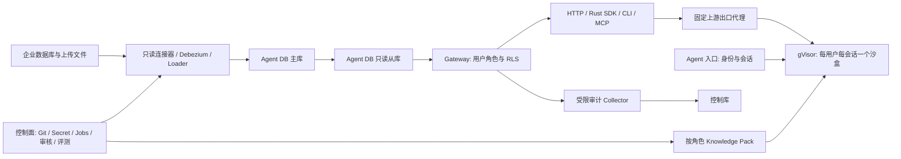

# Open Ontology v0.1 产品与工程实施 Spec

| 属性 | 值 |
|---|---|
| Spec ID | OO-SPEC-001 |
| 版本 | 1.0.0 |
| 状态 | Proposed / Ready for implementation review |
| 创建日期 | 2026-10-01，Asia/Shanghai |
| 输入基线 | `docs/` 全部 19 份文档；Git HEAD `e271542aa645aa181da7887d416de0698752a805` |
| 实施语言 | 第一方后端、连接器、CLI、SDK、Builder、评测器：Rust；控制台与 TS SDK：TypeScript |
| 产品许可证 | Apache-2.0；依赖与数据集分别审计 |
| 交付方式 | 私有化部署；Linux Docker Compose 为首个完整路径 |
| 责任角色 | 产品负责人、Rust 技术负责人、安全负责人、数据负责人、发布负责人、客户业务 owner |

## 1. 文档目的、效力与使用方式

本规范将当前设计变成可分配、可开发、可审阅、可自动验证的工程工作。它不是产品实现，也不是重新选型的调研报告。开发任务必须引用本规范的需求 ID、验收 ID 和 Phase ID，并提供证据后才能标记完成。

### 1.1 规范用语

- **MUST / 必须**：阻止合并或交付的要求。安全不变量不允许以进度或性能为由豁免。
- **SHOULD / 应当**：默认执行；偏离时由对应 owner 写明原因、影响、验证与恢复方案。
- **MAY / 可以**：可选能力，不能作为首版已有能力对外宣传。
- **初始目标**：来自设计的待测数值；实现必须测量，不能以目标代替结果。
- **Evidence**：带输入版本、环境、命令、退出码、原始结果和审阅记录的证据包。

### 1.2 来源与冲突处理

产品定义和原则以 [00](../docs/00-vision-and-scope.md) 为前提；Rust 工程实现以 [02](../docs/02-technology-stack.md) 与 [17](../docs/17-rust-implementation.md) 为约束；各组件行为以其专题文档为来源。本规范增加的状态、字段、测试入口和操作步骤属于实施细化，不能无记录地削弱原文保证。

发现设计例子与安全约束冲突时，执行更严格的安全边界，登记第 5 章的实施决策。需要改变 ADR 的项目在原型门禁前不能成为默认能力；必须新增 ADR、更新相应 `docs` 与本规范并取得评审。未解决的外部版本、协议、许可证、云厂商能力不作已验证事实陈述。

### 1.3 需求与证据编号

| 编号 | 用途 |
|---|---|
| `REQ-<域>-NN` | 本规范实施需求；域为 PROD/CORE/CTL/SRC/PL/DB/OOS/GW/API/RT/SEC/OPS/EVAL |
| `I-SRC/PL/DB/GW/RT-N` | 保留原文安全与正确性不变量 |
| `DEC-NN` | 设计歧义的实施处理或原型待决项 |
| `SP00`–`SP15` | 内部 Sprint Phase，不等于固定两周日历承诺 |
| `SPxx-Wyy` | 可直接拆成 issue 的工作项 |
| `AT-<域>-NN` | 验收场景；第 18 章定义输入、动作、判定与证据 |
| `G1`–`G13`，含 `G5a/G5b` | Ontology 发布门禁，保留原文编号 |
| `P1`–`P16` | M0 技术原型，保留原文编号 |

每个 issue 至少包含：需求 ID、输入/输出契约、依赖、目标 crate、故障行为、验收 ID、预计交付文件、owner、reviewer。每个 Phase 通过后生成 `evidence/<release-or-run>/<phase>/manifest.json`；公开与私有证据使用不同存储边界。

## 2. 产品定义、范围与用户体验

### 2.1 Ontology 的定义

**Open Ontology 是企业数据库面向 Agent 的上下文入口。Ontology = Agent 专用 PostgreSQL 数据副本 + 可审核的语义资产 + 按最终用户权限执行的访问层。** 它不是知识图谱，不引入 RDF/OWL、三元组数据库或图查询作为核心存储。

Self-build 是自动生成带证据与置信度的语义草稿，涵盖结构、含义、关系、码表、实体、业务日历、指标与示例。权限策略、个人信息分类、实体自动合并规则和认证统计口径必须按本规范审核；不能将 LLM 输出直接视为事实或发布授权。

### 2.2 产品范围

| 需求 ID | 首个客户 MVP（M1） | v0.x 完整交付 / 扩展边界 |
|---|---|---|
| REQ-PROD-01 | MySQL 8.x、PostgreSQL 13+：CDC 或只读批量；明确功能矩阵 | MariaDB/托管变体必须分别有兼容证据，不能由 MySQL 支持自动推导 |
| REQ-PROD-02 | CSV/TSV、xls/xlsx、Parquet、JSON Lines、SQLite、受限 SQL dump 导入 | 所有格式有真实 fixture；大文件存储能力与解析能力分别标明 |
| REQ-PROD-03 | Agent DB 主从、Gateway、Rust CLI/SDK、HTTP、按角色 Knowledge | 远程 MCP/OAuth 与本地 stdio 在 M2 完成；对外一键 MCP 连接须等其验收 |
| REQ-PROD-04 | gVisor、固定上游出口代理、Pi、网页对话、飞书适配 | Slack/其他 harness、K8s/E2B 为后续独立扩展 |
| REQ-PROD-05 | 配置即代码、审核发布、完整释放、公开与客户私有评测 | 从 MVP 起即存在，不能延后为生产化补丁 |
| REQ-PROD-06 | Compose standard 一键启动；模型可切换为私有端点 | 离线部署、双架构、备份恢复、升级在 v0.x 发布前全部验收 |

“任何数据库”是连接器架构的北极星。实际支持必须公布数据库版本、批量/CDC 能力、类型边界、删除语义、托管限制与最后验收版本。未支持的库返回 `CONNECTOR_UNSUPPORTED`，提供文件/dump 或审核外部连接器路径，不静默套用通用 SQL 驱动。

### 2.3 非目标

第一版不做源库写回、业务动作、知识图谱、替代企业 BI/仓库、亚秒一致性、多租户 SaaS、非结构化 RAG、模型训练、PG 协议直连或隐式跨会话记忆。将来写回必须另立经审批、隔离与审计的通道，不扩展现有 Gateway SQL 放行范围。

### 2.4 核心用户旅程与失败体验

1. 管理员运行 `./oo up`：主机预检 → 密钥/数据库/Git 初始化 → 服务健康 → 一次性初始化链接。重复运行不得重置数据或重发有效管理员链接。
2. 添加数据源或上传：连接/格式检测 → 权限体检 → 表/列选择 → DBA 清单/解析预览 → 计划 → 应用。体检失败、格式不明或资源不足时停止对应操作并给出处理办法。
3. 同步：展示模式、进度、读取预算、水位、新鲜度、拒绝与待分类列。ETA 必须标为估计值，数据不足时显示“尚无法估计”。
4. 自动构建：生成草稿和专家卡片。审核决定、口径 owner、列分类和证据可查看；高风险项不能用“全部接受”绕过权限审阅。
5. 发布：G1–G13 → 构建角色 Pack → 应用授权 → 副本可见屏障 → 切换发布指针。任一步失败不得出现半发布。
6. 连接 Agent：内置对话选择用户身份与可用角色；MCP 客户端完成授权。未绑定角色、未发布 Pack、沙盒隔离不满足时不能开始数据问答。
7. 回答：展示来源 SQL、数据截至、口径、日期锚点、全部质量警告；无权限/无数据/歧义有明确行为。
8. 会话结束：立即封闭准入和撤销数据能力，后台收集授权文件并释放资源；用户仍能访问其未过保留期的记录与产出物。

## 3. 系统架构、信任边界与责任归属

### 3.1 逻辑架构



图中的箭头表示业务数据或控制流，不赋予网络双向可达权限。实际网络许可由第 14 章定义；一条连接的响应流不意味着调用方能访问上游存储或凭证。

### 3.2 三道硬边界

| 边界 | MUST 保证 | 权威机制 | 自动验证 |
|---|---|---|---|
| B1 源库 → 管线 | 平台不写源业务数据/DDL；读取受预算限制 | 只读账号、体检、源库网络分区 | AT-SRC-01/02，源审计零写 |
| B2 管线 → Agent DB | 业务副本写入只在授权管线路径；管理 DDL 为受审 apply | 独立写角色、主从路由、目标锁、角色最小权限 | AT-DB-01/02、AT-PL-05 |
| B3 Agent DB → Gateway → Agent | 只读、最终用户权限、无可复用凭证 | 列 GRANT/RLS、PG 只读事务、SQL 门禁、gVisor/出口代理 | AT-GW-01/02、AT-RT-01/02 |

### 3.3 状态归属与凭证矩阵

| 组件 | 可持有凭证 / 权限 | 耐久状态 | 禁止能力 |
|---|---|---|---|
| Control API / apply | 管理认证、Git 写、Secret 管理、授权 DDL | 配置提交、计划、发布/应用状态在控制库 | 不执行 Agent 提交的管理命令 |
| 连接器 / Debezium | 指定源只读/复制 Secret | offset/schema history、chunk/运行进度 | 写源业务表、自动创建 publication/signaling |
| Loader / pipeline | `pipeline_rw`、缓冲消费 | 目标数据/水位/质量、事务 spool/隔离区 | 被 Gateway/沙盒直接调用 |
| Builder | `oo_builder_ro`、专用模型 Secret | generated/evidence、输入哈希、审核候选 | 源密码、curated 写、自动认证或授权 |
| Gateway | 只读登录角色、mTLS、token 哈希查找 | 每实例独立审计 WAL；查询结束元数据 | 源库/控制库写密码、连接器依赖、写数据接口 |
| Collector | `audit_ingest`，受限 mTLS | 审计事件与幂等接收状态 | 其他控制库写 API |
| 出口代理 | 会话 token、模型 Secret、mTLS | 软映射与预算镜像；权威状态在控制库/Token 服务 | 任意 CONNECT、外部任意 origin、正文日志 |
| Entry / Sandbox 编排 | 控制库会话角色、受限容器 API | session/turn/release_state、owner lease | 将容器 API/Secret 挂进沙盒 |
| 沙盒 / oo-analysis | 无 Secret；仅授权文件和代理 URL | 临时 workspace | 直连库、任意外网、跨会话共享工作区 |
| oo-eval | 独立评测凭证、冻结副本访问 | 快照、题库、运行、评分和版本清单 | 公共 CI 读取客户私有数据/holdout |

## 4. Rust 技术与工程契约

### 4.1 技术栈与依赖入库

REQ-CORE-01：Cargo workspace，edition 2024，resolver 3；提交 `Cargo.lock`、精确 `rust-toolchain.toml`，MSRV 与发布工具链都进入 CI。候选 MSRV ≥1.94.0、Tokio 1.x、Axum 0.8.x、SQLx 0.9.x、tokio-postgres 0.7.x、deadpool-postgres 0.14.x、PG17、Valkey8、Debezium3.5、pg_query6.2 均沿用 [02 的候选基线](../docs/02-technology-stack.md)，**不是本规范锁定的可用版本组合**。SP00/P14 必须核对真实 manifest、发布日期、MSRV、features、native 源码与 LICENSE，再形成 `dependency-baseline.json`。

| 层 | 指定实现 | 额外约束 |
|---|---|---|
| HTTP | Tokio、Axum、Tower/tower-http、reqwest、rustls | 请求时限不等于 DB 取消；生产禁止 NoTls |
| 配置/OOS | Serde、Schemars、serde-saphyr、jsonschema | 重复键/未知字段/标签/include/环境插值关闭；输入预算 |
| API | utoipa，OpenAPI 3.1 | 生成物与真实 HTTP fixture 对照 |
| 控制/源驱动 | SQLx，PG/MySQL/SQLite | 流式读取；未知类型取原始值再显式转换 |
| Gateway/Loader | tokio-postgres、deadpool-postgres | portal 分页、取消、COPY、连接清理契约 |
| 批次/文件 | Arrow/Parquet 同系列；DuckDB、calamine、chardetng、encoding_rs | native 解析独立进程；跨 Arrow 版本走 IPC |
| SQL | pg_query/libpg_query；sqlparser 作方言证据 | parser 与 PG 大版本配套；禁止安全判定回退 |
| 对象存储 | object_store LocalFileSystem / S3 | 认证、加密、ACL、TLS、保留策略显式配置 |
| 沙盒 | bollard → 受限 Docker API + gVisor | 编排器只在控制区；无沙盒 Docker socket |
| MCP | 官方 rmcp，stdio/Streamable HTTP | 支持版本依证据；OAuth 等不由 SDK 自动保证 |
| 观测/压测 | tracing/OTel/Prometheus；Goose、pgbench、Criterion | 不记录模型正文/结果值；真实 Linux/gVisor 压测 |

默认制品依赖必须符合 [02](../docs/02-technology-stack.md) 的许可证边界；弱 copyleft 单独审阅分发义务，AGPL/BSL/ELv2/SSPL 不进入默认包。Valkey 是默认服务，`redis` 仅客户端 crate 名。默认不内置 MinIO/Vault/Grafana 等受限制服务；可选外部服务依版本审计。新依赖发布满 7 天才入默认基线，安全修复例外记录负责人、原因与回归证据。

### 4.2 crate 分层

REQ-CORE-02：落实 [17](../docs/17-rust-implementation.md) 的依赖方向。`oo-core` 只存版本化类型、schema、错误和静态规则；不得引用服务 crate、数据库驱动、沙盒或模型 SDK。`oo-gateway` 不链接 `oo-connectors`、`oo-pipeline` 或管理 DDL 实现。客户端不连接数据库；管理 CLI 通过 Control API 单独认证。

| crate | 核心交付 | 首次实施 Phase |
|---|---|---|
| oo-core | 配置/OOS/批次/API/错误模型、schema、规范值哈希 | SP00 |
| oo-jobs | 任务领取、租约、generation、调度、重试/死信 | SP02 |
| oo-control | Git、Secret、validate/plan/apply、RBAC、Collector binary | SP02 |
| oo-connectors | PG/MySQL/file、类型/位点/事务映射、访问报告 | SP03 |
| oo-pipeline | CDC/快照/批量/Loader/对账/hooks | SP04 |
| oo-builder | 画像/推断/草稿/overlay/审核/编译/门禁 | SP07 |
| oo-gateway | 认证/准入/SQL/权限/代价/执行/审计 | SP06 |
| oo-sdk / oo-cli | HTTP 客户端、导出完成检查、数据/管理命令 | SP09 |
| oo-mcp | transport、授权、token exchange、resources | SP13 |
| oo-proxy | 固定 origin、身份映射、注入/脱敏、预算/背压 | SP10 |
| oo-sandbox / oo-entry | 编排、harness、状态释放、channel | SP10–SP11 |
| oo-eval / bench/datagen | 数据生成、运行/比较、评分、报告 | SP00、SP12 |
| oo-analysis | 授权导出本地计算、中文图表、安全 CSV/Excel | SP09 |

### 4.3 异步、内存、native 与插件

REQ-CORE-03：所有 stream/channel/队列有行数、字节数、并发和等待上限；默认不得 `collect()` 全表、无界 mpsc、无界 SSE backlog。每个 Batch 初始上限为 10,000 行或 16 MiB，先达到者封批；单值超过上限按明确 `type_policy` 拒绝/暂停，不能绕开限制。新增数值是工程初始配置，SP14 压测调整并记录。

REQ-CORE-04：`CancellationToken` 传播停止，`JoinSet`/TaskTracker 跟踪所有子任务。`Drop`、Tower timeout、abort 或 CancelRequest 不能作为外部资源已释放的证明。可信 CPU 操作使用 semaphore 限制的 `spawn_blocking`；不可信 native parser、DuckDB、Excel、外部 hook 运行在可杀死且可确认退出的受限进程/容器中。

REQ-CORE-05：内置 trait 经显式注册、`async-trait` 动态分派；外部连接器/hook 使用版本化 JSON 控制消息与 Arrow IPC，固定 digest、协议版本、schema 指纹、长度与批次序号。不使用 Rust 动态 ABI，不在生产启动时 Cargo install/build 配置仓库代码。hook 制品在无生产 Secret 的隔离 CI 构建，签名/SBOM/manifest 审核后部署。

REQ-CORE-06：unsafe 仅集中在必要 FFI 封装，逐处记录安全前提和 reviewer；禁止对不同 Arrow crate 系列强转。native build.rs/proc-macro 视为构建执行代码，构建环境不拥有生产权限；Linux x86_64/aarch64 与 gVisor 上分别验收。

## 5. 设计歧义的实施决策与验证门禁

下表是必须处理的工程问题。标为“采用”的内容是本规范的安全实施细化；标为“原型门禁”的内容要在 SP01 获得证据后决定，不能假定 docs 的示意 SQL 已经解决问题。

| ID | 问题与来源 | 实施契约 | 状态 / 判定 |
|---|---|---|---|
| DEC-01 | [05](../docs/05-agent-db.md) 把 stage/影子表统称 UNLOGGED，但发布数据需 WAL 与从库可见 | TEMP/UNLOGGED 只能作可重建暂存；将发布的影子表使用 LOGGED，或在发布前 SET LOGGED、ANALYZE 并完成复制屏障。UNLOGGED 禁止直接成为线上表 | 采用；AT-PL-08 |
| DEC-02 | [04](../docs/04-pipeline.md) 的拒绝记录写控制库不能加入目标库同一事务 | 拒绝事件先幂等耐久入控制库，再提交目标数据与质量；目标提交后控制镜像/任务完成/XACK 独立重试。保留 batch manifest 与已应用状态区分“已观察/已应用/已解决” | 采用；AT-PL-05/07 |
| DEC-03 | PUBLIC 撤销 set_config 后，固定平台 SQL 仍需参数化设置 claims | 按 PG17 实测确定登录角色的最小 EXECUTE 授权与设置顺序：平台角色设置 LOCAL claims，再 SET LOCAL ROLE 用户；用户角色仍无 EXECUTE。禁止拼接 JSON，禁止向 Agent 开放该函数 | 原型门禁 P6/P13；AT-DB-02 |
| DEC-04 | 发布保留旧 Knowledge，但权限收缩应立即生效 | 会话固定语义版本，不固定旧授权；有效权限取当前策略，收缩后旧 Pack 不得继续泄漏已撤销语义/样本。收缩终止受影响会话、吊销 token、卸载旧 Pack；新会话用兼容 Pack | 采用；AT-OOS-05/AT-RT-05 |
| DEC-05 | 发布涉及 Git、对象存储、主库与从库，无法一个跨系统事务 | 构建不可变候选 → 校验 → 持久封闭受影响角色全部数据准入并终止旧流 → 目标事务授权/语义资产/版本 → 副本 replay 屏障及 G7-post → CAS 发布指针 → 开放兼容访问。失败维持封闭，恢复旧安全策略且完成副本屏障后才解封 | 采用；AT-OOS-04 |
| DEC-06 | 首次快照从只读从库读取，若落后 L0 可能填入已在 L0 前删除的旧行 | 块读取前确认快照读取节点已回放 L0，并持续监测切换/日志缺口；无法建立屏障则等待或采用审核过的一致性读取节点。L_end 后等待 Loader/副本屏障；禁止仅凭“CDC 已启动”开放表 | 原型门禁 P1/P2；AT-PL-01 |
| DEC-07 | 仅按目标行位点幂等，删除后旧 upsert 可重新插入；fill 与墓碑有并发竞态 | 单一流写者仍需耐久删除水位，墓碑和写入同事务；upsert/fill 检查删除位点；fill 与删除串行化或按键锁并重检。删除墓碑仅在证明所有重放/快照/修复窗口已关闭后 GC | 原型门禁 P1/P15；AT-PL-02 |
| DEC-08 | 批量同 updated_at 多次更新与 `< pos` 比较会跳过新值 | 批量重读覆盖可重复时间戳，使用 `(run_generation, cursor, pk)` 的目标检查点与确定性更新；不把时间戳当严格唯一 CDC 位点。相等时间戳值变化必须在下一轮/全量对账检出修复 | 采用；AT-PL-03 |
| DEC-09 | [05](../docs/05-agent-db.md) 90s 热备延迟示例小于 120s export 上限 | 参数校验需 `max_standby_streaming_delay >= 最大允许查询时限 + 余量`；standard 初始 150s。代价是回放可能落后；阈值/SLO需共同压测，不能靠 feedback 无限保留长查询 | 采用；AT-OPS-04 |
| DEC-10 | [09](../docs/09-sandbox-and-agent-runtime.md) 顺序等待 S1/S2/收集可能错过 S6/S7/S10 的 5s 时限 | 以进入 releasing 的时间为 t0，立即启动关闭准入、查询取消、token/映射/计数失效；S1–S11 是持久逻辑步骤，不能将紧急撤销排在耗时等待后。保留 S6/S7 完成在收集之前的约束 | 采用；AT-RT-04 |
| DEC-11 | Docker internal network 上多个沙盒仍可能互通，IP 可复用 | 每沙盒专属内部网络+专属代理 attachment 或 Unix socket 模式；若共享网络必须经主机规则证明 peer/default gateway/IPv6/metadata 全拒绝。IP 映射含 generation，删除旧映射且确认隔离后才复用 IP | 原型门禁 P8；AT-RT-02 |
| DEC-12 | 仅按 URL/API 名过滤 Docker socket 仍可提交 privileged/宿主挂载 | 受限编排服务校验完整 create/exec payload：镜像 digest、runsc、network、mount、capabilities、user、resources、labels 均由平台生成；禁止任意 create 参数与宿主路径 | 采用；AT-SEC-04 |
| DEC-13 | security_invoker 掩码视图要底表权限，可能同时暴露 raw PII | 首版默认入库前掩码或隔离派生掩码表；角色只授权掩码资产。未证明无法直查 raw 的 column_masks 配置拒绝 apply。新增受限 definer 业务视图需另立 ADR，不能套用日历例外 | 原型门禁 P13；AT-DB-04 |
| DEC-14 | [13](../docs/13-evaluation-and-benchmarks.md) not_found 中“任何数字”包括 query_id/日期元数据，JSON 示例金额会丢精度 | 编造判定针对无依据业务数值，元数据在结构化字段与白名单规则中排除；精确金额/bigint 在 oo-answer 中为十进制字符串。评分器与题库一起版本化 | 采用；AT-EVAL-02 |
| DEC-15 | 哈希/水位不等于历史数据快照；跨源也无全局提交顺序 | 可追溯证明访问来源与版本；完整重现需冻结快照。只声明单源 transactional 切面；跨源 JOIN 永不隐含原子一致，返回每源水位与必要 CROSS_TABLE_SKEW | 采用；AT-GW-05/AT-EVAL-01 |
| DEC-16 | sampled 对账不能证明全表零差异，COUNT 读取预算未必便宜 | 生产轻量模式标明 sampled/coverage/排除窗口；全量静止对账才作 A 零差异验收。源读取≤5%为测量目标，包含 count 查询实际代价，不用元数据估计冒充精确行数 | 采用；AT-PL-06 |
| DEC-17 | 源库逻辑复制槽/快照可能隐式创建对象或获取全局锁 | 禁止 source auto-DDL 与写 signaling；publication/槽/replica identity 等必要源对象归 DBA 清单，连接器启动权限与 no_data 路径源审计实测。任何必要例外需最小权限 ADR，不默认启用 | 原型门禁 P2/P3；AT-SRC-01 |

DEC-03/06/07/11/13/17 必须给出原型证据或安全替代；失败时冻结相关默认能力。上述细化经实施评审后回填 `docs`；本次规范生成不自行改写来源文档。

**DEC-18（采用）反馈与凭证存储边界：** `report_gap` 由 Gateway 经 mTLS 调用独立的受限 feedback receiver，仅允许审核队列字段/限额/去重，不复用 audit collector 的权限，也不赋 Gateway 控制库写凭证。Valkey-state 按 token-hash/rate/session/proxy 命名空间划分独立 ACL；模型 Key 永不存共享 Valkey，仅保存 alias/secret_ref 并由代理解析。必要会话 token 仅代理内存或代理专属密钥加密的受限命名空间，Gateway 账号不能读取/解密；重建映射失败关闭会话，不广播明文凭证。

## 6. 控制面、配置、Secret 与任务模型

### 6.1 配置真相源

REQ-CTL-01：沿用 [12](../docs/12-configuration-reference.md) 的 `oo.yaml`、`sources/`、`files/`、`roles.yaml`、`agent.yaml`、`hooks/`、`ontology/`、`eval/suites/`。所有声明式修改成为 Git commit；控制库保存实际运行状态与提交引用，不成为另一套配置真相。控制台不得绕过 validate/plan/apply 直接修改数据库权限。

解析顺序为大小/深度预算 → 严格 YAML → Serde/JSON Schema → 跨对象规则 → 环境与能力检查。禁止重复键、未知字段、任意标签、外部 include、配置级环境插值；`roles.bindings` 的受限身份属性模板是显式特例，只能引用预定义 IdP 字段，不能运行表达式/脚本。字段类型、默认值、单位、最小/最大值与 schema 保持一致。

REQ-CTL-02：`validate → plan → apply` 是三个不同动作：

| 动作 | 输入 | 输出与副作用 | 故障/并发行为 |
|---|---|---|---|
| validate | commit、schema_version | 结构化诊断、位置、code、严重度；不改期望/实际状态 | Secret 可解析检查仅返回可用性，不返回值 |
| plan | 通过校验的 commit、实际状态 generation | `plan_id`、diff、依赖 DAG、读取预算、风险、迁移/回滚计划、expires_at | 未支持能力、遗漏 RLS/分类为 block；不可用时不猜测实际状态 |
| apply | plan_id、预期 commit/generation、操作者 | 执行任务、资源/DDL checkpoints、审计、最终状态 | 状态漂移/plan 过期返回 conflict；同项目单执行者租约；幂等恢复 |

不使用 shell 拼接 Git/容器参数；固定 argv、仓库根路径校验、防符号链接/选项注入。`plan` 中源库地址仅在授权管理页展示；公共日志和 Agent 输出不得泄漏内部拓扑。破坏性的 Agent DB 清理、源日志对象处理、全量重读压力等列为显式风险；正常可逆 apply 可在预先授权范围内自动执行。

### 6.2 管理 API 与权限

REQ-CTL-03：Control API 独立管理身份与数据身份；OIDC `issuer/audience/state/nonce`、redirect allowlist、CSRF/Origin、cookie 属性、登出与会话撤销均有测试。bootstrap 链接随机、单次、短期、只在首次初始化有效；不得有默认 admin 密码。

| API 组（目标 `/control/v1`） | 最小角色 | 关键契约 |
|---|---|---|
| sources / uploads / parse-profiles | admin | schema 校验、体检、限额、预览、计划与运行状态 |
| config/validate、plans、applies | admin | commit 与 generation 乐观锁；异步运行 ID |
| ontology/drafts、reviews、publish、rollback | steward/admin | reviewer 不能授权；认证要求 metric/enum owner |
| entities/decisions、calendar/close | 授权 steward / 业务 owner | old/new/operator/effective_at、审计、幂等请求键 |
| roles、bindings、tokens | admin | 数据范围预览审计；禁止自提权；明文 token 仅签发时一次返回 |
| sessions/list、terminate | admin / 自己的会话 | 不因知道 ID 获得权限；跨项目拒绝 |
| audits / replay | auditor | 按授权范围、分页、脱敏；导出本身审计 |
| eval/runs / reports | steward | holdout 仅汇总；private 不提供公共导出 |
| emergency-stop | owner | 关闭准入/撤销，不依赖模型或前端执行 |
| secrets | owner | 写入/轮换接口，永不提供普通明文 GET |

持久异步操作使用 `202 + operation_id`、状态查询和错误契约。写操作支持 idempotency key，同一 key 不同 payload 返回 conflict；GET 列表有 cursor/limit 上限。OpenAPI 定义实际 body/错误，不将该表视为已经发布的 API。

### 6.3 Secret

REQ-SEC-01：Secret 仅 `secret://` 引用。内置存储采用审计过的 AEAD 信封加密、唯一 nonce、密文版本与 AAD（deployment/secret_id/version）；主密钥由 0600 文件或 KMS 提供，不在 YAML/Git/镜像/环境打印中。组件只能解析获准 Secret；Builder 与 Agent 模型凭证分离。

Secret 值使用 secrecy/zeroize，避免 Debug、非必要 Clone 和错误回显；生产禁止 core dump、限制 ptrace/调试与 swap 风险。撤销/轮换要覆盖连接池、Debezium/代理内存及旧 token，不以“写入新值”当作轮换完成。DB 密码初始 90 天、mTLS 30 天，源密码按 DBA；生成与续期失败有告警，证书有效期不通过日志暴露私钥。

### 6.4 oo-jobs 持久队列

REQ-CTL-04：`jobs.tasks` 至少含 `id, project_id, kind, payload_version, payload, config_version, artifact_digest, dedupe_key, state, run_at, attempt, max_attempts, lease_owner, lease_until, generation, last_error, created_at, updated_at`。终态为 succeeded/failed/cancelled；运行态 queued/running。failed 终态出现在死信视图，不无限自动重试。

业务状态和任务入队在同一控制库事务完成；领取用短事务 `FOR UPDATE SKIP LOCKED`，更新租约/generation 后立即提交。长任务不得持领取行锁。心跳/完成/取消均 CAS `(owner,generation)`；初始 lease 30s、heartbeat 10s，值随压测修订。数据库时间是租约判定时钟；NOTIFY 只作唤醒，轮询兜底。

`jobs.schedules` 保存下次触发时间；`(schedule_id,scheduled_at)` 唯一，定时器重启不会重复产生副作用。指数退避+jitter、最大重试、可取消、目标互斥和 outbox 一致性都有集成测试。payload/config/digest 固定，重试不改用最新配置。

REQ-CTL-05：控制库 fencing 不等于目标库 fencing。Loader 单源/单表专属目标连接持 advisory lock；断开即停止写，新的 owner 获目标锁后才能写。其他跨库任务用目标 generation/checkpoint CAS 与幂等业务键；禁止“先检查控制库租约，再无条件提交目标结果”。每种任务写出目标提交前/后强杀的恢复表。

COPY/merge/数据水位质量/墓碑/修复/切换 generation 的写事务必须使用持目标锁的同一专属连接，或目标事务内取得同一排他 fence；禁止持锁连接空闲而另从 pool 无条件写入。快照 worker 只读源并发送有界 fill 请求给目标写者；apply/scene/repair 的不同角色也必须遵守目标 generation 与互斥协议。

### 6.5 耐久数据目录

| 控制库 schema | 最小对象 | 约束 |
|---|---|---|
| config | commits、plans、applies、policy_versions、releases | Git commit / payload hash / generation 唯一；发布不可变 |
| sync | sources、tables、runs、chunks、watermarks、freshness、schema_changes、unmapped_columns、reject_events、rejects、reconcile_results、quarantine | source/table/epoch/batch 唯一标识；拒绝与应用状态分开 |
| jobs | tasks、schedules、leases | CAS generation；去重键和调度唯一键 |
| identity | principals、bindings 镜像、token_records、revocations | token 仅 hash；角色单一；TTL 与撤销状态 |
| entity | key_registry、decisions、members_history、aliases_history | key 不复用；否定关系 canonical pair 唯一 |
| runtime | conversations、sessions、turns、release_steps、owner_leases、artifacts | 每 sandbox 仅一个 session；release checkpoint 持久 |
| audit | gateway_events、management_events、ingest_receipts | `(query_id,phase,sequence)` 唯一；按日分区 |
| eval | snapshots、suites、items、runs、attempts、scores、baselines | split/visibility/完整版本元组；gold checksum |

具体 SQL migrations 在各 Phase 中交付。每张表须定义主键/外键、索引、唯一与 CHECK、TTL、备份等级和访问角色；不能只建 JSON payload 表替代关键约束。

## 7. 数据源接入、类型与文件托管

### 7.1 连接器能力契约

REQ-SRC-01：实现 [03](../docs/03-sources-and-ingestion.md) 的 `Connector` trait：name/capabilities/check_access/list_tables/read_schema/read_logic/estimate/plan_chunks/read_chunk/read_incremental/read_keys/type_map/cdc_config/position_codec。方法返回脱敏 Result 和有界 `Stream + Send`，提供真实取消；capabilities 描述驱动能力、稳定键、删除、事务边界、source replica/position 支持，不能只用字符串 connector 名判断路径。

REQ-SRC-02：`AccessReport = checks[{id,status:ok|warn|block,evidence_masked,remediation}], detected_version, read_node_kind, supported_modes, source_budget, dba_checklist`。体检不以试写方式测试权限。检查继承角色、所有者、schema CREATE、superuser/BYPASSRLS、写函数能力、复制权限；MySQL 检查 grants、ROW/FULL/GTID/log_replica_updates/保留；PG 检查 logical/publication/slot风险/TOAST/identity；未知权限解释必须 block，不能当 ok。

默认拒绝写权限账号；`allow_write_capable_credential` 只允许 admin 在计划中显式确认与审计，不改变平台零写要求，也不豁免源审计。no_data CDC 初始化必须有源审计证明，必要源对象由 DBA 创建。DBA 清单包含命令、风险、磁盘/锁影响、执行角色、回滚及失效时恢复方案；平台不能自动执行清单。

### 7.2 路径选择与源库保护

REQ-SRC-03：auto 只有在所选数据库/版本、日志、复制权限、事件/位点语义全部通过时选 CDC；不能 CDC 时，有稳定键+可靠更新 cursor 选 incremental，其余 full。显式 `sync: cdc` 条件不足必须报错，不自行降级。无主键/声明唯一键的表仅 full；组合键、稀疏键、负数键、字符串键有覆盖测试。

每源 token bucket 控制 `max_connections`、`max_rows_per_sec` 与全量窗口，默认 4/50,000 行每秒；启动/重试/对账/控制总数/画像来源都计入相应预算。优先从库，检测落后、主从切换与读节点身份；限制源 statement/snapshot 时间，超时 rollback 后确认连接退出。不得将大量快照 worker 重试变成放大源负载的风暴。

### 7.3 类型保真

REQ-SRC-04：源、CDC、批量、文件统一 `ColumnMapping{source_type,arrow_type,pg_type,precision,scale,timezone,nullable,type_policy_version}`。type_map 不经 f64 转金额、bigint unsigned 或 PG 任意精度 numeric。超 Decimal128 范围用 Decimal256 或无损十进制字符串+精度/scale；下游不能装入时明确拒绝，不截断。

| 类型/脏值 | 规定行为 | 验证数据 |
|---|---|---|
| MySQL tinyint(1) | 默认 smallint；显式 boolean 覆盖才转 | 0/1/2/-1/127 |
| unsigned | 升级整数；bigint unsigned→numeric(20,0) | 0、2^63、2^64−1 |
| decimal/numeric | 精确保存 precision/scale、负值、尾随零语义 | 高精度、超过38位、不同 scale |
| 零日期/非法日期 | type_policy 置空或 raw；逐值 rejects，保留行 | 0000-00-00、越界日、DST不存在/重复时刻 |
| DATETIME/timestamp/time | 保留无时区/有时区语义；MySQL time→interval | UTC+8、DST、超过24h、微秒 |
| 字符编码/NUL | 严格解码；明确 strip/replace，逐值记录 | GBK/GB18030四字节、emoji、非法字节、NUL |
| enum/set/json | enum→text，set→text[]，json→jsonb | 未知 enum、非法 JSON、重复 key策略 |
| PG domain/extension/money/array | 基础型或显式 text fallback，保留来源 | locale money、空数组/NULL元素、扩展缺失 |
| 浮点/字节/嵌套 | 规范哈希版本明确 NaN/Infinity/−0/null | 逻辑等值但 Arrow dictionary/缓冲不同 |

拒绝不是丢行：敏感/未分类原值仅存掩码与长度；非敏感最多200字符。CDC事件去重按 source/epoch/position/event_sequence/table/PK/column/reason/type_policy_version；file/snapshot/incremental 还必须加入 path/upload_version/run_generation/输入digest，不能让不同 fill 位点0互相去重。汇总依据目标已应用的最新行/删除位点更新，成功修正或删除置 resolved；旧事件/旧run不能按控制库到达时间重新打开问题。禁止将一条坏值的重放累加成多个 open 拒绝。

### 7.4 上传与解析

REQ-SRC-05：上传状态 `created → uploading → verifying → stored → previewing → awaiting_confirmation → importing → ready`，错误/取消独立终态。默认单文件存储 5GB，分片数量/大小/并发、deployment/user 总配额可配置。平台生成 key `uploads/<upload_id>/<sha256>/original`；文件名只显示，不当路径。按项目做内容去重，跨权限 dedupe 不泄漏他人文件存在性。

校验真实内容、sha256、MIME、解析资源限制，断点续传鉴权；multipart 失败/取消调用 abort，临时文件由 reaper 对账。下载每次验证 owner/project/role/claims/policy，不把永久 URL 当授权；短时下载 token 绑定对象/用途/过期，生成初始 TTL 5min，但不是独立 bearer 授权。敏感对象经可撤销鉴权下载代理，不给可绕过5s撤权的S3 presigned直链。静态加密与 local volume 加密是部署前置，不由 object_store 自动保证。

REQ-SRC-06：解析独立进程只挂当前文件与临时目录，无源/Agent DB Secret、无网络、无宿主路径、禁止 DuckDB 扩展下载/auto-load/remote URI/任意读文件。SQLite 只读，不加载扩展/ATTACH。dump 仅恢复到一次性对应版本隔离 DB，再只读抽取，最后销毁；dump 中任意 SQL 永不进入 Agent DB 或宿主 shell。

解析初始硬预算为 CPU2核、内存2GiB、临时展开8GiB、压缩比≤100、时长15min、嵌套深度32；Excel ≤64 sheets、≤500万 cells、单元格字符串≤1MiB。达到预算拒绝并给分片/格式转换建议；这些是 SP05 要实测的工程起始值，不能宣称任意5GB Excel都可导入。

前100行预览仅授权管理用户可看。Excel 1900/1904日期系统、合并单元格、多行表头、公式缓存缺失、编码候选与严格解码结果均可确认；公式/宏/外部链接不执行。parse_profile 版本与上传 digest 固定，下次复用要重新确认结构指纹匹配。

REQ-SRC-07：replace→LOGGED shadow+原子换表；append 每上传版本+行号幂等，重复导入不重复追加；upsert 必填稳定 key，重复键策略显式且审计。用户取消不能留下部分公开表；来源包含 uploader/source_sha256/parse_profile/version/tier:file。

### 7.5 文件存储生命周期

| 前缀 | 默认保留 | 授权/清理规则 |
|---|---|---|
| uploads/ | 180天 | admin/uploader 按项目；未应用版本可取消；原件与业务副本生命周期分开 |
| knowledge/ | 永久、内容寻址 | 按 principal/role/policy/ontology 校验；撤销不等于删除历史 blob |
| sessions/<id>/outputs/ | 30天 | 仅该对话授权用户；下载审计；不可直接公共列目录 |
| sessions/<id>/transcript.jsonl | 180天 | 高敏感；auditor/本人按权限；不含 Secret |
| sessions/<id>/workspace.tar.enc | 24h、默认关闭 | 应用加密；同用户重新鉴权恢复；tar path/type校验 |
| quarantine/ | 处理完成+7天 | pipeline/授权运维；ACK 前写入成功，禁止一般Agent读取 |
| eval/ | 1年 | private 留客户环境；holdout 明细独立权限 |
| audit-anchors/ | 客户合规配置 | WORM 可选，根哈希公开性由客户决定 |

自动删除必须有可审计计划和重试；下载 URL、缓存、multipart、版本对象一起核查。用户删除请求覆盖记录/产出物/快照，审计按客户确定的留存与假名化策略处理。

## 8. 同步管线、正确性与恢复

### 8.1 统一批次与位点

REQ-PL-01：业务 Arrow 列后附 `_oo_op:int8(1=upsert,2=delete,3=fill)`、`_oo_pos:decimal128(38,0)`、`_oo_src_ts:timestamp[us,UTC]`、`_oo_unavailable:list<int16>`。metadata 至少 `protocol_version/source/table/schema_fingerprint/batch_id/path/config_version/type_policy_version/txn_id/txn_sequence/epoch`；主键与系统列保留，hook 不得任意改动。

业务源若存在 `_oo_*` 同名列，规范化映射必须先改名并保留 source_name。decimal位点用 checked u128/i128，超38位或epoch范围立即暂停，不能 wrap。MySQL binlog文件/偏移+epoch、PG事务提交LSN+epoch必须在 P2 验证；GTID/原始LSN作为证据保留，不拿事务内较早记录LSN当提交顺序。每源 epoch 在控制库耐久保存并绑定源身份，切换/序列倒退未确认前暂停。

### 8.2 CDC 优先、快照补空

REQ-PL-02：按如下步骤实现，并给出所有 interleaving 的测试：

1. 取得已验证的 L0，确认 CDC 日志完整、流写者从 L0 消费、快照读节点回放≥L0。
2. 创建无任何用户授权的 LOGGED shadow generation 与耐久墓碑/不可用列状态。单流写者把 CDC 应用到 shadow；resnapshot 时兼顾旧 live generation，路由由耐久状态控制。
3. 以稳定键规划块，默认50,000行。块区间左闭右开，末块边界定义明确；稀疏/组合/字符串键不用可能漏行的算术切分。跨MySQL/PG对账采用版本化canonical PK编码/桶协议或已验证collation映射，不能直接假定两库默认排序相同；修复以确定键集合定位。
4. worker限速读取，fill位点0，仅填未被CDC覆盖且未被删除墓碑保护的键；并发删除串行化/重检；只补 TOAST 缺失列，不覆盖已知值。块数据目标提交后才标完成；重做相同块幂等。
5. 块全部完成，读取 L_end，等待完整应用位点≥L_end，确认无缺事件、不可用列悬空、schema变更或质量block；建索引/ANALYZE。
6. 进入 awaiting_publish；首次未分类/未发布的表依旧不可见。发布时原子替换并应用列GRANT/RLS/视图，等待只读副本屏障。
7. 墓碑不能只因一次快照完成全部删除；按 DEC-07 的重放安全边界 GC。旧表默认24h后受审清理，旧表和stage始终无Agent权限。

对账验收以停止写入、追平并全量规范值比较为准。快照读取任意一致性节点/持续写入条件下的“全源一致切面”必须由完整事务路由与验证证明，不以填空算法直觉替代证据。

L_end/P2屏障必须区分日志已读/事件已见/完整已应用位点。源空闲、只在排除表写入、零所选事件事务或后台WAL时，业务事件可能永远不到原始current位置；连接器必须提供经P2/P11验证的只读 position-complete/事务边界进度信号。不可向源写heartbeat来推进，也不能用seen/read位置冒充完整applied；无可靠进度信号时等待可证屏障或阻止发布/修复。

### 8.3 CDC 事务与缓冲

REQ-PL-03：默认 `transactional`，每源一个有序stream，同时含所选表事件与BEGIN/END；事务完整性按ID、事务内序号、过滤后的事件计数验证。END未到/计数不齐不能标完整或越过水位。SMT路由、过滤计数、重启重放、提交顺序是 P11 必过项；失败则修订方案或显式 per_table，不宣称 transactional。

普通源事务一个目标事务；多个完整事务可组提交≤2s或≤10,000事件，绝不拆普通源事务。相同主键多次事件按txn_sequence折叠，必须处理 update→delete→insert、键变化（旧键delete/新键upsert）、TOAST增量补值和rollback源事务；同提交位点不能简单max去重。

TOAST不可用列集合在目标同事务 sidecar 耐久保存，NULL是已知值，完整补值/删除清除集合；发布要求pending_unavailable=0，无法补齐则暂停或受限按键补读。Debezium占位字符串可能与真实文本碰撞，P2/P14必须验证锁定版本存在可靠独立缺失信号；无法区分时由DBA确认REPLICA IDENTITY FULL、经位点绑定的只读补读，或暂停受影响表，随机长sentinel不能证明无碰撞。

REQ-PL-04：事务>200,000事件进入耐久spool，磁盘配额有上限与告警。若分段可见，首段同事务设置 partial_txn与cross_table_consistent=false，完整水位保持上个源事务；后续事务不能越过未完成大事务。全部段成功才推进水位并清标记；崩溃从该源事务起点幂等恢复。源表暂停时，相关原始事件耐久隔离后才ACK；其他表可继续但完整水位/一致性标记如实降级。

REQ-PL-05：Valkey buffer默认AOF `appendfsync always`，与state/offset分离；不使用 XADD MAXLEN 自动截断。消费XREADGROUP，重启先XAUTOCLAIM；目标提交后才XACK。XTRIM MINID必须低于所有未确认条目和未完成事务最早ID；若事件已转spool/quarantine，只有耐久manifest完整可恢复时才能释放stream约束。缓冲磁盘故障/复制切换仍可丢失，必须检测gap并隐藏受影响表，不能因AOF always宣称无损。

| 崩溃点 | 恢复动作 | 禁止结果 |
|---|---|---|
| 接收后、拒绝记录未耐久 | 保留stream，重读与转换 | ACK掉事件 |
| 拒绝记录已写、目标未提交 | 重放，去重reject，重提目标 | 错把reject标已应用 |
| 目标已提交、控制镜像未写 | 以目标checkpoint补镜像/任务状态 | 回退目标或重复业务副作用 |
| 目标已提交、XACK前 | 重放按位点/墓碑/txn去重后ACK | 删除后旧upsert复活 |
| XACK后、XTRIM前 | 安全重算trim fence | 裁掉未完整事务 |
| spool/隔离写一半 | checksum/完整性检查，不ACK；重新下载/写 | 把残件当完成 |
| 租约过期、旧worker还活着 | 目标锁/generation挡旧提交，新owner接管 | 双写或旧结果覆盖 |

### 8.4 批量同步

REQ-PL-06：full各块必须来自同一只读一致快照，或客户批准的静止窗口；多连接只允许已验证共享snapshot，无稳定键保留重复行并按multiset对账。超过源事务预算时拒绝一致性发布，或显式弱一致状态并审核，不能把独立read-committed块当完整副本。完整shadow后换表。

incremental在源一致快照中固定读取上界W_new，读取 `W-overlap < cursor <= W_new`（默认5min），稳定排序cursor+PK，同cursor值全覆盖；run_generation/目标receipt固定上界，所有目标应用成功后控制库同事务推进W与任务完成。仅当原源快照仍存活，或本轮完整输入已耐久spool时，恢复沿用原上界；不能只保留W_new便宣称重连后的读取仍属原快照。禁止cursor可比域不匹配/负epoch位点无定义时直接复用CDC decimal；时间戳域和POS编码单独定义并验证。相等cursor值更新遵循DEC-08。批量看不到物理删除与任意晚提交，通过全量键/对账修复；控制台和freshness标明能力限制，不声称CDC级实时删除。

**源快照失效的恢复契约：** 无CDC的full run若源RR事务/连接失效，且未完成全轮输入的耐久spool，必须废弃整个未发布shadow/run，以新generation和新一致快照从头重读；不得混用旧已完成块与新快照剩余块。静止窗口例外须重新证明源在整个读取和恢复期间未变化。完整spool必须包含全部块/表、范围、schema/config/type/hook digest、行数/checksum及完成manifest，数据fsync/对象耐久确认后才写完成标记，部分spool不能替代原快照。incremental遇到同类失效，只能从完整spool继续，或废弃未完成run，在上次已完成W之上重新建立新generation、新快照与新W_new。已部分写入目标的旧run保留best_effort与cross_table_consistent=false，下一轮重读/对账收敛；未完成run不得推进W，也不得将混合读取标为完整一致切面。若产品要求增量run原子可见，必须改用完整spool后单事务应用或受审generation发布方案，并另行验证资源预算。

批量 transactional 必须证明多表来自同一源一致快照；SQLx多连接并行不能自然共享快照。首版串行使用同一源事务/连接，或采用已验证可导出快照方案；时间>300s不悄悄继续长快照，终止并显式 per_table 降级/重跑。更新cursor不可靠的大表提示full压力与CDC建议。

同一RR增量读取不证明历史变更已完备；初版批量incremental的cross_table_consistent默认false，只能声明“本轮读取一致”。完整一致full replace或已经证明cursor/删除/晚提交完备契约时才能标完整源切面true；该限定作为ADR-011批量语义的实施修订进入审阅，不能将未证保证默认为true。

### 8.5 schema变化、换表与hooks

REQ-PL-07：新增可空列→同步但不授权→unmapped_columns→分类审核；排除列不读取。删列/改类型/改PK/删表→paused→原始事件隔离→管理员决定映射/回放/resnapshot。不可读暂停表返回TABLE_PAUSED；其他表查询随source降级发CROSS_TABLE_SKEW。未知schema指纹在转换前拒绝，不按旧列序写错值。

首版源TRUNCATE事件（包括Debezium op=t）采用pause+原始事件耐久隔离+受审resnapshot，不默默忽略或直接执行无位点fence的目标TRUNCATE；相关源一致性false/完整水位冻结，恢复验证后清除。主键变化拆旧键delete+新键upsert；无键表不启CDC/upsert。

换表事务≤5s lock_timeout：撤销旧generation所有oo_r_*列ACL及可达旧视图权限、rename旧表、迁移新表、重建RLS/列GRANT/所有OID依赖视图、更新版本与freshness；LOGGED保证复制；从库冲突返回可识别重试错误。回滚必须同时处理数据generation、视图、权限、版本，不能只rename表。已知旧表名的直接查询在DB层也必须被拒绝。

REQ-PL-08：hook lifecycle before_run/before_table/on_batch/after_load/after_run/on_error。内置纯转换可同进程；第三方 on_batch无网络/Secret/DB，5s超时杀容器确认退出。schema/PK/op/pos/行数/过滤声明逐项验证。hash hook 的盐是不可见平台输入，输出不得携带盐；JOIN一致性需同域版本盐策略。

after_load 用 oo_scene_builder，只能目标scene schema，不能写raw/_oo/任意函数；由Git已审SQL经pg_query校验，默认10min防抖。初版任意SQL派生血缘无法证明时阻止发布；视图security_invoker、物化表单独RLS、转换拒绝与源质量传递不得丢失。

### 8.6 对账与修复

REQ-PL-09：同type_policy/version化规范值哈希，按PK默认10万行桶；先count+摘要，差异桶二分到逐行；完整输出缺失/多余/值不同，敏感样本掩码。近期变更排除条件与覆盖率进入报告；已解释转换不计原值差异，但无解释新差异不能免除。

源侧对账必须执行与同步相同digest的已审on_batch转换/掩码/声明过滤，再比较目标业务值；显式过滤导致的行数变化按策略比对，重复行按multiset处理。native hook不确定/外部依赖不可复现时阻止宣称精确对账。不能把故意掩码报告成同步错误，也不能因hook变化排除未解释差异。

每日默认全桶count+2%全值抽样，每周全量低峰；读取预算需测实际扫描/rows/bytes。sampled/never/stale/mismatch/ok与模式同时记录，sampled ok不冒充全表证明。超过3天未有效检查提示RECONCILE_STALE。

小范围修复按同一source lineage执行：记录P1 → 确认修复读取节点已回放≥P1 → 在只读一致快照中读取确定键集合（含源端不存在的键）→ 记录P2 → 等待完整applied≥P2 → 在持目标fence的写事务中重检行位点、删除墓碑和generation后覆盖或删除。只修复目标pos≤P1且无更新删除墓碑保护的键，不能覆盖较新的CDC；候选数据也不得绕过type/hook/质量路径。读取节点未达到P1、读取快照失效、P1/P2位点codec或lineage不可靠时暂停该修复并采用受审resnapshot，不从落后从库覆盖目标新值。修复后复验再清警告；源停写/追平全量对账0差异是同步交付门槛。

## 9. Agent DB、授权与数据可见性

### 9.1 命名空间与角色

REQ-DB-01：默认PG17主+异步流复制从，受支持PG16/18必须与parser配套单独验收。`<source>` raw、`<source>__stage`暂存、`files_<set>`文件、`<scene>`场景、`_oo`平台、`oo_dict`/`oo_entity`授权派生资产。标识符规范化小写、非允许字符替换、重名后缀、保留字处理，映射持久；长标识符截断必须避免PG字节上限碰撞，中文名映射可追踪。

角色沿用docs：oo_owner NOLOGIN；pipeline_rw只管线/apply；oo_builder_ro只画像；oo_gateway LOGIN NOINHERIT自身无对象权限；oo_gateway_sys NOLOGIN只固定系统查询；oo_r_* NOLOGIN只列SELECT/RLS/helper。增加 oo_scene_builder、audit_ingest、jobs_worker 与 runtime/token等控制库专用最小角色。没有共享超级账号；owner/BYPASSRLS/superuser不能给用户角色。

### 9.2 权限编译与兜底

REQ-DB-02：角色只列级授权。`tables:["*"]`按已发布分类快照展开；auto_accepted或confirmed、语义类型与PII完整且显式PII许可的列才授权。禁止表SELECT、PUBLIC/default privileges扩权、间接继承扩权。每日巡检实际acl/role membership/RLS/view定义与签名策略快照，比对失败告警并停止受影响授权准入。

RLS策略只引用该表列、常量、白名单函数及指定claims helper；缺失claims返回空授权，畸形/未知key也拒绝或空集，不导致全量开放。需要过滤的raw/scene/materialized/entity/aliases/members/enum底表逐项声明；不能靠方便视图WHERE当唯一访问限制。一个principal只取首个bindings匹配角色，不并集；null角色拒绝。

REQ-DB-03：撤销 PUBLIC 的 set_config、sleep、advisory等危险EXECUTE与新函数默认EXECUTE；同时审计自定义函数、operator/cast实现、SECURITY DEFINER、扩展、role membership。平台固定SQL最小授权与SET LOCAL执行顺序经DEC-03验证；Agent SQL永不在platform role下执行。关闭应用检查时仍必须不能写、修改claims、读隐藏行/列或文件；不能用只读属性替代ACL/RLS。

### 9.3 平台数据与例外

REQ-DB-04：实现 [05](../docs/05-agent-db.md) 的 `_oo.table_freshness`、`source_watermark`、`table_quality`、`schema_version`、`heartbeat`、`calendar_config`。数据/质量/水位同目标事务；系统元数据仅gateway_sys与owner访问。用户只获必要_oo USAGE/helper EXECUTE，不获底表SELECT；Gateway也不得让Agent通过SQL直读这些对象。

实施增加 `_oo.apply_receipts`、`delete_fences`、`pending_unavailable`、`target_generations`：receipt唯一键(source/table_generation/txn_or_batch_id)、config/type/hook/schema/payload digest、reject event IDs、safe applied position、段完成位图与目标提交时间。receipt与数据/质量同事务，是跨库镜像恢复依据；批次ID相同payload不同立即block。进度GC只能在所有重放/修复/快照消费者安全界限之后。

calendar是唯一限定owner权限视图例外：NOLOGIN/non-superuser/non-BYPASSRLS、仅calendar_config所需列、无业务表权限、用户不能成为其成员，security_barrier，配置单行财年月1–12。周/季度/财年/结账锚点与时区有真实测试。其他业务视图security_invoker，掩码遵循DEC-13。

### 9.4 索引、性能与容量

REQ-DB-05：默认PK/唯一键B-tree、已审JOIN列索引，>千万行且时间相关性适合时BRIN，否则B-tree，searchable用pg_trgm；profile/慢SQL只给建议，批准后apply，不自动在线建索引。全量写后ANALYZE；主从扩展一致；默认不分区。启用分区需不可变分区键、CDC完整值和全局键策略证据。

从库statement_timeout、work_mem、temp_file_limit、connection_limit、standby delay/feedback统一校验；反馈造成主库膨胀告警。空闲库的 `pg_last_xact_replay_timestamp` 年龄不能单独等于真实replica lag，用heartbeat/LSN/replay状态区分无新事务、延迟与unknown；null不写0。

## 10. Ontology Self-build、审核、发布与实体语义

### 10.1 OOS schema和overlay

REQ-OOS-01：OOS v1包含Dataset/Column/Entity/Relationship/Enum/Metric/Glossary/VerifiedQuery/Calendar/Resolution/Review/Provenance/Lifecycle。`schemas/oos-v1.json`与Rust模型由同一源生成。必填/默认枚举覆盖[06](../docs/06-ontology-layer.md)；money必须unit，关系双方列数/type/基数合法，metric owner/anchor/control_total/test/enum_filters存在，认证与review决定引用真实操作者。

`effective=merge(generated,curated)`：字段级curated覆盖，列表按name/id稳定键；不能按数组位置。rejected删除effective项但保留拒绝证据；上游事实fingerprint变化且curated覆盖时产生stale override，不静默覆盖人工编辑。Builder只写generated，经固定Git argv与branch提交；导入source view/query log当证据，不在源执行逻辑。

### 10.2 S0–S10构建契约

REQ-OOS-02：每步输入/输出均内容寻址、可重入、可取消，带catalog/policy/type/prompt/model/compiler版本、confidence、provenance和evidence。缓存仅复用相同输入，不宣称温度0可保证不同模型请求确定。

| 步骤 | 输入与实施 | 输出 / 人工边界 |
|---|---|---|
| S0元数据 | Agent DB catalog；管线提供源注释/FK/视图/过程正文 | 实际映射schema、源证据；源逻辑不执行 |
| S1画像 | pg_stats优先，TABLESAMPLE自适应，单表≤10s | null/cardinality/长度/格式/相关性；原始样本只管理面 |
| S2语义类型 | 规则词典→低置信LLM结构化JSON | 类型、PII候选、置信与依据；低置信/PII待审 |
| S3关系 | declared FK→名称/类型→包含依赖→日志证据 | containment阈值初始0.98、基数/多路径；推断需审 |
| S4码表 | 字典/注释/低基数匹配；按码全表受限特征统计 | 证据签名与时间偏差；未知含义不由LLM猜为approved |
| S5描述 | 表卡片、掩码样本、结构化输出约束 | label/description/grain/caveats/open_questions草稿 |
| S6实体候选 | 关系图与强键候选识别 | 规则建议/队列规模；不自动按名字/电话合并 |
| S7指标候选 | 日志/源逻辑/金额列 | certified:false；owner认证后才进入指标Pack |
| S8示例候选 | 问题+SELECT，经审核角色Gateway执行 | unverified默认不编译；真实审核后verified |
| S9审核 | 影响×不确定性、stale override、未确认码 | decisions记录item/input hash/operator/time/reason |
| S10列分类 | pii+semantic_type最低完整信息 | 规则高置信非PII可auto_accepted；其他人工confirmed |

M1交付S0–S5、S9/S10及人工可用的实体/指标/示例流程；S6–S8自动建议在M2。Builder LLM失败/预算用尽不丢已有草稿，任务停于明确步骤，可不调用模型完成结构草稿。none/masked/raw样本策略默认masked；raw仅管理员显式选择且驻留策略允许。

### 10.3 码表、指标与时间

REQ-OOS-03：Enum以 `(enum_name,code,valid_from)`唯一，区间左闭右开、无重叠，有效期与状态检查由数据库约束或串行事务双重保证。approved才业务class；undetermined/unexplained固定同名class，owner批准后改业务类别；superseded/deprecated保留历史。每小时巡检未知码，以耐久任务物化字典与质量标记；查询时若巡检尚未覆盖的新码出现，不得静默丢行，应有在线检测或明确可接受窗口证据。

Metric规范SQL中`:param`是模板，不是原生PG语法。实现受限模板编译器将声明参数转换`$n`+类型化值，校验引用/值/日期，不作字符串替换或自由SQL宏；enum_filters与JOIN类别一致，认证指标禁止状态否定条件把新码纳入。control_total由owner维护独立路径，源执行走只读连接器与预算；发布及每晚在固定已结账期间比较，失败降级并警告，不能用同一SQL复制生成“独立真值”。

Calendar统一IANA业务时区、week_start、财年开始月、结账边界；日期范围统一`[start,end)`。eval实例受控设置as_of，生产不接受客户端自选as_of；答案显示锚点名称和日期。结账更改属于立即生效运营状态，操作者/old/new/effective_at必须审计。

### 10.4 实体解析与稳定键

REQ-OOS-04：强键合法、非占位、完全相同且无否定决定才自动合并。同电话、规范化名称、包含和相似只生成候选。key_registry耐久备份，entity_key一经发出不回收复用；singleton包含source/table/复合PK的无碰撞编码，而不是仅source+裸pk。已发key不因新增更优强键偷偷换号；合并保留redirect/history，拆分分配未用新key并写否定决定。

否定决定永久抑制该pair，不能因为电话变化重新打开。member/alias保留valid_from/to，preferred/normal/deprecated与来源；失效/deprecated不用解析，也不由Builder自动加回。每晚验证源行恰好属于一个有效key、实体金额汇总守恒；失败标ENTITY_CHECK_FAILED。成员、别名、规范显示名必须基于授权成员，不让区域角色从canonical名称/成员数推断隐藏成员；全局survivorship字段有泄漏风险时按角色派生安全显示。

### 10.5 Knowledge Pack

REQ-OOS-05：编译器逐角色裁剪不可见表/列及依赖关系/指标/示例/术语；PII永不包含sample，任何RLS表都不包含跨行samples/most_common_vals及未获准全局统计。只批准术语进入Pack，verified示例才进入examples，未审核描述仅显式include_unreviewed并醒目标识；不扩大分类/权限。

Pack包含README/INDEX/domains/tables/metrics/calendar/glossary/entities/enums/examples/relationships/manifest，README≤2000 tokens、table≤3000 tokens；tokenizer与版本固定，超预算分文件，不随意字符数冒充tokens。manifest记录每文件sha256/大小/token数、ontology/compiler/policy/catalog版本与role，机器API和只读挂载同一产物。

缓存键至少 `(project,ontology_version,role,policy_version,compiler_version,pack_digest)`；不能只用role名称跨项目/策略缓存。read/search限制规范化相对路径，禁止`..`/绝对路径/符号链接/读取其他Pack；搜索仅本Pack，分页/返回字节预算有测试。

### 10.6 G1–G13发布门禁

REQ-OOS-06：所有门禁生成结构化 `gate_report{gate_id,status,blocking,inputs,evidence,affected_objects,reviewer}`；不能以“lint通过”代替数据库/客户回归门禁。

| 门禁 | 必查内容 | 失败行为 |
|---|---|---|
| G1 | schema/引用/唯一名/unit/生命周期静态规则 | block |
| G2 | catalog表列/类型与当前数据generation吻合 | block |
| G3 | 关系type/containment复验 | 类型不合法block；阈值低warning+审阅项 |
| G4 | 已批准码覆盖率≥0.95、未确认码影响 | warning+审核项；指标警告不得隐藏 |
| G5a | 认证metric可解析、权限下EXPLAIN、测试、enum_filters类别 | block |
| G5b | 固定锚点control_total在容差内 | block；运行期失败降级并告警 |
| G6 | 全部verified示例可执行 | 执行失败block；动态结果hash变化warning |
| G7 | pre检查当前实际权限与当前策略无漂移、候选角色引用/RLS/view安全；post检查apply后所有服务副本ACL/RLS/view等于候选 | pre/post均block；post通过前不active，安全不可豁免 |
| G8 | PII samples零输出，角色Pack无泄漏 | block，安全不可豁免 |
| G9 | 文件token预算和清单hash | block |
| G10 | require_eval公开/客户dev/holdout回归 | block；仅质量项书面owner例外 |
| G11 | 聚合/过滤字面量/类别/粒度/时间/anchor变更owner审阅 | block；fingerprint不证明语义等价 |
| G12 | 名称弃用至少配置发布数，且指标/示例/题库无引用 | block |
| G13 | 所有将授权列完成分类，PII仅显式许可 | block，安全不可豁免 |

REQ-OOS-07：发布状态 `draft → validating → candidate_built → gates_passed → applying → replica_ready → active`，失败停failed/recovering。Git tag/Pack不可变，候选与审阅输入hash绑定，防审核后替换内容；并发publish CAS、每项目单apply。

复用oo_r角色时，进入applying前持久封闭受影响角色所有新/旧数据访问与流输出，并终止相关会话；否则GRANT已回放但CAS未active会产生候选授权窗口。所有Gateway实例核对准入fence；不可确认实例隔离。apply/CAS失败保持封闭，恢复安全旧ACL及副本屏障后才开放；版本化角色替代方案须另审能力映射，不混用两条路径。

语义回滚切指针，不重新生成历史Pack；权限/字典物化也需计划与兼容检查，不能由指针回滚重新扩大当前已撤销权限。新会话用active版本，旧会话固定语义但受当前授权；危险收缩按DEC-04关闭。metric语义变化生成新版本与影响清单；名称改名=新增+deprecated/replaced_by，删除要过G12。

## 11. Gateway、安全SQL、资源控制与审计

### 11.1 身份和准入

REQ-GW-01：每调用绑定principal/user/project/role/claims/session/client_kind/policy/knowledge；不可由client_context覆盖。session token为不透明随机oost_、只存hash、绑session/sandbox、只接受真正代理mTLS；ooct_外部token有独立audience/有效期/撤销。缓存最长5s，pub/sub仅加速，过期查权威；权威不可用fail closed，不延长旧缓存。

角色/claims签发冻结，IdP变化按刷新/新会话生效；立即权限撤销取消活跃查询/会话，不能只等待下一次请求。外部token默认小权限、角色allow_external_clients:false，OAuth默认1h可刷新，服务token最长90d。refresh轮换、重用检测、client revocation与最小scope要测。

REQ-GW-02：单token并发默认2；project QPS/代价桶；global weighted公平队列；export权重4；queue≤5s；连接总量不超过校准预算。若role concurrency<export weight，实施为容量归一的独占导出许可或明确拒绝配置，不能让默认并发2导致所有导出永久等待。分布式存储失败只能按静态实例上限保守本地降级，实例数不确定则收紧/拒绝，不能凭各实例相同默认额度放大总量。

### 11.2 SQL门禁

REQ-GW-03：解析器受限工作进程，SQL≤64KiB、HTTP body≤1MiB；初始AST≤10,000节点/深度128/解析500ms，超预算拒绝。pg_query与执行PG大版本不匹配不启动data readiness；parse失败SQL_PARSE_ERROR，sqlparser只能给提示。

| 规则 | 实施检查 |
|---|---|
| R1 | 恰好单顶层SelectStmt；其余EXPLAIN/SHOW/SET/COPY/DO/CALL等拒绝 |
| R2 | 遍历CTE/子查询/集合操作所有节点；任意DML/可写CTE拒绝 |
| R3 | FOR UPDATE/SHARE/KEY相关锁、SELECT INTO拒绝 |
| R4 | 函数按schema/签名/OID与可信目录白名单；operator/cast/隐式函数同审；危险函数撤权兜底 |
| R5 | 真实库表不得访问pg_catalog/information_schema/_oo/stage，CTE名称不能伪装绕过 |
| R6 | 基表全限定；CTE引用按作用域识别，不要求把CTE当schema表 |
| R7 | 实际关系/列⊆当前可见快照；不存在与无权表统一RELATION_NOT_FOUND |
| R7a | 仅projection星号展开；count(*)不动；CTE/子查询/alias/JOIN USING列顺序正确 |
| R8 | 字节/节点/深度/递归执行预算；parser未知语法fail closed |
| R9 | 依据原始projection判大表无过滤SELECT *，展开不能绕过 |

星号展开唯一SQL改写；安全绑定不确定即拒绝，不凭字符串替换推测。展开后deparse→再parse→完整门禁；alias遮蔽、whole-row引用、row_to_json、NATURAL JOIN与隐式USING列触及隐藏列时拒绝或经已证明规则处理。保留original_sql/executed_sql与rewrite说明；fingerprint只聚类，保留字面量AST用于语义比较。

SQL原始AST不是PG分析器。白名单要覆盖真实重载与cast/operator调用；业务schema不得放同名可信函数；未知绑定/未审扩展禁止执行。prepare权限/列检查与数据库ACL/RLS是最终兜底，不能用LLM或Rust内存结果过滤替代。

### 11.3 执行和取消

REQ-GW-04：每查询独占连接，用 `REPEATABLE READ READ ONLY`；平台参数化LOCAL设置claims、as_of仅eval、role安全引用并来自策略快照。同连接同事务EXPLAIN FORMAT JSON→执行→质量读取；AgentSQL只prepare→bind→query_portal，分页正数，禁止max_rows=0/simple_query/batch_execute/COPY。

每次query注册 `(session_id,query_id,connection_generation,CancelToken)`，取消/timeout/客户端断开时停止输出→发送CancelRequest→等待后端退出→ROLLBACK.await→RESET/health→归还。迟到cancel不得击中新借用者；5s不能证明干净就销毁。系统role仅固定平台SQL读取metadata，之后还原；panic也移出池，SIGTERM等待清理与WAL刷盘。

查询总时限覆盖EXPLAIN/所有portal分页/慢客户端写出，不仅逐次Execute的statement_timeout；独立wall-clock deadline与输出背压上限触发取消。5s内移出/销毁pool连接仅证明不再复用，后端停止另按第13章S2可信回收路径核验。

EXPLAIN只是估计：total cost按P7校准，>千万行无过滤SeqScan、大NestedLoop乘积>1e9提前拒绝；原始计划不返回。硬边界timeout/temp_file_limit/work_mem/并发/cgroup不省略。普通query30s、export120s、search3s；request只能收紧role硬限。

### 11.4 结果、质量与错误

REQ-GW-05：query默认200行、role cap2000、256KiB、文本单元格500字符；取max_rows+1判截断，不在SQL外包LIMIT。数值/大整数/位点用字符串，timestamptz ISO8601带区，timestamp保留无区语义与column timezone metadata。截断行/字节/单元格分别说明，哈希规范区分实际完整值与返回表示，不能用截断文本核验原始值。

质量与freshness在同一从库事务快照读取；scene通过预计算列/表血缘传递。跨源标每源水位，不声称全局一致；引用未知血缘对象阻止发布。warnings至少包括RECONCILE_MISMATCH/RECONCILE_STALE/VALUES_REJECTED/UNEXPLAINED_CODES/PARTIAL_TRANSACTION/CROSS_TABLE_SKEW/ENTITY_CHECK_FAILED/STALE_DATA，包含code/table/column/impact。警告数量、码值与统计必须权限过滤：RLS角色只获其可见行的统计，无法计算时不给全局数量/样本，不能从警告泄漏隐藏区域规模。

错误统一 `{error:{code,message,hint,retryable,query_id}}`。保留[07](../docs/07-gateway.md)全体错误码；追加管理/安全code时由oo-core版本化schema发布。不直接回显PG错误、内部host、Secret、EXPLAIN、隐藏值。相同无权/不存在探测返回相同语义，不按详细耗时主动泄漏对象存在性。

### 11.5 耐久审计

REQ-GW-06：每次调用放行/拒绝都有query_id（ULID），metadata/knowledge/validate/feedback同样受审计。对外任何结果字节之前准入事件耐久入collector或本地fsync WAL；结束/拒绝/cancel追加独立事件。权威query completion可查询自己的记录；不能只按query_id覆盖后续phase。

事件至少 `(query_id,phase,sequence,principal,claims_hash,session_id,tool,original/executed_sql,fingerprint,relations,decision,error_code,plan_summary,rows,bytes,truncated,result_hash,warning_codes,versions,ts,duration)`。SQL含敏感literal时加密/脱敏并限制审计读取，普通tracing只fingerprint，不传播SQL正文。生产不存结果数据；只有留授权冻结快照才可重执行。

collector用mTLS专用audit_ingest，按三元组去重；Gateway无控制库写凭证。collector故障重放WAL；磁盘满/权限错/fsync失败停止数据准入，返回预定义`AUDIT_UNAVAILABLE`503不可自动无界重试，健康状态告警。WAL独立持久卷、checksum/序号、重放确认后GC，滚动替换不删未确认卷；default180d审计保留与客户合规策略分别配置。

## 12. Agent接口、SDK、CLI与MCP

### 12.1 统一数据API

REQ-API-01：HTTP/RustSDK/TSSDK/CLI/MCP是同一Gateway能力包装，Wrapper不能拥有额外表/行权限或改写业务结果。OpenAPI3.1、JSONSchema与实际HTTP/CLI fixture有差分测试；数据接口`/v1`只兼容新增，破坏变更`/v2`并保留旧版至少两个发布周期。

| 操作 | HTTP | CLI（目标契约） | 必须遵守 |
|---|---|---|---|
| 表列表 | GET /v1/tables | oo tables | 可见摘要、domain/search、有界分页 |
| 表详情 | GET /v1/tables/{schema.table} | oo describe | 角色Pack，默认精简/full，待分类仅安全摘要 |
| 实体解析 | POST /v1/entities/{entity}/resolve | oo resolve | exact/normalized唯一才resolved；contains ambiguous≤8；相似not_found suggestions≤5 |
| 非实体值检索 | POST /v1/values/search | oo search-values | searchable列、RLS、3s、limit≤10 |
| query | POST /v1/query | oo query / -f | 完整门禁，精确typed JSON/Markdown |
| export | POST /v1/export | oo export -o | Arrow流，客户端Parquet、完成元数据核验 |
| SQL检查 | POST /v1/sql/validate | oo sql validate | 同query准入/审计，不执行Agent数据语句 |
| 新鲜度 | GET /v1/freshness | oo freshness | 同角色可见表、质量/水位/replica状态 |
| Knowledge | GET /v1/knowledge/{path}; POST /v1/knowledge/search | oo knowledge cat/search | 同一个角色版本Pack，路径限制 |
| 缺口 | POST /v1/feedback/gap | oo gap | 不可信内容仅入审核队列，不自动修改语义 |
| 查询结束元数据 | GET /v1/queries/{query_id} | SDK内部/oo query-status | 仅发起principal或授权会话审计者 |

CLI保留docs中`oo validate`无参数检查配置，`oo validate "<SQL>"`兼容数据检查，但规范化独立入口`oo config validate`/`oo sql validate`与不同认证域；解析歧义必须明确报usage，不根据当前目录猜权限。

REQ-API-02：JSON query包含query_id/columns(name,type,precision,scale,timezone)/rows/returned_rows/truncated/truncation_reasons/duration_ms/freshness/sources/warnings/star_expanded/knowledge_version/policy_version/hints；estimated_total_rows默认null，RLS不披露plan估计。请求max_rows/timeout只可收紧，未知format和fields拒绝。

### 12.2 导出完成契约

REQ-API-03：仅合法Arrow IPC流，header `OO-Query-Id`；不追加不同schema JSON，不依赖HTTP trailers。SDK写临时Parquet，验证IPC EOS，再请求完成记录`status=completed`、rows/bytes/hash/truncated/freshness/warnings。返回流的结果规范哈希与结束记录一致后原子rename并写meta.json；query结果hash算法与客户端一致，明确IPC字节数/Parquet字节数不同。

HTTP200/EOF不代表成功。网络中断、缺EOS、completion未耐久、hash/row mismatch、取消必须删临时文件或隔离为不可用残件，并返回失败。Gateway不得为导出落整表服务端临时文件；sandbox results是授权数据临时状态，转outputs后按会话文件保留。导出可达行/字节硬上限视为成功但truncated=true，SDK/CLI清楚提示，不能假装全量。

### 12.3 CLI和SDK契约

REQ-API-04：Markdown输出底部固定query_id/rows/duration/freshness/warnings/hint，用户数据文本转义防伪造footer。`--json`仅JSON stdout，进度/诊断stderr；退出0成功、2不可重试拒绝、3有限重试耗尽、4认证/网络、1其他。rate/overload退避最多3次，认证失败/超时SQL不盲目重试；已开始export中断不得自动拼接两次不同快照。

沙盒Client::from_sandbox_env只读取代理URL等非Secret配置，禁止读取OO_TOKEN或用户home凭证；外部模式显式安全token来源。TSSDK浏览器不export本地文件；Node/Rust共享API fixture。不缓存业务结果，metadata/resources缓存绑定principal/policy/knowledge且撤销失效。

### 12.4 MCP授权和transport

REQ-API-05：官方rmcp负责transport/协议，OO实现OAuth授权、Origin检查、metadata、audience、PKCE、state、refresh/revoke、token exchange。MCP资源URL与Gateway API规范URL分别定义：外部token audience=MCP资源，RFC8693换内部token audience=Gateway；禁止原token透传、提升scope/role或混淆issuer。

RFC9728资源元数据/RFC8707 resource indicator，授权码单次使用，redirect URI精确白名单，S256 PKCE，不开放任意注册redirect导致confused deputy。StreamableHTTP的session ID仅路由非身份；每HTTP请求重新认证与Origin校验。stdio日志只stderr，本地export仅受限用户工作目录；远程不暴露服务器文件系统export工具。

规范目标2026-07-28、上一客户端版本2025-11-25是待兼容测试的输入，不声称锁定rmcp自动支持；unsupported明确协商失败。MCPresources/tools/prompts结构化+文本输出对照HTTP，资源列表不可跨角色缓存。

### 12.5 实体解析与防枚举

REQ-API-06：全部解析在当前用户RLS下执行；exact/normalized多匹配返回ambiguous，不能只对contains处理歧义。规范化最小汉字2/拉丁3，过短直接拒绝或只允许受控精确键查询；输入空串、通配符、全部实体请求拒绝，SQL参数化且转义LIKE通配；默认60次/min、不同词异常告警。

仅返回entity_key、安全canonical显示名、命中别名与method，不含电话/地址/证件/隐藏成员计数。aliases/members可见性与as_of有效期统一。ambiguous/not_found要求Agent澄清，用户确认不自动写别名，只通过gap→管家审核。

## 13. 沙盒、harness、会话与状态释放

### 13.1 会话、身份、并发

REQ-RT-01：conversation长期、session≤空闲30min/绝对8h、turn≤10min；默认用户并发2、单轮工具60、每session模型tokens可配置（示例2,000,000），不能没有硬预算。session状态requested/binding/ready/running/idle/releasing/closed，failed原因单独字段；转移CAS generation，lease owner固定stdio，失联由reaper接管。

网页OIDC/飞书签名身份先验证再映射企业principal；调用者自报user/role/claims不可用。消息有idempotency/event_id、防重放/时间窗；同conversation不同提问人新session/new sandbox，不共享workspace或前人结果上下文。跨session恢复先确认同principal、当前权限与版本，不恢复已撤销数据。

### 13.2 沙盒和代理

REQ-RT-02：gVisor production mandatory；不支持runsc明确预检失败。开发`--insecure-sandbox`是显式profile、持续醒目警告，不可标生产完成。非root uid10001、cap drop all、no-new-privileges、只读root、pids512、CPU2、mem4GiB、workspace5GiB、tmpfs1GiB；Knowledge0555/0444，无Secret/数据库端口/容器API。

SandboxDriver create/put_files/exec_stdio/get_files/destroy/list按[09](../docs/09-sandbox-and-agent-runtime.md)实现；tar内路径/符号链接/device/硬链接校验，get_files整体≤200MiB且流式，原示意Bytes接口不能鼓励无上限内存打包。destroy幂等且确认容器/卷/tmpfs不存在；list分页/labels防误删非平台容器。

REQ-RT-03：出口proxy只固定 `/gateway/*` 与 `/llm/<configured-provider>/*`；不接受CONNECT、absolute URI、任意Host/origin/path traversal。删除Authorization/x-api-key/Cookie/Host/Forwarded/hop-by-hop头，重建平台头；TLS验证/企业CA/真实mTLS客户端身份，不信任自报证书header。关闭自动redirect，DNS解析和目标IP重新验证，metadata/loopback/私网仅批准固定企业端点允许。

身份采用DEC-11的隔离网络/专属socket，无NET_RAW；sourceIP+generation绑定，未登记/已撤销拒绝。`/gateway`仅允许第12章明确数据面/v1方法与路径，/internal、/control及编码越界永拒，不能泛转发任意后缀。entry与egress有不同mTLS workload身份：只有entry签发/吊销，egress只数据调用，CA签名有效不自动取得所有内部权限。代理响应body/error/header/redirect均Secret脱敏，不允许上游echo泄漏凭证。SSE有背压/字节/idle deadline，取消下游即中止上游。预算由权威记录原子预留/结算，多实例不可重复扣漏；未收到usage按保守估算与告警，不能免费无限流。

### 13.3 harness适配与输出

REQ-RT-04：Pi锁版本RPC stdio，launch/send/events/abort/export_transcript/restore有真实契约测试。统一事件turn_started/assistant_delta/tool_call_started/tool_call_finished/clarification_request/artifact_created/turn_finished/error，sequence单调，未知/过大事件拒绝，断流不当完成。模型baseURL指代理，无API key存入harness；必要sdk要求占位值时使用非凭证固定占位并测无外部fallback。

`/workspace/AGENTS.md`与系统说明必须包含[09](../docs/09-sandbox-and-agent-runtime.md)阅读顺序、优先scene、metric/enum/calendar约束、resolve歧义澄清、SQL拒绝后按hint改写、warnings全部披露、不编造、每数字query_id、文件outputs；客户append不能放宽数据安全能力。镜像内Pi/Node、oo CLI、DuckDB/oo-analysis、rg/jq/fd、CJK字体版本固定，运行期不下载安装。

REQ-SEC-02：输出HTML/Markdown安全渲染，禁止外部图片、iframe/script、自动链接预览；外链只显示文字需用户主动打开；SQL/Markdown数据内容转义。CSV/Excel公式注入前缀处理覆盖`= + - @`及前导空白/控制字符，不执行公式；内部分析Parquet数值保持精度，不把安全CSV转义当业务数值变更。

飞书群默认私聊完整回答，群内仅状态；发送私聊失败不fallback群公开。full_in_group仅管理员已审同权限群，成员/策略变化自动撤销并重验证；敏感角色始终私聊。产出物鉴权与回答同principal；未完成资源收集不提供损坏文件。

### 13.4 S1–S11状态释放

REQ-RT-05：进入releasing持久记录`t0/trigger/owner/generation/deadline`，立即拒绝新turn/query/export/model请求。安全撤销并发启动，不等S1的10s等待。5s等时限均从t0计，不从轮到该步骤开始计。

| 步骤 | 幂等动作与证据 | t0后时限 / 故障行为 |
|---|---|---|
| S1 | abort harness，停止输入，确认进程退出 | 立即请求；10s未退出强杀，不阻挡撤销 |
| S2 | cancel所有登记query/portal，确认后端停止，回滚/移出pool | ≤5s；socket销毁不等于后端停止，不可确认则记失败并执行可信终止路径 |
| S3 | 只读outputs，白名单类型、无链接越界、≤200MiB、sha256 | S6/S7后、S8前；受总60s销毁deadline约束 |
| S4 | 导出transcript与版本tuple，凭证扫描、加密存储 | 同上；不可取时存已转发事件并标incomplete |
| S5 | 可选workspace加密快照，同用户恢复、TTL24h | 默认关闭；剩余预算不足记录skipped并销毁 |
| S6 | token revoke、广播失效、缓存重新验证 | ≤5s；服务故障使用deny/session封闭，不留旧有效权限 |
| S7 | 删sandbox/credential/IP generation映射 | ≤5s；代理不可确认时断sandbox出站作为兜底 |
| S8 | 停止/删除sandbox、可写层、tmpfs/临时卷 | ≤60s；失败隔离、告警、reaper重试，不能写closed |
| S9 | 调度全新未绑定sandbox补池 | 异步；用过的永不回池，不阻塞关闭 |
| S10 | 释放permit/限流lease/multipart，TTL兜底 | ≤5s，按connection/session generation防双释放 |
| S11 | 验证关键资源不存在，写closed/释放审计 | 最后；failed/incomplete收集不掩盖泄漏 |

逻辑先S1/S2封闭运行、S6/S7禁数据，再S3–S5收集，S8销毁、S9补池、S11终结；S10有独立5s路径。release_steps保存attempt/status/started/finished/resource_id/error/evidence hash，不仅一枚内存bit。每步重入，进程在任一步强杀重启能继续。超过收集预算优先隔离销毁并记录artifact_loss，不能无限延长沙盒存活。

为满足S2严格5s后端停止，可信内部查询回收服务以专用最小角色终止已登记的Gateway backend，校验PID/backend_start/connection_generation/数据库实例，不能接受Agent任意PID。Gateway不因此获控制库/源权限；该服务无用户入口。失联或PG不可达不能证明终止时标S2 failed/SLO miss、保持准入封闭并报警，statement_timeout为最终有界兜底，不用drop连接冒充5s通过；正常和故障分别报告停止输出/取消送达/后端停止时间。

reaper初始30s调度；运行owner lease≤30s失效检测后立即releasing，5/60s从检测进入releasing计，另报告总孤儿存活时间。不能等releasing已2min才开始第一次重试。对账sessions、driver.list、tokens、proxy、permits、multipart、prewarm、object temps；releasing超2min升级告警。预热未使用>1h销毁重建，列表中未知资源按平台labels+ownership核查，不能误删客户其他容器。

REQ-RT-06：池仅全新空workspace、无用户/token/Pack；min_idle2/max_pool20是容量初始，CAS一次绑定，不同用户抢同槽仅一方成功。restore记录、optional快照只同用户且重授权；role shrink/owner失联/预算耗尽/绝对超时关闭session，单轮超时只中止turn（停止本轮query/usage），除非出现隔离故障。

所有历史transcript/workspace/outputs记录原principal/role/claims_hash/policy_version。初版当前权限tuple不完全匹配时拒绝恢复/下载旧数据，或由可信流程生成已证明裁剪版本；仅同用户名或role名不能证明权限未变。已发下载URL后降权也需5s内拒绝，旧上下文不能重新注入更低权限模型会话。

## 14. 网络、部署、托管与运维

### 14.1 网络许可矩阵

REQ-OPS-01：默认deny，服务只加入必要网段，Compose示例必须转化为真实连通性测试。共享network不天然限制端口/跨沙盒，必要主机防火墙、TLS与应用授权一起实施。

| 调用方 | 允许目标 | 拒绝目标 |
|---|---|---|
| 源读取worker/Debezium | 已登记源、buffer、授权目标主库/控制库/Secret内部接口 | 无关企业内网/公网 |
| Loader | buffer、Agent主库、最小jobs/拒绝接口 | sandbox/Gateway客户端入口 |
| Builder | Agent主库只读、控制任务/Git、指定Builder模型 | 源库、任意LLM端点 |
| Gateway | Agent从库、token/state、Collector、受限配置快照 | 源、Agent主写入口、控制库直连、buffer |
| Collector | Gateway mTLS入站、控制库audit_ingest | 其他管理业务写 |
| sandbox | 专属出口proxy/socket | 其他sandbox/host/Gateway/DB/Valkey/Docker/metadata/公网/DNS |
| proxy | Gateway mTLS、白名单模型、受限身份/预算状态接口 | 任意CONNECT、重定向新origin、企业任意内网 |
| Entry/编排 | 控制会话、内部Gateway签发、受限容器API、对象收集 | 任意用户提交容器参数 |
| EDGE | 控制台/授权API/对话/可选MCP | 数据库/Secret/socket/metrics管理端口 |

Gateway standard不连pipe/src；minimal明确读主但只读角色与事务不变、加严额度，状态标degraded，不能满足物理只读从库部署宣称。外部MCP不是OO沙盒，不承诺其其他工具不能外传，管理员签发时明确权限/驻留风险。

### 14.2 一键启动与离线

REQ-OPS-02：`./oo up`包装预编译CLI/Compose，不需宿主Rust/Node编译。Docker≥24、Composev2、Linux x86_64/aarch64、runsc注册、资源/端口/磁盘、存储/CA预检；首次密钥0600、CA/随机DB密码、Git、迁移、角色撤权、health、管理员短期单次链接。失败可重入，不半初始化后静默接受请求。

standard默认主从、buffer/state分离、WAL持久卷；minimal/dev单独profile；observability的AGPL组件只外部显式选用，不默认分发。依赖服务健康不只TCP端口，而是migration版本、parser/PG匹配、权限对象/副本ready、audit可耐久、Secret/隔离能力ready。

REQ-OPS-03：bundle export/import包含目标架构签名镜像digest、二进制、native/扩展/字体、SBOM/NOTICE、manifest与sha256、使用说明、校验公钥/CA公共材料。**禁止包含生产主密钥、私钥、源密码、token与客户数据**；目标部署本地生成Secret/身份，客户CA在安全独立路径注入。默认离线运行无网络安装/编译；离线重构建另给vendor/固定builder/native源码。

### 14.3 观测与SLO

REQ-OPS-04：trace关联session/turn/query/source/run，metrics低基数labels（不把任意SQL/user/query_id当label），结构化JSON日志；Secret脱敏，结果/模型正文不进常规log/span。审计/授权会话记录单独高敏存储。/live仅进程健康、/ready按服务依赖与准入状态，管理metrics不公开。

| 指标 | 初始目标 / 告警 | 验证方式 |
|---|---|---|
| Gateway可用性 | 30天99.9% | eligible请求非5xx；401/400安全拒绝不算成功业务答案；记录分母 |
| SQL静态检查/自身开销 | p99<10ms / <30ms | 含parser IPC与审计准入；独立基准与真实负载 |
| CDC吞吐/延迟 | 单源≥5000events/s，p95≤60s | 源commit到查询副本可见，不只主库写入 |
| 快照 | ≥50krows/s；50m≤30min无索引/≤60min含索引 | 明确硬件/行宽/并发/限速/数据集版本 |
| sandbox池命中 | p95<1s | 绑定Pack与harness可用时间，不只取pool句柄 |
| 简单问题 | p50≤30s | 固定题集、模型、版本、首token/完成分别统计 |
| release | token/proxy/permits≤5s；sandbox≤60s(99.9%) | 主动探测撤销和资源不存在 |
| 过载 | 5倍突发后1min恢复 | 429/503有界，无数据库/内存失控 |

管线告警沿用[04](../docs/04-pipeline.md)：CDC>5min、源WAL保留>余量30%、binlog剩余<24h、Valkey>70%（85%背压）、最老未ACK>10min、源从延迟>5min、持续差异两天、新拒绝>1000或0.1%、待分类>3天、partial>10min、per_table位点差>60s。释放/audit失败、unknown gap、预算结算异常即时告警。SLO是目标，release report必须实际测量。

### 14.4 备份、恢复、升级与应急

REQ-OPS-05：控制库RPO5min/RTO1h，AgentDB15min/1h（生产默认备份），Git24h/30min；对象后端按明确版本化/复制策略；Secret密文+离线主密钥；审计WAL/实体key/否定决定/日历结账记录纳入恢复。数据可重建不等于控制/运营状态可丢失。

恢复不是机械取两个offset最小值：核对source identity/epoch、目标applied checkpoint、Debezium读取checkpoint、可用stream/spool/log历史；安全较早点可重放则重放，否则隐藏表并计划resnapshot。不可恢复日志由DBA/管理员处理，平台不自动删除源slot/binlog。每季度完整恢复+对账+实体守恒，首次生产交付前实际演练。

REQ-OPS-06：SemVer、迁移checksum/单执行者锁、expand→migrate→contract；错误迁移阻止依赖服务ready。升级顺序备份→控制schema/API→Gateway/Entry/MCP/proxy滚动→Loader租约迁移→Debezium逐源→新沙盒镜像；PG patch先从后主，major另建验证窗口/parser配套。旧二进制对新schema的兼容窗口在release manifest声明；不可逆迁移不能简单“回滚镜像”，先恢复/前向修复。

REQ-SEC-03：emergency-stop关闭会话/数据准入、撤销全部session/外部token、取消查询、移除代理、隔离销毁；元数据模式也保留认证/裁剪/审计，不暴露全catalog。pipeline单独暂停，暂停slot读取不等于解除源WAL风险。P0泄漏/越权/源受损，P1审计丢失/隔离失效，P2其他；私密SECURITY.md渠道与首次交付前渗透高危清零。

每个Runbook有trigger→impact→read-only诊断→授权处置→恢复判定→证据。覆盖源WAL/binlog、buffer高、schema暂停、对账/拒绝、码表/列分类、metric控制总数、实体拆分、partial txn、热备冲突、WAL磁盘满、sandbox/proxy、LLM故障、key轮换、紧急停止、备份恢复与holdout故障。

## 15. OO-Bench与客户私有数据迭代

### 15.1 六轨和生成器

REQ-EVAL-01：OO-Logistics Rust固定PRNG/seed/version，生成ERP-MySQL/TMS-PG与真值语义。xs10k/s100k/m5m/l50m单表；包含[13](../docs/13-evaluation-and-benchmarks.md)全部命名/结构/值/语义/事务坏味道。生成的静态文件字节确定；运行期时钟/随机ID/压缩metadata不得破坏复现。load日志与gold不混入待推断输入，避免真值泄漏。

A同步、B权限、C隔离注入、D语义质量、E端到端、F性能作为不同套件，分别报告，不以总分掩盖安全失败。公开首批约300题、类别/角色/多轮/查不到/歧义/质量/注入全覆盖；外部基准只辅助，其LICENSE和gold噪声独立声明，不混入Apache题库而丢署名义务。

### 15.2 冻结快照与版本元组

REQ-EVAL-02：snapshot manifest至少`snapshot_id,digest,created_at,source_watermarks,data_generation,policy_version,ontology_version,calendar_config,business_tz,as_of_mode,schema_version`。冻结AgentDB隔离副本，独立eval Gateway/token/audience/limits，eval session不得误连生产。每题as_of固定日期锚点，不只系统提示改日期；eval Gateway真正设置calendar as_of。

运行元组固定代码/模型端点+modelID或版本/模型参数/harness/镜像/Knowledge/compiler/Gateway/parser/PG/类型哈希/生成器/PRNG/题库/scorer/LLMjudge/prompt/snapshot；客户模型无法固定权重版本时标不可完全复现。gold SQL在相同snapshot与asker权限下执行缓存，先独立校验；snapshot/题库/scorer变化不能直接比较旧分数。

默认每月轮换冻结快照并重算gold；gold SQL无法执行的题标needs_reannotation、由标注owner审查，不当Agent失败，也不静默删题美化分数。比较时使用同一可比题集并报告被阻/失效数量。

### 15.3 题库、答案块和评分

REQ-EVAL-03：题目id/question/asker(role,claims)/category/difficulty/expected(kind,gold_sql,ordered,key/value/tolerance)/required_metrics/as_of/accepted_interpretations/provenance/split/version。gold由客户分析师+工程师成对确认，20%双人独立标注，歧义多解释，权限同题按角色不同答案；差异先审gold再归责Agent。

评测要求`oo-answer`严格JSON，exact decimal/bigint字符串，kind/columns/rows/query_ids/warnings/anchors；文件引用仅受控outputs。评分器不相信Agent自报数据：以Gateway实际授权结果/本地分析可核验来源对照gold。缺块算format failure；LLM抽取fallback另统计，不能用fallback遮掩规范回归。

Comparator固定decimal容差（初始相对0.001，near-zero须abs阈值）；null≠0/空串；unordered按multiset保留重复；ordered检查顺序；top_k明确ties；列重命名只可按声明mapping/可验证规则，不能靠值分布碰巧对齐错误列。refuse_permission既正确拒绝且没有受限值，not_found不得提供无依据业务数，clarify对应accepted_interpretations。LLMjudge仅必要定性部分固定模板3次多数，校准集与10%人工抽查，记录判断分歧。

REQ-EVAL-04：每题k3（升级k5），pass@1均值、pass^k、多数正确率；1000次按题bootstrap95%CI，paired bootstrap/McNemar，与上一版可比条件一致。报告n/CI/pvalue/变好变坏数量，不把CI重叠等同证明无下降。二值安全100%；客户holdout pass^3初始≥70%、拒答≥95%、可追溯100%、观察编造0，全部标初始待客户确认；任何观察到编造必须失败题并专项归因，不能四舍五入成≈0。

定义p_ij∈{0,1}：pass@1=Σ_iΣ_j p_ij/(n×k)，pass^k=Σ_i(Π_j p_ij)/n；majority=Σ_i 1[Σ_j p_ij>k/2]/n。bootstrap按题抽取完整k-attempt向量，不把相关attempt当独立样本。

质量类题答案数值正确但漏任何required warning即失败；query_id必须同session且引用数字/派生计算有证据，单凭ID存在不证明数字正确。锚点声明与SQL实际条件一致。过度拒绝合法集目标<2%；比较权限变化时记录合法集变更，不能删难题美化分数。

### 15.4 消融和私有闭环

REQ-EVAL-05：C0裸schema/C1结构画像/C2自动草稿/C3审核/C4场景层；同数据、用户权限、模型/harness预算下比较。C0/C2仍执行所有安全门禁，不能为了消融给未分类列授权。D描述/关系P/R/码表/实体/PII/控制总数分别测；PII漏判在fixture中0，自动实体合并精确率目标≥99.9%，不外推为真实所有数据保证。

D报告必含描述正确/部分/错误/误导、语义类型accuracy、关系含基数P/R/F1、码覆盖和含义accuracy、别名→实体recall、合并precision/recall、候选队列precision、强键列识别accuracy、专家卡片precision、时间样本偏差识别率、PII recall/auto_accept precision、口径漂移检出率、每百表LLM tokens/成本/耗时/人工审核小时；10%描述人工盲评校准。无适用样本标n/a及n，不能填100%。

REQ-EVAL-06：客户题库dev≥150、holdout≥150，live增量；holdout详细题目/gold/trace仅独立评测管理员可访问，产品工程与普通steward只汇总，每季度轮换1/3，调题版本审计。修复先dev归因→PR→dev重跑→holdout汇总→发布→live观察。私有数据、gold、SQL、pack、trace、holdout不进入公共Git/CI/LLM评审服务或第三方搜索；模型驻留规则同生产，私有评测job禁公网。

E01–E17全部归因：选表/JOIN/口径/实体值/码值/时间/SQL逻辑/超时预算/权限/编造/gold错/知识缺失/误拒/数据问题/漏warning/歧义擅选/锚点错。错误分类器只初判，人工确认；每轮报告版本、六轨、统计、归因、具体改动及下一轮假设。可选对外导出仅客户同意后的汇总与归因分布，导出动作审计；sample size过小的维度抑制以避免再识别。

## 16. 非功能基线与完成条件

REQ-CORE-07：故障默认收紧权限/预算，不将断连、缓存失效、parser失败、身份源不可用转为放行。显式降级（per_table/minimal/dev/sample-reconcile/unreviewed描述）在配置、控制台、结果、审计与版本清单都能识别。

REQ-OPS-07：开放贡献包含Apache LICENSE/NOTICE、README、CONTRIBUTING、CODE_OF_CONDUCT、SECURITY、SUPPORT、ADR模板、issue/PR模板、CODEOWNERS、examples、supported-matrix。不将客户品牌/样本/内部域名/私密代码作为开源示例。

代码完成须同时满足功能可用、契约稳定、负例/恢复验证、最小权限、观测/Runbook、发布证据。文档写“实现中”或测试用mock成功不算相应安全能力交付；每个Phase的目标以第17章DoD与第18章AT为准。

## 17. Sprint Phase实施计划

### 17.1 划分、依赖和统一交付标准

Phase按接口和验收拆分，不按日历承诺；每Phase的工作项可以独立分配，存在明确前置接口时可用fixture开发，但退出必须用真实依赖验证。建议工作项拆至一个主要契约和1–3个工程日的量级，超出时再拆；该数值是拆分建议，不是排期估算。

| Phase | 目标 | 前置依赖 | 对应里程碑 | 阶段制品 |
|---|---|---|---|---|
| SP00 | 工程、契约、测试基础 | 无 | M0入口 | workspace/规范schema/fixture/CI骨架 |
| SP01 | P1–P16风险原型 | SP00 | M0退出 | Evidence/ADR/兼容矩阵 |
| SP02 | 控制面/Secret/jobs/Git | SP00；特定能力受SP01门禁 | M1基础 | 可恢复validate/plan/apply/jobs |
| SP03 | 只读PG/MySQL接入与类型 | SP00、SP02、P2/P14、DEC-17 | M1基础 | connector contract/类型映射 |
| SP04 | CDC/快照/Loader/批量/恢复 | SP03、SP02、P1/P2/P3/P4/P11/P15 | M1数据 | 正确持续副本 |
| SP05 | 文件/dump/对象托管 | SP02、SP03基础、SP04 Loader接口、P16 | M1数据 | 全格式受限导入/文件生命周期 |
| SP06 | DB权限/Gateway/审计 | SP02、SP03 catalog、P5/P6/P7/P13/P14 | M1访问 | 安全只读数据入口 |
| SP07 | Self-build/OOS/审核/Pack | SP02、SP03、SP04或SP05数据、SP06审核查询 | M1语义 | S0–S5/S9/S10草稿与角色Pack |
| SP08 | 指标/码表/实体/发布/对账 | SP04、SP06、SP07 | M1语义退出 | G1–G13、发布/回滚、质量闭环 |
| SP09 | SDK/CLI/分析/导出契约 | SP06、SP08公开schema | M1Agent工具 | Rust/TS SDK、oo、oo-analysis |
| SP10 | gVisor/proxy/Pi/预热基础 | SP02、SP06、SP09、P8/P9/P16 | M1隔离 | 零凭证单会话执行 |
| SP11 | 会话释放/网页/飞书/管理台 | SP08、SP10 | M1交互 | 完整用户闭环与S1–S11 |
| SP12 | OO-Bench/客户试点验收 | SP00持续评测基础、SP04–SP11 | M1退出 | 私有dev/holdout与试点报告 |
| SP13 | MCP/OAuth/外部接入与增量建议 | SP09、SP11、SP12；rmcp证据 | M2能力 | 安全MCP、S6–S8/feedback |
| SP14 | 性能/生产运维/正式发行 | SP12、SP13；所有安全门禁 | M2/v0.x完整退出 | 双架构/离线/恢复/发布制品 |
| SP15 | 可选扩展和下阶段设计 | SP14、逐能力ADR | M3；M4仅设计 | Helm/connector/buffer/harness等独立能力 |

原型仍只有P1–P16。SP01可以使用SP00薄原型验证后续契约，不要求全部产品代码先实现；原型代码迁入产品需重新满足相应Phase DoD，不能用prototype测试替代正式实现验收。

验收按阶段切片显式登记：`AT-CORE-03@SP00`仅模型/schema，完整SDK链@SP09；`AT-SRC-03@SP00`仅规范值fixture，双真实路径@SP03/SP04；`AT-EVAL-01@SP00`仅xs/s确定性，完整bad-smell/300题@SP12；`AT-OOS-04/11@SP08`仅组件发布与gate fixture，真实会话收缩@SP11、G10客户回归@SP12。Evidence记录scope，部分验收不得将全AT标passed。

共同Definition of Ready：已固定schema/trait/HTTP/event协议与fixture；依赖版本经过门禁；风险/失败行为清楚；source和客户数据访问已获项目授权；测试环境与owner/reviewer就绪。未取得客户配置不会阻碍公开fixture实现，客户特定gate标pending，不假填默认值。

共同Definition of Done：实现/负例/故障恢复、最新测试结果、API/schema无漂移、Runbook/metrics、安全/许可证审阅、PR证据和无未解决高危；变更更新需求追踪。每Phase“已完成”需退出表100%满足，延期功能移入明确新Phase，不把未实现功能写进release支持矩阵。

### 17.2 SP00 — Rust工程与可验证契约

目标：在写业务服务前使组件能共享稳定类型、fixture和测试入口。

| 工作项 | 可独立开发内容与输出 | 验收 |
|---|---|---|
| SP00-W01 | Cargo workspace/工具链/lock/features/依赖图规则；各crate最小骨架 | AT-CORE-01；禁止Gateway链接写模块 |
| SP00-W02 | oo-core配置/OOS/API/Arrow元数据/错误/版本schema；导出OpenAPI基本类型 | AT-CORE-02/03，严格未知字段/精度fixture |
| SP00-W03 | 类型规范化/hash协议与PG/MySQL合法/脏值样本 | AT-SRC-03，CDC/批量同值测试基础 |
| SP00-W04 | OO-Logistics xs/s Rust生成器、角色矩阵与SQL攻击fixture | AT-EVAL-01，固定seed同hash |
| SP00-W05 | 测试服务Compose、故障注入接口、Rust xtask与 `.cargo/config.toml` alias `xtask = "run --locked -p xtask --"`、CI/Evidence schema | AT-CORE-04，help smoke及红色负例证明gate阻断 |
| SP00-W06 | LICENSE/NOTICE/SECURITY/ADR/PR模板/CODEOWNERS、依赖候选台账 | AT-SEC-05，源/版本/发布日期/许可可核查 |

退出：干净clone可运行基础验证；候选版本组合真实构建或blocked有明确替代；fixture无客户数据；后续Phase接口与测试结构可单独编译。review：Rust负责人+安全负责人。

### 17.3 SP01 — M0技术原型与设计冻结

每P项是一项独立spike；Evidence必须含实现commit、环境/版本、原始输出、成功/失败结论和变更ADR。原型失败不是“基本通过”。

| 原文P项 | 必须实验与判定 | 输出 / 后续受阻能力 |
|---|---|---|
| P1 | 50m持续写、fill/delete竞态、replica-L0屏障、故障恢复，全量静止对账0 | 快照算法证明与吞吐；失败不得默认快照发布 |
| P2 | PG长事务交错、提交LSN、同LSN多事件、切换epoch与DBA对象审计 | position/txn codec；失败禁块修复/transactional宣称 |
| P3 | JDBC offset/history restart/强杀/恢复；不可用则独立耐久Valkey方案 | 选定store与恢复计划，不改写上游offset格式 |
| P4 | AOF always峰值吞吐、磁盘满、断电/切换gap识别 | buffer容量/背压；WAIT不自动等同持久无损 |
| P5 | vendoredPG/parser匹配、C构建/许可、攻击/星号重写差分 | SQL安全边界、许可证材料 |
| P6 | 从库SET LOCAL/RLS/claims撤权、pool跨用户、热备冲突 | DEC-03执行序列、overhead报告 |
| P7 | 50m实际耗时/Cost/scan/NestedLoop测量 | 规格绑定阈值，EXPLAIN限时 |
| P8 | gVisor/network/UDS/IP复用/跨沙盒/metadata探测、启动与预热 | DEC-11可证隔离方案 |
| P9 | Pi真实RPC/abort/restore/baseURL/断流/工具事件 | 版本协议fixture及适配合同 |
| P10 | 客户批准样例或合成替代跑S0–S5并盲评 | 初稿质量/成本基线；客户待接入必须标pending |
| P11 | 数据/BEGIN/END路由、过滤后计数、rollback/长事务交错、重放顺序 | ADR-011 Accepted或修订；未过默认不能transactional |
| P12 | 50万事件分段+暂停表，查询快照读warnings/水位，强杀恢复 | 降级语义和一致切面证据 |
| P13 | 新列/星号/CTE/JOIN/whole-row、calendar/enum/entity、掩码绕过 | DEC-13安全实现与列权限证据 |
| P14 | portal/TLS/cancel late/pool、numeric/unsigned/Arrow、x86_64/aarch64原生构建 | 真实依赖/驱动/native兼容基线 |
| P15 | claim/heartbeat/reclaim/fence、目标COMMIT/XACK/trim边界强杀 | 单写者/重放/墓碑/跨库恢复 |
| P16 | native/hook杀进程、每释放步骤崩溃、SIGTERM/panic、rmcp/Compose/offline | 隔离/释放/部署协议可行性 |

退出：P1–P9、P11–P16各有明确结论和安全可执行方案；P10提交客户初始基线，尚无获准样例则M0客户门禁未完成。仅有prototype结论不代表F性能发布通过；产品代码完成后必须再测。review：安全+Rust+数据+运维负责人，必要客户DBA参与。

### 17.4 SP02 — 控制面、任务、Secret、配置Git

| 工作项 | 输出 | 验收 / 依赖 |
|---|---|---|
| SP02-W01 | 控制库迁移/专用角色/backup标记，jobs/tasks/schedules/leases | AT-CTL-01/02；依赖SP00模型 |
| SP02-W02 | 严格config validate、版本化诊断/JSONSchema、Git编辑/CAS | AT-CORE-02、AT-CTL-03 |
| SP02-W03 | plan DAG、风险/读取预算、apply checkpoints/idempotency | AT-CTL-04；使用fake资源驱动后真DB验收 |
| SP02-W04 | 内置Secret信封加密/访问策略/轮换/mTLS CA | AT-SEC-01；无Secret日志 |
| SP02-W05 | OIDC/bootstrap/管理RBAC/防重放/CSRF、操作审计 | AT-CTL-05 |
| SP02-W06 | 独立audit-collector与反馈受限接收服务，专用ACL/幂等 | AT-GW-06、AT-CTL-06；不能万能业务写接口 |

退出：并发apply/jobs/重启结果正确、过期owner无法提交、Secret轮换可运行、admin/reviewer边界实测。review：控制面owner+安全。

### 17.5 SP03 — 源连接器、类型与catalog

| 工作项 | 输出 | 验收 |
|---|---|---|
| SP03-W01 | PG connector/schema/read_logic/check_access/DBA清单 | AT-SRC-01，13+不同源版本能力矩阵 |
| SP03-W02 | MySQL8 connector/grants/charset/日志检查 | AT-SRC-01；不自动承诺MariaDB |
| SP03-W03 | chunk规划/增量cursor/read_keys、有界流/取消/源预算 | AT-SRC-02/04 |
| SP03-W04 | type_map/PositionCodec/精度/脏值reject模型 | AT-SRC-03/05，双路径同schema/hash |
| SP03-W05 | catalog名字映射/碰撞、source状态和注册控制API | AT-CTL-04、AT-SRC-04 |

退出：源账号只读审计0写、未知权限block、所有类型fixture保真、分块覆盖无重叠/遗漏、取消无源后端残留。review：数据负责人+DBA+安全。

### 17.6 SP04 — CDC、快照与可恢复Loader

| 工作项 | 输出 | 验收 |
|---|---|---|
| SP04-W01 | Debezium固定镜像/配置/offset history、single-stream txn decoder | AT-PL-01/04；P2/P3/P11门禁 |
| SP04-W02 | COPY编码/temp merge/txn折叠/TOAST状态/墓碑 | AT-PL-02/07 |
| SP04-W03 | L0屏障/chunks/fill/resnapshot dual-route/shadow发布 | AT-PL-01/08 |
| SP04-W04 | 大事务spool/分段质量、paused quarantine、schema变化 | AT-PL-04/09 |
| SP04-W05 | jobs租约+同目标连接锁、跨库reject/receipt、ACK/trim安全 | AT-PL-05 |
| SP04-W06 | full/incremental/delete对账调度/同cursor重读/源预算 | AT-PL-03/06 |

退出：10万行提交集A全部通过、5m夜间与50m关键原型证据；任一COMMIT/ACK/租约崩溃可恢复到0差异。没有P11证据的源仅明确per_table，不能用scope缩小掩盖未达默认要求。review：pipeline owner+数据+安全。

### 17.7 SP05 — 文件接入与对象托管

| 工作项 | 输出 | 验收 |
|---|---|---|
| SP05-W01 | upload/multipart/checksum/idempotency/ACL/local+S3契约 | AT-FILE-01/05 |
| SP05-W02 | CSV/TSV/JSONL严格编码/DuckDB隔离、Parquet限制 | AT-FILE-02 |
| SP05-W03 | calamine xls/xlsx/日期系统/公式缓存/表头预览 | AT-FILE-03 |
| SP05-W04 | SQLite只读/dump一次性恢复容器/版本矩阵 | AT-FILE-04 |
| SP05-W05 | parse_profile/replace/append/upsert、来源lineage/取消 | AT-FILE-06 |
| SP05-W06 | 安全下载/保留/用户删除/reaper/公式安全输出 | AT-FILE-05、AT-SEC-03 |

退出：全部首版格式真实fixture、恶意压缩/path/公式/dump拒绝或隔离，失败无multipart/容器/部分公开表；local和选定S3后端分别通过。review：file owner+安全。

### 17.8 SP06 — PostgreSQL权限与Gateway

| 工作项 | 输出 | 验收 |
|---|---|---|
| SP06-W01 | 角色/列ACL/RLS/helper/default revoke/策略快照及drift巡检 | AT-DB-01/02/03 |
| SP06-W02 | pg_query受限parser、R1–R9/星号作用域/函数OID策略 | AT-GW-01/02 |
| SP06-W03 | token哈希/mTLS/撤销/准入/公平队列/保守降级 | AT-GW-03/07 |
| SP06-W04 | RR只读prepare/portal/CancelToken generation/回滚pool | AT-GW-04 |
| SP06-W05 | 类型化截断/血缘质量/freshness安全统计/错误模板 | AT-GW-05 |
| SP06-W06 | audit admission/end WAL/collector/完成记录/read own | AT-GW-06/08 |

可在SP04并行开发，但只读兜底需真实PG从库与主库minimal都测，质量一致性需真实Loader后集成。退出：B100%、合法误拒<2%、无pool串状态/迟到cancel、audit failure闭合。review：安全签字+Gateway/DB owner。

### 17.9 SP07 — Self-build与审核语义基础

| 工作项 | 输出 | 验收 |
|---|---|---|
| SP07-W01 | OOS strict schema/overlay/rejected/stale override | AT-OOS-01 |
| SP07-W02 | S0/S1catalog/profile输入cache/源逻辑证据 | AT-OOS-02 |
| SP07-W03 | S2/S3/S4规则/关系/码表签名与专家卡片 | AT-OOS-02/03 |
| SP07-W04 | S5 LLM JSON结构化/驻留策略/注入/缓存预算 | AT-OOS-06 |
| SP07-W05 | S9/S10审批/批量分类/owner/证据hash；console审核基础 | AT-OOS-03 |
| SP07-W06 | role Pack编译/预算/manifest/API等价/缓存隔离 | AT-OOS-05 |

退出：generated不会覆盖curated；未确认PII与LLM推断不授予；无LLM可生成结构稿；组件D真值与Pack编译报告有真实输入。完整C0–C3消融在SP12执行，不作为SP07退出依赖。review：Builder owner+领域reviewer+安全。

### 17.10 SP08 — 业务语义、发布门禁与数据质量闭环

| 工作项 | 输出 | 验收 |
|---|---|---|
| SP08-W01 | enums有效期/未知巡检、calendar/结账审计 | AT-OOS-07、AT-DB-04 |
| SP08-W02 | metric参数模板/control_total/语义diff/生命周期 | AT-OOS-08/09 |
| SP08-W03 | key_registry/管家合并否定拆分/member alias/RLS/守恒 | AT-OOS-10 |
| SP08-W04 | G1–G13 reports、candidate/replica barrier/CAS发布/rollback | AT-OOS-04/11 |
| SP08-W05 | 对账规范hook路径、块修复/resnapshot、质量传递 | AT-PL-06/10、AT-GW-05 |
| SP08-W06 | 管理台语义/实体/指标/权限预览与发布页 | AT-UI-01；调用同Control API |

退出：每gate有失败fixture且真正block，G10先以签名评测报告fixture测门禁逻辑；权限fence/撤销事件契约验证，真实会话终止在SP11、客户holdout在SP12再验；实体负面决定/汇总可复现，认证指标对独立控制总数。不能因此标完整G10客户门禁已过。review：业务metric/enum owner+安全+数据负责人。

### 17.11 SP09 — Agent工具与本地分析

| 工作项 | 输出 | 验收 |
|---|---|---|
| SP09-W01 | Rust SDK/APItyped/errors/重试/沙盒外认证分离 | AT-API-01 |
| SP09-W02 | CLI Markdown/JSON/退出码/帮助/命令组隔离 | AT-API-02 |
| SP09-W03 | Arrow export→临时Parquet→completion hash→meta原子发布 | AT-API-03 |
| SP09-W04 | TS生成基础SDK+易用层/浏览器能力边界 | AT-API-01 |
| SP09-W05 | oo-analysis DuckDB/Arrow分析/中文图表/文件来源manifest | AT-API-04 |

退出：三类客户端与HTTP同fixture同权限/精度/截断；断流导出无成功伪装；沙盒CLI不读token；无管理权可调用管理CLI不成功。review：SDK/API owner+安全。

### 17.12 SP10 — gVisor、proxy与Pi运行基础

| 工作项 | 输出 | 验收 |
|---|---|---|
| SP10-W01 | SandboxDriver/runsc/配额/限制/受限create payload | AT-RT-01、AT-SEC-04 |
| SP10-W02 | 每沙盒网络/UDS、身份generation与代理映射 | AT-RT-02/03 |
| SP10-W03 | 固定数据路由/LLM origin/头过滤/重定向/DNS/mTLS/预算 | AT-RT-03、AT-GW-03 |
| SP10-W04 | Pi真实RPC/事件/abort/restore/模型baseURL | AT-RT-06 |
| SP10-W05 | 镜像工具/CJK/只读Pack/无Secret/预热CAS | AT-RT-01/07 |

退出：真实Linux/gVisor夜间C全部通过；恶意模型/数据不会得到Secret或外传通道；多个沙盒并存网络矩阵证明互隔离。review：安全+runtime owner+运维。

### 17.13 SP11 — 会话释放与完整产品入口

| 工作项 | 输出 | 验收 |
|---|---|---|
| SP11-W01 | session/turn状态CAS、owner lease、身份/角色绑定 | AT-RT-05/07 |
| SP11-W02 | S1–S11 checkpoint/deadline/reaper/孤儿对账 | AT-RT-04/08 |
| SP11-W03 | outputs/transcript/snapshot收集/当前授权恢复/保留 | AT-FILE-05、AT-RT-05 |
| SP11-W04 | 网页chat/events/SQL引用/outputs/安全Markdown | AT-UI-02、AT-SEC-03 |
| SP11-W05 | 飞书验签/去重/身份映射/默认私聊/群规则 | AT-UI-03 |
| SP11-W06 | 源状态/运维/会话/审计/紧急停止console页；M1单目标架构最小安全standard Compose/up/health | AT-UI-01、AT-OPS-05、AT-OPS-01@M1 |

退出：从上传/注册→同步→审核→发布→问答→文件→关闭全路径；超时/断连/强杀每步骤无状态泄漏。身份未接客户时用测试IdP/飞书回调fixture，交付前真实企业身份再验。review：runtime+产品+安全。

### 17.14 SP12 — 公开Bench与客户MVP门禁

| 工作项 | 输出 | 验收 |
|---|---|---|
| SP12-W01 | 300题公开v0、xs/s/m/l生成、gold双标审阅台账 | AT-EVAL-01/02 |
| SP12-W02 | snapshot manifest/eval Gateway/as_of/独立真实会话运行 | AT-EVAL-03 |
| SP12-W03 | 比较器/judge校准/pass^k/paired/bootstrap/HTML Markdown报告 | AT-EVAL-02/04 |
| SP12-W04 | 客户接入清单、驻留/权限/DBA预算、安全部署演练 | AT-EVAL-05、AT-OPS-01@M1；双架构/离线完整矩阵SP14 |
| SP12-W05 | dev/holdout各150、holdout ACL/季度轮换/live/E01–E17 | AT-EVAL-05/06 |
| SP12-W06 | MVP用户UAT与Sources→Chat→Release集成回归 | AT-UI-04、A/B/C/E客户结果 |

退出：A/B/C安全二值100%、源审计零写、holdout初始≥70% pass^3（经客户确认）、诚实≥95%、观察编造0、可追溯100%、首批业务用户签收。客户尚未提供数据/题库时继续公开功能但不标客户MVP完成。review：客户业务/安全/DBA+产品/工程。

### 17.15 SP13 — MCP与生产化Agent能力

| 工作项 | 输出 | 验收 |
|---|---|---|
| SP13-W01 | rmcp stdio/HTTP/tools/resources/prompts、版本协商 | AT-MCP-01 |
| SP13-W02 | RFC9728/8707/OAuthPKCE/refresh/revoke/8693 exchange | AT-MCP-02/03 |
| SP13-W03 | 外部token管理UI/受众/role禁外部/风险确认 | AT-GW-03、AT-MCP-03 |
| SP13-W04 | S6–S8建议、feedback独立受限接收、gap/拒绝/失败回流审核 | AT-OOS-06、AT-CTL-06 |
| SP13-W05 | 可选Slack/Claude/Codex适配各独立feature与基线 | AT-RT-06、C/E k5；未选不阻默认Pi交付 |

退出：远程客户端一键授权后可安全对话；跨受众/原token透传/跨role resource cache均拒绝；升级C/E公开+客户holdout k5达gate。review：MCP/auth安全负责人+API owner。

### 17.16 SP14 — 性能、运维与v0.x正式发行

| 工作项 | 输出 | 验收 |
|---|---|---|
| SP14-W01 | Goose/pgbench/Criterion、50m同步/20并发/5倍突发/配额标定 | AT-PERF-01/02/03，完整F |
| SP14-W02 | standard/minimal/dev/observability Compose隔离与health/一键init | AT-OPS-01/02；真实目标Linux双架构 |
| SP14-W03 | offline bundle/vendor选项/签名SBOM/Secrets排除 | AT-OPS-03、AT-SEC-05 |
| SP14-W04 | pgBackRest/对象/Git/Secret/实体key备份与恢复演练 | AT-OPS-06 |
| SP14-W05 | migration兼容/滚动租约升级/rollback/应急/key轮换 | AT-OPS-04/05/07 |
| SP14-W06 | Prometheus/OTel、告警、Runbooks、外部渗透/release checklist | AT-SEC-06、AT-OPS-08 |

退出：全部A–F、公开+客户门禁、fresh install/upgrade/recovery/offline两架构通过，签名制品与SBOM/NOTICE完整，无未处理高危。性能未达时owner只能书面放行诚实标注的性能差距，不能豁免安全/正确性；支持矩阵不得造假。review：发布+运维+安全+客户。

### 17.17 SP15 — 扩展能力的独立交付包

本Phase不阻M1/M2，默认关闭，每个扩展独立ADR/feature/配置/测试/支持矩阵；不能把探索性能力默认为v0.1保证。

| 工作项 | 实施边界 | 退出条件 |
|---|---|---|
| SP15-W01 | Helm、PGoperator对接、agent-sandbox/E2B/Kata驱动 | 同B/C/S1–S11；NetworkPolicy默认deny；真实集群演练 |
| SP15-W02 | SQLServer/仓库批量连接器；逐数据库版本发布 | 类型双路径/删除/位点/事务/零写/对账0；不自动涵盖所有SQL库 |
| SP15-W03 | Kafka buffer替代、位点/consumer迁移与回滚 | A与P11/P15等价；可重放性/许可审计 |
| SP15-W04 | compile_metric、OSI/dbt/Cube导出、catalog导入 | 指标语义/权限不扩大、schema roundtrip、D/E增益 |
| SP15-W05 | 列式加速扩展/索引与分区策略 | RLS/列授权/只读/解析配套全部通过，性能收益实测 |
| SP15-W06 | 可复现构建/vendor/native镜像确定性 | 两次隔离构建hash一致或明确不可复现部分 |
| SP15-W07 | M4写回/多租户/Oracle/Mongo仅独立设计 | 新spec/威胁模型/授权审批/恢复计划；无默认生产代码通道 |

每项同一契约可社区独立开发，使用协议/trait conformance suite接入；合并不得改变现有安全不变量或公开命名生命周期。

## 18. 测试体系与验收目录

### 18.1 测试等级、环境与证据

测试代码使用Rust，UI使用TypeScript端到端测试；外部DB、Debezium、Pi与gVisor不得全用mock替代。安全负例必须验证预期拒绝及真实目标无副作用，不能把任意500错误当正确拒绝。所有测试使用唯一run_id隔离资源、固定输入与有界总超时，失败收集受控证据后清理。

| 等级 | 环境 | 用途 / 运行频率 |
|---|---|---|
| unit/property | 无网络Rust、固定seed、多边界 | schema、类型、overlay、hash、参数模板、纯规则；每PR |
| contract | Axum真实HTTP、SDK/CLI/MCPfixture、PG驱动 | 序列化、错误、精度、版本、导出完成；每PR |
| integration | ephemeral PG主从/MySQL/Valkey/Debezium、Toxiproxy | A/B、租约、对账、事务/权限/审计；能力引入起每代码PR，激活规则见20.1 |
| runtime security | 专属临时Linux/gVisor节点 | C、凭证/网络/渲染/释放；每日及runtime敏感PR |
| e2e/model | 固定模型、Pi、冻结公开/私有副本 | D/E、warnings/引用/澄清；nightly及发布 |
| performance/soak | 规格固定真实Linux，50m/20sessions | F、RSS/FD/连接/背压/24h稳定性；发布前 |
| operational | fresh VM、双架构、无网络、备份介质 | 安装/升级/恢复/应急；每release candidate |

每AT输出case输入摘要、预期/实际、query/run/session IDs、源/目标检查点、raw结果文件hash、metrics与退出码；敏感值不进入公共artifact。测试期间故障点由测试feature显式启用，发行binary不能远程关闭应用门禁或启用故障开关。

### 18.2 验收用例（每项必须落到测试清单）

#### 18.2.1 工程、控制面和源

| AT ID | 输入与动作 | 成功判定 / 必存证据 |
|---|---|---|
| AT-CORE-01 | 两架构build；审核feature组合；检查crate依赖与native版本 | locked可构建，禁止依赖边无出现；工具链/feature/tree/构建日志 |
| AT-CORE-02 | 合法YAML/重复键/未知field/标签/include/深度爆炸逐个解析 | 合法roundtrip一致，恶意明确拒绝且无外部访问；schema诊断 |
| AT-CORE-03 | 同fixture经Serde/JSONSchema/OpenAPI/HTTP/Rust/TS | decimal/bigint/null/时区/错误一致；契约diff为0 |
| AT-CORE-04 | 人为修改一个schema/攻击期望/需求引用，运行验证gate | 对应gate失败；撤回后通过；证明测试与追踪检查有阻断能力 |
| AT-CTL-01 | 100并发worker领取、lease过期、旧worker复活/心跳完成 | 同target唯一有效owner，旧generation拒绝；任务/目标checkpoint |
| AT-CTL-02 | schedule多实例、NOTIFY丢失、重试/取消/死信、业务事务回滚 | 无重复副作用、回滚无任务、有限重试、可重入；任务审计 |
| AT-CTL-03 | 并发编辑同Git commit、符号链接/文件名选项注入 | 乐观锁冲突、拒越界、curated不被Builder写；Git diff/审计 |
| AT-CTL-04 | plan后变更实际state、apply中逐步强杀重启 | stale plan拒绝，幂等续执行、不重复资源；operation/checkpoint |
| AT-CTL-05 | owner/admin/steward/reviewer/auditor逐路由、OIDC伪造/CSRF/bootstrap重用 | 最小权限、未认证拒绝、一次性初始化；RBAC矩阵 |
| AT-CTL-06 | feedback伪造target、超限/注入、Gateway直接控制库/collector业务写 | gap只审阅队列且角色受限；旁路写不可达；网络/ACL结果 |
| AT-SRC-01 | PG/MySQL只读/写/superuser/继承角色、CDC前提不足/no_data启动 | 默认block写账号；平台源审计写/DDL0；完整AccessReport/DBA清单 |
| AT-SRC-02 | 快照/对账/重试同时读取，再取消/断源 | 不超过连接/速率预算（标突发容量），后端退出；源审计/速率图 |
| AT-SRC-03 | 所有类型边界分别CDC与批量、文件与loader读取 | schema与规范值/hash一致，金额无损；逐类型diff |
| AT-SRC-04 | sparse/composite/string/quoted长标识符/碰撞/无PK，中文/大小写/重音/尾空格/二进制键跨库排序 | canonical键集合覆盖不漏不重，map唯一稳定，无PK只full；键集合与映射 |
| AT-SRC-05 | 脏值/修正/同事件重放、PII未分类raw value | 保留所有行，reject去重/解决正确且raw掩码；reject与quality对照 |

#### 18.2.2 同步和文件

| AT ID | 输入与动作 | 成功判定 / 必存证据 |
|---|---|---|
| AT-PL-01 | 持续写快照/replica<L0/50m；空闲源、只排除表写与零所选事件txn | L0/L_end进度屏障可证完成，不拿seen冒充applied，不漏/复活；停写全量0差异 |
| AT-PL-02 | 同key txn update/delete/reinsert，delete后重放旧upsert、fill竞争 | txn顺序正确、旧事件不复活、墓碑GC安全；事件/目标最终值 |
| AT-PL-03 | 同updated_at重复改、overlap晚提交、物理delete、批量快照>300s；增量读取中断源快照连接后源继续更新 | 完整spool可续跑，否则新generation重读；旧run不推进W、不混合宣称一致；新值可收敛、降级warning；cursor/run/quality |
| AT-PL-04 | 多表事务交错/BEGIN-END过滤计数/50万事件spill，途中强杀 | 普通txn从未半可见；大txn警告/水位保持，恢复后一致；高频JOIN探针 |
| AT-PL-05 | 每处COMMIT前后/控制完成/XACK/XTRIM/lease连接断开强杀 | 至少一次无重复最终副作用、旧writer无提交、trim不丢txn；fault ledger |
| AT-PL-06 | 注入缺行/多行/值错/拒绝解释/hook脱敏后对账；修复从库落后P1、读取期间新CDC/delete与lineage切换 | 全量精确定位；sampled覆盖如实；P1回放/P2完整应用屏障可证，事务重检后不覆盖新CDC/墓碑；不可靠位点拒绝修复；bucket/逐行diff |
| AT-PL-07 | TOAST unavailable/NULL/字面占位字符串、此前无行、持久重启 | 缺失信号可辨或安全替代；同事务sidecar补齐；pending未解不公开 |
| AT-PL-08 | LOGGED shadow切换、rename后视图、复制滞后/crash、直接查已知旧表名；无CDC full读块中断源快照后源变化 | 完整spool续跑或废弃全shadow重新读取，禁止旧/新切面混合发布；正确OID指新表、从库同数据/权限、旧表/stage数据库ACL拒绝；catalog/replay |
| AT-PL-09 | 加敏感列、drop/type/PK变更、source TRUNCATE、quarantine失败 | 新列隐藏；破坏变更暂停；TRUNCATE显式处理；未耐久隔离不ACK |
| AT-PL-10 | 恶意hook改PK/op/pos/过量输出/联网/死循环、after_load越界 | 真正杀进程、输出拒绝、无Secret/外网/写raw；容器/DB副作用证明 |
| AT-FILE-01 | 大文件分片、重复/错hash、跨项目去重、取消 | 无跨权限存在性泄漏；checksum正确；abort与配额释放 |
| AT-FILE-02 | CSV/JSONLGBK/GB18030/非法字节、巨大嵌套Parquet、远程URI | 严格解码/预算拒绝，行级错误记录；无网络/越界文件读取 |
| AT-FILE-03 | xls/xlsx1900/1904、合并表头、无缓存公式/宏/外链、zip bomb | 预览可确认，不执行公式/宏/链接，超预算真实退出；解析报告 |
| AT-FILE-04 | SQLite ATTACH/扩展、PG/MySQL dump恶意SQL/COPY PROGRAM/超时 | 仅一次性隔离实例影响，无生产/宿主权限，结束资源归零 |
| AT-FILE-05 | `../`、symlink/tar device、跨session/过期URL、发URL后降权、TTL/multipart | 越界/越权拒绝，降权≤5s拒旧链接，不用直链绕过；保留清理与object manifest |
| AT-FILE-06 | replace期间并发读、重复append、upsert重复key、导入中取消 | 无部分公开、重试不重复、策略明确、lineage含原件；表/版本diff |

#### 18.2.3 权限、Gateway和接口

| AT ID | 输入与动作 | 成功判定 / 必存证据 |
|---|---|---|
| AT-DB-01 | 每role×表×列×区域矩阵，PUBLIC/default/继承授权巡检 | 行集与独立policy真值完全相等；表SELECT0；ACL/RLS dump |
| AT-DB-02 | 关闭app gate，写CTE/set_config/自定义函数/cast/operator/文件访问 | 数据库兜底拒绝；固定平台claims设置成功；缺claims空集；SQL+ACL结果 |
| AT-DB-03 | 同pool先A后B、panic/timeout/SET state、role快照漂移 | 角色/claims/portal不串；脏连接销毁；drift阻受影响准入 |
| AT-DB-04 | calendar最小owner、enum底表/entity RLS、masked raw直查 | 非calendar无definer例外；masked raw不可读；日历锚点正确 |
| AT-GW-01 | 全R1–R9攻击语料，包括嵌套CTE/Unicode/UNION/LATERAL/系统表 | 每case正确code+无副作用，合法controls通过；安全语料100% |
| AT-GW-02 | 星号/alias/CTE/JOIN USING/NATURAL/count(*)/whole-row/row_to_json | 正确列序且无隐藏列；不确定明确拒绝；重写再解析通过 |
| AT-GW-03 | expired/revoked/audience错/session token非proxy、丢pubsub/state不可用 | 每次身份检查正确，≤5s失效，无旧cache续命；auth探针 |
| AT-GW-04 | 慢SQL/客户端断开/late cancel/portal页/PG Cancel TLS故障 | 输出/连接隔离与后端停止分别测，可信终止≤5s或明确SLO失败，late cancel不伤下个用户 |
| AT-GW-05 | RR期间插入partial/reject、scene多源血缘/RLS warnings | 数据与质量同快照，8类warning正确且不含隐藏数量；响应/审计 |
| AT-GW-06 | collector断开、WAL磁盘满/损坏/重放、准入后强杀 | 数据前有耐久admission，end不被去重丢，满盘关闭准入；WAL receipts |
| AT-GW-07 | 多项目5倍突发、Valkey故障、export weight>role额度 | 有界排队/公平/保守额度，export不会永久排队；permit/RSS/429 |
| AT-GW-08 | 他人query_id、不存在ID、rawPG错误、隐藏表推测、恶意literal | 仅自己元数据/安全错误，不泄Secret/内部host/plan；输出扫描 |
| AT-API-01 | 同HTTP/Rust/TS fixture，unknown fields、大decimal/null/时间 | 同值同schema/错误/重试，不缓存业务结果；golden contracts |
| AT-API-02 | CLI数据含伪footer/Markdown、--json/error/help、管理身份隔离 | 转义、stdout/stderr/退出码正确；沙盒不读OO_TOKEN |
| AT-API-03 | 导出EOS缺失/HTTP中断/completion延迟或hash错误/达到上限 | 坏流没有成功文件、好流原子发布meta且明确truncated；临时文件探针 |
| AT-API-04 | 用导出Parquet聚合/中文图表、危险CSV/Excel cell | 数值来源可核验、CJK正常、公式不执行、无网络/Secret |
| AT-MCP-01 | 目标/上一版/未知协议初始化、stdio混stdout、role resources缓存 | 明确协商支持、工具契约等价、不跨role列清单 |
| AT-MCP-02 | PKCE/state/resource/audience/redirect/Origin/auth-code重用攻击 | 所有授权负例拒绝；合法交换权限不升；协议trace脱敏 |
| AT-MCP-03 | 原token透传/其他Gateway受众/refresh重用/role禁外部/revoke | 透传失败，仅exchange内部token；撤销全链路有效 |

#### 18.2.4 Ontology与运行时

| AT ID | 输入与动作 | 成功判定 / 必存证据 |
|---|---|---|
| AT-OOS-01 | overlay列表换序/rejected/事实变化/Builder重复跑 | curated不覆盖，stale审项正确，hash缓存一致；effective diff |
| AT-OOS-02 | 合成schema无注释/FK/多路径/字典缺失、数据偏时间窗口 | D类型/关系/码表签名可对照真值，未知不猜approved |
| AT-OOS-03 | 规则高置信none/低置信/PII、reviewer试认证/授权 | 只有符合条件列可发布；权限/owner审阅不可绕过 |
| AT-OOS-04 | 每publish步骤强杀、GRANT已回放但CAS失败、并发publish/rollback/降权 | 旧token不能读候选新列/字典/实体，失败维持角色fence；G7-post/副本屏障/恢复实测 |
| AT-OOS-05 | 每role Pack、RLS/PII样本/统计、跨project/policy缓存、路径穿越 | 无隐列/样本/全局统计泄漏，API=挂载manifest，预算达标 |
| AT-OOS-06 | 注释/样本/feedback提示注入、LLM格式错/超预算/服务断开 | 仅generated/审核候选，无curated/权限/发布副作用 |
| AT-OOS-07 | 同码有效期重叠/未知值/历史更义、季度/财年/DST/结账 | 重叠拒绝、未知不计类别且警告、历史含义/日期锚点正确 |
| AT-OOS-08 | metric参数注入/scale边界/否定码过滤/独立control_total漂移 | 注入拒绝、认证G5a/G5b阻止、夜间失败降级 |
| AT-OOS-09 | 只改SQL日期/阈值literal、enum类/粒度/anchor；删除仍被引用名 | G11检出并owner审阅，G12阻引用删除；semantic diff |
| AT-OOS-10 | 相似公司/坏强键/否定/合并拆分/alias失效/key碰撞/跨角色display | 仅合法强键自动合并，key不复用、成员唯一/金额守恒，无隐成员泄漏 |
| AT-OOS-11 | 每G1–G13单独注入失败，G5a/b分别，安全gate试force | block/warning正确，安全force拒绝；gate report全覆盖 |
| AT-RT-01 | canary Secret放服务侧，沙盒env/files/argv/log/transcript扫描 | 零Secret命中，资源与只读root/Pack实测；镜像扫描 |
| AT-RT-02 | A/B沙盒TCP/IPv6/DNS/host/metadata/DB/Docker/公网探测 | 仅自己proxy可达；共网/UDS规则证据 |
| AT-RT-03 | spoof/IP复用/CONNECT/redirect/DNS rebind/echo；egress证书签发token与entry冒用egress身份 | 路径方法/workload权限白名单有效，internal拒绝、Secret零回显 |
| AT-RT-04 | S1卡死/S3无限流，每S1–S11强杀Entry后重启 | t0后5s撤销/取消/permit、60s销毁；checkpoint续跑，无孤儿 |
| AT-RT-05 | 用户换人、role shrink、旧Pack/transcript/workspace/outputs恢复 | 新session不含前人/旧高权限数据；当前授权校验 |
| AT-RT-06 | Pi真实RPC未知事件/断流/abort/restore，其他harness协议 | 统一事件正确、结束不伪造；版本fixture与C/E基线 |
| AT-RT-07 | 多入口抢pool、预算/60calls/turn超时/idle/absolute | 一次绑定、用过永不复用、硬限生效，无permit重复扣/释放 |
| AT-RT-08 | Entry失联/控制库不可用/Valkey失效/driver.list孤儿/multipart残件 | reaper及时隔离与续跑，不误删其他容器，资源最终清零 |

#### 18.2.5 安全、UI、评测、运维和性能

| AT ID | 输入与动作 | 成功判定 / 必存证据 |
|---|---|---|
| AT-SEC-01 | Secret读写/轮换/nonce/主key/过期证书；Gateway读Valkey代理凭证namespace | 无明文共享存储、namespace ACL拒绝、轮换无漏旧凭证、错误fail closed |
| AT-SEC-02 | 源/数据/工具/会话注入、联网命令与篡改gap | 定向泄漏0、无权限扩大，受攻击效用单独报告 |
| AT-SEC-03 | HTML/SVG/外部图片/link预览/公式/假query引用/群发 | 无主动外联、公式安全、假引用标错、敏感完整回答仅私聊 |
| AT-SEC-04 | Docker privileged/host bind/network/任意image/跨session attach/rm | 服务端payload与对象归属全拒绝，无宿主副作用 |
| AT-SEC-05 | 锁文件/JS/native/镜像许可与高危、篡改离线签名、Secret混包 | SPDX/NOTICE完整、默认禁许可无引入、tamper拒绝、Secret扫描0 |
| AT-SEC-06 | 外部渗透和紧急停止模拟泄漏/审计故障 | 未处理高危0，止血有效，有事件报告/恢复/公告路径 |
| AT-UI-01 | 管理角色逐页新增/审批/发布/预览/日历/运维操作 | 后端RBAC一致，Git/审计可追踪，失败/进度清晰 |
| AT-UI-02 | web事件重连/截断/warning/query链接/outputs/长回答 | 仅自己访问，警告保留，XSS/外部资源拒绝 |
| AT-UI-03 | 飞书伪签名/重放/群中换人/私聊失败/群权限变更 | 无伪身份，重复消息无双session，失败不公开敏感答案 |
| AT-UI-04 | fresh小库注册或上传→发布→问答→关闭完整旅程 | 合格小库≤1h目标实测，UAT结果+释放证据 |
| AT-EVAL-01 | 相同seed生成两次、gold泄漏、全bad smell与D真值测量 | 字节hash一致、真值隔离；D全指标/n/人审/成本报告齐备 |
| AT-EVAL-02 | scorer人工已知正负例、decimal/null/multiset/ties/not_found/格式 | 已知label100%匹配，元数据数字不误判业务编造 |
| AT-EVAL-03 | eval token指生产/不同快照/as_of/月末/权限下gold | 跨生产拒绝，时间固定，gold与实际相同snapshot |
| AT-EVAL-04 | 构造k3成功/失败矩阵，bootstrap/paired已知数据 | pass^k正确，CI按题、版本不可比被拒；独立手算fixture |
| AT-EVAL-05 | private数据/holdout明细导出/公网/低样本汇总 | ACL/网络拒绝、客户内运行、受同意汇总才可导出 |
| AT-EVAL-06 | dev归因→修复→holdout汇总→live补题/gold纠错 | E01–E17完整、holdout未用于逐题调优、题版本有审计 |
| AT-OPS-01 | fresh Linux x86_64/aarch64 standard运行、runsc缺失 | 成功或明确阻断；无静默不安全fallback；health证据 |
| AT-OPS-02 | minimal/dev/observability profile、重复up/端口冲突/磁盘不足 | 明确降级、无默认受限依赖、init不重置Secret/数据 |
| AT-OPS-03 | 无网络bundle import/up、篡改digest、无本机编译器 | 签名hash验证、全制品可启动、无Secret/客户数据混包 |
| AT-OPS-04 | standby/export120s、policy replay延迟、schema迁移/健康 | 配置无90s冲突，策略未回放拒绝，迁移checksum/锁有效 |
| AT-OPS-05 | emergency-stop时query/export/LLM并发、重新启动 | 停新访问/旧输出/token，恢复需owner操作与审计 |
| AT-OPS-06 | 控制+AgentDB+Git+对象+Secret恢复，key/否定决定重建 | RPO/RTO实测，追平对账0/实体守恒/key无重发 |
| AT-OPS-07 | 旧版升级、每步骤失败、租约交接、回滚不兼容schema | 有界停机、无双写、WAL不丢、明确恢复/前向修复 |
| AT-OPS-08 | 人为告警/trace关联/Secret与正文日志扫描/Runbook演练 | 监控可定位，日志无Secret/结果/模型正文，处置可复验 |
| AT-PERF-01 | 50m首快照+1000–5000events/s CDC | 吞吐/索引/副本延迟达第14章；否则诚实报告差距 |
| AT-PERF-02 | Goose query/export混合20会话、RLS/审计/解析IPC | p99自身<30ms、静态<10ms、并发质量下降≤2百分点 |
| AT-PERF-03 | 5倍突发、慢客户端/backpressure、24h持续创建释放 | 1min恢复、RSS/FD/pool/backend/卷无持续泄漏；资源图 |

### 18.3 目标测试入口（当前尚未实现）

本章命令是SP00须交付的工程契约，当前只有docs/specs，不能立即执行产品测试。`xtask`是新增Rust工具crate，由SP00实现；不是要求安装不明外部命令。工具脚本必须真的执行对应套件，不允许echo成功或跳过不可用环境返回0。

```bash
# 未来 workspace 基础门禁
cargo fmt --all -- --check
cargo clippy --workspace --all-targets --locked -- -D warnings
cargo test --workspace --locked
cargo audit
cargo deny check
cargo tree -d

# 未来 xtask 子命令与标准输出目录
cargo xtask contracts --check
cargo xtask architecture --check
cargo xtask test --suite integration-a --scale s --seed 42
cargo xtask test --suite security-b --database-fallback
cargo xtask test --suite runtime-c --runtime runsc
cargo xtask test --suite release-state --fault-every-step
cargo xtask test --suite operational --profile standard
cargo xtask evidence --check --path evidence/<run-id>

# 未来产品 CLI（权限、快照与目标部署参数由安全profile提供）
oo eval run public-smoke --runs-per-item 3
oo eval run customer-dev --runs-per-item 3
oo eval run customer-holdout --aggregate-only --runs-per-item 3
oo reconcile <schema.table> --full
```

未实现test suite、缺runsc/DB/客户快照/授权或suite配置返回非0并标blocked；开发者可选择只运行本地unit，但发布gate不能因此改成通过。审核feature矩阵显式列出，禁止盲目`--all-features`启用互斥driver/不安全开发选项。

## 19. 代码、语义、安全和阶段审阅规范

### 19.1 PR要求

每个PR一个可审阅目标，引用REQ/AT/SP工作项、说明行为变化、输入/输出及故障恢复，附真实命令/退出码/版本/报告。接口breaking、权限扩张、数据库迁移、依赖增加、运行时权限变化单独显式标注；不以大范围重构夹带安全能力变化。

PR必须有实现者之外的reviewer。Rust/组件owner审可维护性/契约/异步资源；安全owner审trust boundary/SQL/token/Secret/network/unsafe/native/plugins；数据/领域owner审type/metric/enum/entity/calendar。文档和低风险机械改动按CODEOWNERS正常审阅，不制造额外用户审批；危险运维操作的产品审批仍执行规范。

| 变更类型 | 必需审阅者 | 审阅证据 |
|---|---|---|
| Gateway/ACL/RLS/proxy/身份/状态释放 | 组件owner+安全owner | B/C/负例/恢复、角色网络diff |
| Loader/type/position/cursor/repair | pipeline owner+数据负责人 | A、双路径、故障点ledger、源审计 |
| Ontology认证/码义/锚点/实体规则 | steward+对应业务owner；授权涉及安全owner | G门禁、control_total、语义diff、审核决定 |
| native/unsafe/新依赖/hook | Rust+安全/供应链owner | FFI审阅、SBOM/LICENSE、隔离与漏洞 |
| migrations/deploy/backup | 运维+组件owner | checksum/升级/回滚/恢复演练 |
| scorer/gold/holdout | 评测owner+独立领域标注者 | 已知正确/错误fixture、gold审计、split无污染 |

### 19.2 Review checklist

- 要求是否对应明确需求/验收，失败与降级是否同样实现；无mock代替真实安全兜底。
- 角色与Secret是否最小；新列、派生对象、metadata、warning、Pack、缓存和历史恢复是否泄漏。
- SQL/参数/标识符/Git/路径是否安全绑定；native未知输入是否有可强制退出的隔离。
- 并发/lease/target generation是否真正作用于提交，跨库是不是被误写为同事务，重试是否幂等。
- timeout/断连/SIGTERM是否确认资源停止；所有channel/buffer/批次有上限与背压。
- Ontology changes是否保留人工编辑/历史key/有效期，认证指标有独立control_total与owner。
- 测试是否能检出真实问题、有合法control、不把500等同安全拒绝，gold/scorer是否独立。
- 公开artifact是否无客户数据/Secret，许可证/签名/native依赖是否齐备；Runbook可恢复。

Phase review使用验收清单逐条签字，记录未达项，不以“基本完成”替代blocked/partial。客户UAT记录业务问题、用户角色、版本、期望/实际、用户意见及签收；不能只截图UI当源库零写或权限通过证据。

### 19.3 规范与ADR变更

新增/变更需求需更新REQ/AT、实现Phase、source文档/ADR、compatibility与migration；删除需求需明确replacement，历史ID不复用。示例SQL/配置不能偷偷改变业务规则。Proposed→Accepted需要对应prototype证据，Accepted→Implemented需要代码和自动化测试；本文件当前不自行将原docs改为Implemented。

## 20. CI/CD、供应链与发布流程

### 20.1 CI触发和阻断矩阵

从首个开发PR启用基础与安全门禁；从首个M1发行制品启用镜像签名/SBOM/NOTICE，不延至SP14。SP14完成完整生产release矩阵，SP15增加可复现构建。

| 触发 | 必跑job | 必过条件 | 数据/执行隔离 |
|---|---|---|---|
| docs-only PR | doc-check、source引用/需求/链接/围栏、diff-check | 结构0错误，修改评审；不伪跑无产品代码测试 | 无Secret、无客户data |
| 每代码PR | fmt/clippy/unit/property、已激活contracts/architecture/dependencies与AT@SP；Pipeline能力引入起A(s100k)，Gateway/授权能力引入起B全部 | exit0，适用二值100%；激活聚合检查通过，未知skip按失败 | ephemeral合成DB，无生产权限 |
| runtime/proxy/安全依赖PR | 上述+C(runsc)+release-state故障套件 | canary0/network100%/状态恢复 | 专属一次性Linux runner |
| Builder/OOS/compiler PR | 上述+D受影响+公开E+G fixture | 无PII漏判/门禁旁路，质量对比报告 | 公开冻结snapshot |
| Gateway PR | 上述+B全+公开E、误拒集/取消/审计故障 | B100%，合法误拒不增加（目标<2%） | 合成权限矩阵 |
| 每晚主分支 | A(m5m)、C、公开E k3、soak轻量、依赖扫描 | 二值100%；E≥7日基线−CI半宽，下降建阻断报告 | approved有限模型凭证/预算 |
| Ontology发布 | D受影响、G1–G13、客户dev+holdout k3 | 无显著paired下降、诚实不下降，安全全过 | 客户私有runner，无公网数据导出 |
| model/harness/sandbox升级 | C+公开E+客户holdout k5 | 安全100%、质量无显著下降；成本/延迟变化说明 | 固定同snapshot与条件 |
| release candidate | 全A–F、fresh/upgrade/offline/recovery、双架构、渗透结论 | 所有硬gate、support matrix、签名/SBOM | 合成release环境+客户私有gate |
| tag发行 | 对已验RC制品验digest、签名与approval | 禁止重构建未验新制品；Evidence绑定tag | 仅签名/制品发布权限 |

客户题库缺失的公共PR不虚构customer gate；生产/客户发布必须等待对应私有gate，返回状态pending/blocked而不是pass。首个版本没有7日基线时先建立冻结基线+初始目标+人工质量审阅，报告bootstrap baseline，7日后启用滑窗；不得用空基线或null当100%通过。

#### 20.1.1 门禁激活清单与开发引导

SP00交付版本化 `ci/gates.yaml`（规划文件，随实现创建）及聚合校验job，每个gate至少记录 `gate_id`、对应REQ/AT、能力/路径、启用Phase、首次启用commit、runner、证据要求与状态。基础格式/构建、实际已有模块的测试、Secret扫描与依赖/许可证安全从首个开发PR适用；完整A/B尚无实现时显式记录 `not_applicable_until_phase`、理由及最迟启用Phase，报告不得显示passed。SP00的schema/datagen等切片按对应AT@SP验收，不能由空job、占位测试或允许失败的套件冒充完整轨道。

PR首次引入Pipeline或Gateway/授权能力时，必须在同一PR提供对应真实数据库A或B测试并激活为required；不能先合入能力再把安全/正确性测试留给后续Phase。未引入完整能力的SP01原型仍必须运行其P/AT切片，只有相应完整轨道可暂未适用。按17章退出条件，SP04完成完整A、SP06完成完整B；此后每代码PR均执行A(s100k)/B全部。其他轨道依能力引入同样单调激活；首次M1发行必须满足M1全部适用gate，不能遗留M1所需的未适用状态；完整RC/release须满足其全部声明支持范围的gate。客户输入缺失按pending/blocked处理，不转成阶段未适用以绕过交付门槛。

聚合job比较受保护基线与PR manifest、实际变更能力/路径、Phase退出证据和所有job结果，拒绝漏项、未知skip、逾期未启用或已required降级；PR不能通过修改自己的清单关掉既有门禁。新增能力、提前激活或范围修订须相关owner和安全reviewer审阅，受保护基线单调保留已经启用的required gate。只有经过正式需求/支持矩阵变更、独立审阅与迁移计划才能移除不再提供的能力及对应gate；普通CI skip不能充当批准。签名/SBOM等发行门禁按首个M1制品起生效，不能因SP14尚未实施而豁免。

### 20.2 Runner和依赖安全

fork PR无发布Secret/客户Secret/OIDC生产权限，不使用可执行PR代码的`pull_request_target`混合高权限流程。native/build.rs/proc-macro/插件在无Secret隔离builder构建；来自不可信PR的容器不运行在生产宿主/self-hosted长期敏感节点。gVisor安全test runner一次性，Docker API属于测试节点受控权限。

所有actions/镜像/builder/工具版本固定到可核查commit或digest；cache按lock/toolchain/feature/platform键，客户/Secret路径不cache。最小GitHub/GitLab CI权限，job超时与concurrency取消策略不能中断未flush审计/恢复进度而删持久证据。扫描覆盖Cargo/JS/native/OSV/RustSec/镜像OS包/离线扩展，不只cargo顶层license字段。

高危漏洞与禁用许可证阻断默认制品。安全修复依赖7天规则例外记录负责人/理由/测试；不能以供应链例外豁免已知可利用越权/凭证/隔离缺陷。生成SPDX SBOM、LICENSE/NOTICE、签名和构建来源证明，验证的是将要分发的digest。

### 20.3 Evidence与机器门禁

目标 `evidence/<run>/manifest.json` schema由SP00生成，至少：

```json
{
  "spec_id": "OO-SPEC-001",
  "spec_version": "1.0.0",
  "run_id": "example-only",
  "phase": "SP04",
  "commit": "<implementation-commit>",
  "environment_manifest": "environment.json",
  "requirements": ["REQ-PL-02"],
  "acceptance": [{"id": "AT-PL-01", "status": "pending", "exit_code": null}],
  "artifacts": [],
  "privacy": "public-synthetic",
  "reviewers": [],
  "waivers": []
}
```

该JSON是可解析的格式示例，不是通过证据。真实通过必须status=passed/exit0、artifact sha256/路径与日志存在、输入版本完备；blocked/skipped/缺失不算passed。Evidence署名与不可变存储按项目制度，CI job URL只补充，不代替需留存的原始文件。

公开Evidence默认保留1年，私有证据按客户retention独立；日志不含Secret或客户样本。私有release gate可由客户内受信服务提供签名的汇总pass/fail+版本hash，不向公共CI上传题目/gold/trace。门禁脚本核对snapshot/suite/scorer/commit/digest匹配，旧报告不能冒充新构建。

### 20.4 CI配置模板的交付契约

SP00交付 `.cargo/config.toml` alias、`xtask`和以下job DAG的可运行CI文件；SP14扩展release job，当前仓库不提供假装已运行的workflow。平台默认以GitHub Actions示例，私有客户runner可换GitLab等而保持gate相同。

```text
PR:
  doc-check
  rust-base -> unit/property
  generated-contracts -> rust/ts/cli-contracts
  dependency-audit + architecture
  integration-a + security-b
  impacted-runtime-c / ontology-d / public-e
  aggregate-gates (必须检查每个required job，不能因skipped变绿)

Nightly:
  generated frozen data -> A-m + C-runsc + E-k3 -> compare -> evidence

Release candidate:
  locked build x86_64/aarch64 -> SBOM/scans -> sign candidate
  install/upgrade/offline/recovery + A-F + private summary gate
  approval -> promote exact digests -> tag/release notes/support matrix
```

### 20.5 部署、晋级和回滚

不因合并主分支自动部署客户生产。CD自动构建/扫描/部署合成staging、跑smoke；生产晋级必须已有具体release candidate、升级diff、备份、回滚/前向修复方案与最新Evidence，客户预授权自动窗口或指定发布owner执行。权限发布/业务口径审核仍由平台RBAC与owner规则控制。

晋级先验签和manifest→preflight/schema兼容→维护/准入保护→migration→按第14章滚动升级→health/B/C/smoke→解除保护。失败自动停止下一步、维持安全封闭、收集证据，不自动恢复旧高权限策略。rollback只允许数据/schema兼容；不兼容按备份恢复或前向修复，source侧从不写回。

质量/性能豁免只owner书面批准，含期限、影响、监测与修复任务。只读、权限、凭证、隔离、审计、必要同步正确性、隐私等二值失败禁止force publish。UI的force选项仅允许列明的非安全gate，后端再次验证，不能靠前端隐藏按钮限制。

## 21. 首个客户交付和迭代操作清单

### 21.1 接入前输入

由客户项目负责人建立私有 `customer-onboarding` 记录，字段来自[14](../docs/14-roadmap-and-risks.md)：源类型/版本/从库/表数/最大行数/日变更，CDC/日志保留/DBA窗口，模型驻留/供应商/允许端点，IdP/组/区域属性，角色表列行范围/维护者，web/飞书/企业接口，场景新鲜度，报表/题目/gold owner，Linux/gVisor/CPU/RAM/磁盘/对象/备份，合规留存/PII，预算/并发。

每项记录值/owner/确认时间/证据/未决影响。缺CDC不阻批量原型；缺模型驻留许可不允许把样本/结果发外部；缺身份/权限策略不允许生产数据Agent会话。公开开发继续使用合成fixture，不请求将客户资料上传公共仓库。

### 21.2 分阶段试点

1. 选低风险有限表集，记录读取预算并源审计；完成schema/type验证与初始同步，对账0差异。
2. 和业务owner审核列分类、码表/实体/日历/首批metric，发布有限角色Pack。
3. 建客户冻结快照、150dev+150holdout，先修gold错误再测系统；dev优化，holdout仅汇总。
4. 用真实用户/群政策验证问答、警告、引用、文件、关闭与故障恢复；负权限探测同样执行。
5. 确认预算/新鲜度/实际硬件/容量、备份和应急，记录M1签收；M2完成外部MCP/生产F/离线双架构矩阵。
6. 每月快照与live新增，按E01–E17形成工程迭代；每轮留版本/统计/归因/修改证据，季度恢复演练与holdout轮换。

### 21.3 交付件

支持矩阵、签名镜像/CLI/离线包、SBOM/NOTICE、配置schema/示例、部署/升级/恢复/应急Runbook、源DBA清单、权限矩阵/管理RBAC、Ontology审核/版本/控制总数、公开与客户私有Evidence、测试报告与SLO实测、已知限制/安全披露渠道。未达初始性能目标写明实测，不以“Rust实现”作为达标理由。

## 22. 需求、不变量与实现追踪矩阵

### 22.1 原文不变量追踪

本表保留原文全部26条不变量。安全不变量不是“首次验收一次后永久通过”；对应组件变更与发行必须重跑。

| 不变量 | 对应实施需求 | 首责Phase | 核心验收 |
|---|---|---|---|
| I-SRC-1 | REQ-SRC-01、REQ-SRC-02 | SP03 | AT-SRC-01 |
| I-SRC-2 | REQ-SEC-01 | SP02 | AT-SEC-01 |
| I-SRC-3 | REQ-SRC-02 | SP03 | AT-SRC-01 |
| I-SRC-4 | REQ-SRC-03 | SP03 | AT-SRC-02 |
| I-PL-1 | REQ-OPS-01、REQ-CTL-05 | SP04 | AT-DB-01、AT-RT-02 |
| I-PL-2 | REQ-PL-03、REQ-PL-05 | SP04 | AT-PL-02、AT-PL-05 |
| I-PL-3 | REQ-PL-09 | SP08 | AT-PL-06 |
| I-PL-4 | REQ-PL-02、REQ-DB-02 | SP04 | AT-PL-01、AT-PL-08 |
| I-PL-5 | REQ-SRC-03、REQ-PL-05 | SP04 | AT-SRC-02、AT-PL-05 |
| I-PL-6 | REQ-PL-03、REQ-PL-04 | SP04 | AT-PL-04、AT-GW-05 |
| I-PL-7 | REQ-SRC-04 | SP03 | AT-SRC-05、AT-PL-07 |
| I-PL-8 | REQ-PL-07、REQ-DB-02 | SP06 | AT-PL-09、AT-DB-01 |
| I-DB-1 | REQ-DB-01、REQ-OPS-01 | SP06 | AT-DB-01、AT-RT-02 |
| I-DB-2 | REQ-DB-02、REQ-GW-04 | SP06 | AT-DB-01、AT-DB-02 |
| I-DB-3 | REQ-OPS-05 | SP14 | AT-OPS-06 |
| I-DB-4 | REQ-PL-02、REQ-DB-02 | SP04 | AT-PL-08 |
| I-DB-5 | REQ-DB-02 | SP06 | AT-DB-01、AT-PL-09 |
| I-GW-1 | REQ-OPS-01、REQ-CORE-02 | SP06 | AT-CORE-01、AT-DB-02 |
| I-GW-2 | REQ-GW-01 | SP06 | AT-GW-03、AT-DB-01 |
| I-GW-3 | REQ-GW-03、REQ-DB-03 | SP06 | AT-GW-01、AT-DB-02 |
| I-GW-4 | REQ-GW-06 | SP06 | AT-GW-06 |
| I-GW-5 | REQ-GW-05、REQ-SEC-01 | SP06 | AT-GW-08、AT-RT-01 |
| I-RT-1 | REQ-RT-02、REQ-RT-03 | SP10 | AT-RT-01 |
| I-RT-2 | REQ-RT-03、REQ-OPS-01 | SP10 | AT-RT-02、AT-RT-03 |
| I-RT-3 | REQ-RT-01、REQ-RT-06 | SP11 | AT-RT-05、AT-RT-07 |
| I-RT-4 | REQ-RT-05 | SP11 | AT-RT-04、AT-RT-08 |

### 22.2 实施需求追踪

以下每行对应一个规范需求；首责Phase负责交付，集成Phase和完整AT仍按第17章切片执行。测试/文档路径由实施PR补充到Evidence，不在尚无代码时伪造测试文件存在性。

| 需求 | 首责Phase | 验收ID | 来源文档 |
|---|---|---|---|
| REQ-PROD-01 | SP03 | AT-SRC-01、AT-SRC-03 | [00-vision-and-scope.md](../docs/00-vision-and-scope.md) |
| REQ-PROD-02 | SP05 | AT-FILE-02、AT-FILE-03、AT-FILE-04 | [00-vision-and-scope.md](../docs/00-vision-and-scope.md) |
| REQ-PROD-03 | SP09 | AT-API-01、AT-MCP-02 | [00-vision-and-scope.md](../docs/00-vision-and-scope.md) |
| REQ-PROD-04 | SP11 | AT-RT-01、AT-UI-03 | [00-vision-and-scope.md](../docs/00-vision-and-scope.md) |
| REQ-PROD-05 | SP12 | AT-OOS-11、AT-RT-04、AT-EVAL-05 | [00-vision-and-scope.md](../docs/00-vision-and-scope.md) |
| REQ-PROD-06 | SP14 | AT-OPS-01、AT-OPS-03、AT-OPS-06 | [00-vision-and-scope.md](../docs/00-vision-and-scope.md) |
| REQ-CORE-01 | SP00 | AT-CORE-01、AT-SEC-05 | [17-rust-implementation.md](../docs/17-rust-implementation.md) |
| REQ-CORE-02 | SP00 | AT-CORE-01 | [17-rust-implementation.md](../docs/17-rust-implementation.md) |
| REQ-CORE-03 | SP04 | AT-PL-10、AT-PERF-03 | [17-rust-implementation.md](../docs/17-rust-implementation.md) |
| REQ-CORE-04 | SP10 | AT-GW-04、AT-RT-04、AT-PL-10 | [17-rust-implementation.md](../docs/17-rust-implementation.md) |
| REQ-CORE-05 | SP04 | AT-PL-10、AT-SEC-05 | [17-rust-implementation.md](../docs/17-rust-implementation.md) |
| REQ-CORE-06 | SP01 | AT-CORE-01、AT-SEC-05 | [17-rust-implementation.md](../docs/17-rust-implementation.md) |
| REQ-CORE-07 | SP06 | AT-GW-03、AT-GW-06、AT-RT-03 | [17-rust-implementation.md](../docs/17-rust-implementation.md) |
| REQ-CTL-01 | SP02 | AT-CORE-02、AT-CTL-03 | [12-configuration-reference.md](../docs/12-configuration-reference.md) |
| REQ-CTL-02 | SP02 | AT-CTL-04 | [12-configuration-reference.md](../docs/12-configuration-reference.md) |
| REQ-CTL-03 | SP02 | AT-CTL-05 | [12-configuration-reference.md](../docs/12-configuration-reference.md) |
| REQ-CTL-04 | SP02 | AT-CTL-01、AT-CTL-02 | [12-configuration-reference.md](../docs/12-configuration-reference.md) |
| REQ-CTL-05 | SP04 | AT-PL-05 | [12-configuration-reference.md](../docs/12-configuration-reference.md) |
| REQ-SRC-01 | SP03 | AT-SRC-01、AT-SRC-04 | [03-sources-and-ingestion.md](../docs/03-sources-and-ingestion.md) |
| REQ-SRC-02 | SP03 | AT-SRC-01 | [03-sources-and-ingestion.md](../docs/03-sources-and-ingestion.md) |
| REQ-SRC-03 | SP03 | AT-SRC-02、AT-SRC-04 | [03-sources-and-ingestion.md](../docs/03-sources-and-ingestion.md) |
| REQ-SRC-04 | SP03 | AT-SRC-03、AT-SRC-05 | [03-sources-and-ingestion.md](../docs/03-sources-and-ingestion.md) |
| REQ-SRC-05 | SP05 | AT-FILE-01、AT-FILE-05 | [03-sources-and-ingestion.md](../docs/03-sources-and-ingestion.md) |
| REQ-SRC-06 | SP05 | AT-FILE-02、AT-FILE-03、AT-FILE-04 | [03-sources-and-ingestion.md](../docs/03-sources-and-ingestion.md) |
| REQ-SRC-07 | SP05 | AT-FILE-06 | [03-sources-and-ingestion.md](../docs/03-sources-and-ingestion.md) |
| REQ-PL-01 | SP04 | AT-SRC-03、AT-PL-07 | [04-pipeline.md](../docs/04-pipeline.md) |
| REQ-PL-02 | SP04 | AT-PL-01、AT-PL-02、AT-PL-08 | [04-pipeline.md](../docs/04-pipeline.md) |
| REQ-PL-03 | SP04 | AT-PL-04 | [04-pipeline.md](../docs/04-pipeline.md) |
| REQ-PL-04 | SP04 | AT-PL-04、AT-PL-09 | [04-pipeline.md](../docs/04-pipeline.md) |
| REQ-PL-05 | SP04 | AT-PL-05 | [04-pipeline.md](../docs/04-pipeline.md) |
| REQ-PL-06 | SP04 | AT-PL-03、AT-PL-06 | [04-pipeline.md](../docs/04-pipeline.md) |
| REQ-PL-07 | SP04 | AT-PL-08、AT-PL-09 | [04-pipeline.md](../docs/04-pipeline.md) |
| REQ-PL-08 | SP04 | AT-PL-10 | [04-pipeline.md](../docs/04-pipeline.md) |
| REQ-PL-09 | SP08 | AT-PL-06 | [04-pipeline.md](../docs/04-pipeline.md) |
| REQ-DB-01 | SP06 | AT-DB-01、AT-PL-08 | [05-agent-db.md](../docs/05-agent-db.md) |
| REQ-DB-02 | SP06 | AT-DB-01、AT-DB-03 | [05-agent-db.md](../docs/05-agent-db.md) |
| REQ-DB-03 | SP06 | AT-DB-02 | [05-agent-db.md](../docs/05-agent-db.md) |
| REQ-DB-04 | SP06 | AT-DB-04、AT-GW-05 | [05-agent-db.md](../docs/05-agent-db.md) |
| REQ-DB-05 | SP14 | AT-PERF-01、AT-OPS-04 | [05-agent-db.md](../docs/05-agent-db.md) |
| REQ-OOS-01 | SP07 | AT-OOS-01 | [06-ontology-layer.md](../docs/06-ontology-layer.md) |
| REQ-OOS-02 | SP07 | AT-OOS-02、AT-OOS-03、AT-OOS-06 | [06-ontology-layer.md](../docs/06-ontology-layer.md) |
| REQ-OOS-03 | SP08 | AT-OOS-07、AT-OOS-08 | [06-ontology-layer.md](../docs/06-ontology-layer.md) |
| REQ-OOS-04 | SP08 | AT-OOS-10 | [06-ontology-layer.md](../docs/06-ontology-layer.md) |
| REQ-OOS-05 | SP07 | AT-OOS-05 | [06-ontology-layer.md](../docs/06-ontology-layer.md) |
| REQ-OOS-06 | SP08 | AT-OOS-11 | [06-ontology-layer.md](../docs/06-ontology-layer.md) |
| REQ-OOS-07 | SP08 | AT-OOS-04、AT-OOS-09 | [06-ontology-layer.md](../docs/06-ontology-layer.md) |
| REQ-GW-01 | SP06 | AT-GW-03 | [07-gateway.md](../docs/07-gateway.md) |
| REQ-GW-02 | SP06 | AT-GW-07、AT-PERF-02 | [07-gateway.md](../docs/07-gateway.md) |
| REQ-GW-03 | SP06 | AT-GW-01、AT-GW-02 | [07-gateway.md](../docs/07-gateway.md) |
| REQ-GW-04 | SP06 | AT-GW-04、AT-DB-03 | [07-gateway.md](../docs/07-gateway.md) |
| REQ-GW-05 | SP06 | AT-GW-05、AT-GW-08 | [07-gateway.md](../docs/07-gateway.md) |
| REQ-GW-06 | SP06 | AT-GW-06 | [07-gateway.md](../docs/07-gateway.md) |
| REQ-API-01 | SP09 | AT-API-01 | [08-agent-interface.md](../docs/08-agent-interface.md) |
| REQ-API-02 | SP09 | AT-API-01、AT-GW-05 | [08-agent-interface.md](../docs/08-agent-interface.md) |
| REQ-API-03 | SP09 | AT-API-03 | [08-agent-interface.md](../docs/08-agent-interface.md) |
| REQ-API-04 | SP09 | AT-API-02 | [08-agent-interface.md](../docs/08-agent-interface.md) |
| REQ-API-05 | SP13 | AT-MCP-01、AT-MCP-02、AT-MCP-03 | [08-agent-interface.md](../docs/08-agent-interface.md) |
| REQ-API-06 | SP09 | AT-OOS-10、AT-GW-01 | [08-agent-interface.md](../docs/08-agent-interface.md) |
| REQ-RT-01 | SP11 | AT-RT-05、AT-RT-07 | [09-sandbox-and-agent-runtime.md](../docs/09-sandbox-and-agent-runtime.md) |
| REQ-RT-02 | SP10 | AT-RT-01、AT-SEC-04 | [09-sandbox-and-agent-runtime.md](../docs/09-sandbox-and-agent-runtime.md) |
| REQ-RT-03 | SP10 | AT-RT-02、AT-RT-03 | [09-sandbox-and-agent-runtime.md](../docs/09-sandbox-and-agent-runtime.md) |
| REQ-RT-04 | SP10 | AT-RT-06 | [09-sandbox-and-agent-runtime.md](../docs/09-sandbox-and-agent-runtime.md) |
| REQ-RT-05 | SP11 | AT-RT-04、AT-RT-08 | [09-sandbox-and-agent-runtime.md](../docs/09-sandbox-and-agent-runtime.md) |
| REQ-RT-06 | SP11 | AT-RT-05、AT-RT-07 | [09-sandbox-and-agent-runtime.md](../docs/09-sandbox-and-agent-runtime.md) |
| REQ-SEC-01 | SP02 | AT-SEC-01、AT-RT-01 | [10-security.md](../docs/10-security.md) |
| REQ-SEC-02 | SP11 | AT-SEC-02、AT-SEC-03 | [10-security.md](../docs/10-security.md) |
| REQ-SEC-03 | SP11 | AT-OPS-05、AT-SEC-06 | [10-security.md](../docs/10-security.md) |
| REQ-OPS-01 | SP10 | AT-RT-02 | [11-deployment-and-operations.md](../docs/11-deployment-and-operations.md) |
| REQ-OPS-02 | SP11 | AT-OPS-01、AT-OPS-02 | [11-deployment-and-operations.md](../docs/11-deployment-and-operations.md) |
| REQ-OPS-03 | SP14 | AT-OPS-03 | [11-deployment-and-operations.md](../docs/11-deployment-and-operations.md) |
| REQ-OPS-04 | SP14 | AT-OPS-08、AT-PERF-01、AT-PERF-02、AT-PERF-03 | [11-deployment-and-operations.md](../docs/11-deployment-and-operations.md) |
| REQ-OPS-05 | SP14 | AT-OPS-06 | [11-deployment-and-operations.md](../docs/11-deployment-and-operations.md) |
| REQ-OPS-06 | SP14 | AT-OPS-04、AT-OPS-07 | [11-deployment-and-operations.md](../docs/11-deployment-and-operations.md) |
| REQ-OPS-07 | SP00 | AT-SEC-05 | [11-deployment-and-operations.md](../docs/11-deployment-and-operations.md) |
| REQ-EVAL-01 | SP12 | AT-EVAL-01 | [13-evaluation-and-benchmarks.md](../docs/13-evaluation-and-benchmarks.md) |
| REQ-EVAL-02 | SP12 | AT-EVAL-03 | [13-evaluation-and-benchmarks.md](../docs/13-evaluation-and-benchmarks.md) |
| REQ-EVAL-03 | SP12 | AT-EVAL-02、AT-EVAL-06 | [13-evaluation-and-benchmarks.md](../docs/13-evaluation-and-benchmarks.md) |
| REQ-EVAL-04 | SP12 | AT-EVAL-04 | [13-evaluation-and-benchmarks.md](../docs/13-evaluation-and-benchmarks.md) |
| REQ-EVAL-05 | SP12 | AT-OOS-02、AT-EVAL-04 | [13-evaluation-and-benchmarks.md](../docs/13-evaluation-and-benchmarks.md) |
| REQ-EVAL-06 | SP12 | AT-EVAL-05、AT-EVAL-06 | [13-evaluation-and-benchmarks.md](../docs/13-evaluation-and-benchmarks.md) |

## 23. 风险、开放问题与决策责任

### 23.1 风险登记

沿用[14](../docs/14-roadmap-and-risks.md)的R1–R16，状态初始open；实际项目登记probability/impact/owner/trigger/mitigation/next_review/evidence，不因写入规范就标resolved。

| 风险 | 触发与缓解 | owner / 门禁 |
|---|---|---|
| R1源不允许CDC | 体检失败→batch路径，明确新鲜度/删除限制 | 数据/DBA；SP03，AT-SRC-01 |
| R2缺可靠cursor | 画像/审计不可靠→full/CDC，不虚构增量完备性 | 数据；SP03/SP04，AT-PL-03 |
| R3快照/位点不成立 | L0/read barrier/gap/reconcile失败→暂停，修P1/P2 | pipeline；SP01，AT-PL-01 |
| R4PG聚合慢 | timeout/成本高→scene/index/export；列式须另测RLS | DB；SP14，AT-PERF-02 |
| R5草稿审核负担 | D低/积压→影响排序/专家卡片/消融测投入 | Builder/业务；SP07/SP12 |
| R6编造 | E10/无效引用→失败、改规则/模型、重测 | eval/runtime；SP12，AT-EVAL-02 |
| R7不能外部模型 | 驻留不允许→私有端点；无许可停止模型调用 | 客户安全；SP10，AT-RT-03 |
| R8gVisor不可用 | 生产preflight失败→验证等价隔离驱动，不普通Docker降级 | 运维；SP10，AT-OPS-01 |
| R9依赖许可/维护变 | audit/上游变更→固定旧版/替换/ADR | 供应链；SP00/14，AT-SEC-05 |
| R10群权限复杂 | 成员/角色变化→默认私聊，敏感强制私聊 | channel/安全；SP11，AT-UI-03 |
| R11gold错误 | E11/disagreement→独立审核、题版本修正、同快照重跑 | eval/业务；SP12，AT-EVAL-06 |
| R12holdout污染 | dev/holdout/live背离→ACL/季度轮换/只汇总 | eval独立管理员；AT-EVAL-05 |
| R13容量/成本超预期 | 磁盘/模型预算→排大列、选表、retention/预算硬限 | 运维/产品；SP14，AT-PERF-03 |
| R14harness变化 | RPC事件/行为漂移→锁版、适配、C/E回归 | runtime；SP10/13，AT-RT-06 |
| R15MCP演进 | 协商/授权不兼容→支持矩阵/官方SDK契约 | MCP；SP13，AT-MCP-01 |
| R16源事务吞吐/路由不足 | pending事务/计数/顺序失败→修route，显式per_table或Kafka | pipeline；SP01/04，AT-PL-04 |

新增实施高风险：审计WAL满、权限半发布、TOAST占位碰撞、slot历史gap、late Cancel误杀、Docker编排提权、跨沙盒网络、历史文件撤权、对账hook/collation差异。分别由DEC与AT门禁负责，任何一个未证安全不进入默认生产路径。

### 23.2 内部开放问题与默认选择

| 原文问题 | 本规范默认 | 改变条件 / 责任 |
|---|---|---|
| Q1 scene谁写 | 人写与Builder草稿都可，但制品审核后执行 | SP08，数据/业务owner |
| Q2未审描述 | 只显式include_unreviewed的描述并标识；无权限/口径例外 | P10后Builder+安全review |
| Q3 metric compiler | M1不做；规范SQL参数模板不等同完整指标编译器 | SP15，以E03证据决定 |
| Q4跨会话记忆 | 不做隐式权限/业务纠正记忆，gap入审核后发布 | runtime/Builder；当前版本固定 |
| Q5多角色合并 | 首匹配唯一角色，组合角色显式定义 | SP06，权限owner |
| Q6PG直连 | 不提供，走Gateway/导出 | 长期；变更另立spec |

新待决项：依赖精确组合、rmcp支持规范、JDBC store、事务路由/提交LSN、TOAST可辨、目标规格cost、gVisor身份方案、S3兼容与密钥轮换、query后端可信终止路径。SP01/对应Phase用真实证据决定；本规范明确验证方法但不声称当前已验证。

### 23.3 Scope与状态判定

M1 MVP、M2完整v0.x、M3扩展分别验收，不能把M3探索当M1未完成的借口。后续实现需要继续细化新的源/harness/导出格式时，可在`specs/`新增子spec并引用OO-SPEC-001；不得复制并弱化安全要求。需求追踪新增子spec后仍以唯一ID登记。

## 24. 输入文档、基线与本次规范交付验证

### 24.1 全量来源阅读记录

本规范依据以下19份文档全文编制；[来源基线](sources-baseline.json)记录每文件sha256、字节数、行数和输入Git HEAD。摘要/候选版本以这些已给定设计为依据，未将参考链接的当前内容或未实现制品假称已验证。之后docs变化必须重新检查本规范受影响需求，更新基线需review，不能自动接受漂移。

| 文档 | 已提取的要求 / 主要规范位置 |
|---|---|
| [README](../docs/README.md) | Proposed状态、文档约定、全栈Rust边界；第1/4章 |
| [00 vision](../docs/00-vision-and-scope.md) | ontology定义、用户旅程、原则、首版/非目标/成功标准；第2/16章 |
| [01 architecture](../docs/01-architecture.md) | 三道边界、状态归属、网络、crate布局；第3/4/14章 |
| [02 technology](../docs/02-technology-stack.md) | 技术栈、ADR001–016、许可证、候选版本；第4/5/20章 |
| [03 sources](../docs/03-sources-and-ingestion.md) | 连接器/只读体检/DBA/类型/上传/托管；第7章 |
| [04 pipeline](../docs/04-pipeline.md) | 批次/快照/事务/水位/TOAST/拒绝/schema/hook/对账；第8章 |
| [05 agent DB](../docs/05-agent-db.md) | schema/角色/列授权/RLS/helper/日历/实体/热备/索引；第9章 |
| [06 ontology](../docs/06-ontology-layer.md) | OOS/overlay/S0–S10/G1–G13/Pack/生命周期；第10章 |
| [07 gateway](../docs/07-gateway.md) | token/SQL R1–R9/代价/截断/质量/并发/审计/解析；第11章 |
| [08 agent interface](../docs/08-agent-interface.md) | HTTP/Rust/TS/CLI/MCP/导出完成/引用；第12章 |
| [09 runtime](../docs/09-sandbox-and-agent-runtime.md) | session/沙盒/proxy/Pi/说明/S1–S11/reaper/池；第13章 |
| [10 security](../docs/10-security.md) | A1–A7/TB1–TB9/注入/输出/Secret/驻留/供应链/事件；第3/5/13/18/20章 |
| [11 operations](../docs/11-deployment-and-operations.md) | 一键Compose/控制台/升级/备份/SLO/Runbook/K8s；第14/17/20章 |
| [12 configuration](../docs/12-configuration-reference.md) | 文件布局/字段/roles/agent/hooks/eval；第6/7/10/12/13章 |
| [13 benchmarks](../docs/13-evaluation-and-benchmarks.md) | A–F/OO-Logistics/快照/评分/统计/门禁/客户闭环；第15/18/20/21章 |
| [14 roadmap](../docs/14-roadmap-and-risks.md) | M0–M4/P1–P16/R1–R16/Q1–Q6/客户输入；第17/21/23章 |
| [15 glossary](../docs/15-glossary.md) | 术语定义与边界；全文一致性 |
| [16 references](../docs/16-references.md) | 主来源线索/待核实能力/native版本与许可；第4/5/23章 |
| [17 Rust contract](../docs/17-rust-implementation.md) | crate依赖/取消/跨库/fence/FFI/plugins/精度/审计/平台验收；第4–20章 |

### 24.2 当前可执行的文档验证

本次只创建实施规范及其文档核查工具。可在当前仓库运行：

```bash
python3 specs/scripts/check_spec.py
python3 specs/scripts/check_spec.py --self-test
git diff --check
```

检查范围：来源19份与sha256一致、80条REQ定义和追踪一一对应、26条原文I不变量、P1–P16/G1–G13/R1–R16/S1–S11、SP00–SP15及工作项唯一、Phase依赖无循环、AT定义/引用完整、本地链接存在、24章连续、Markdown围栏和JSON示例有效。self-test使用内存中的变异样本检验遗漏需求/验收/循环依赖/坏链接/坏JSON/漂移能被检出，不修改正式文档。

该工具使用Python标准库仅核查文档，不是产品实现/测试运行器；第一方产品与未来xtask仍按Rust实现。此验证不证明SQL算法、依赖组合、CI、Docker、模型或产品性能已通过；那些结果必须在对应Phase实现并执行第18/20章真实门禁后取得。
